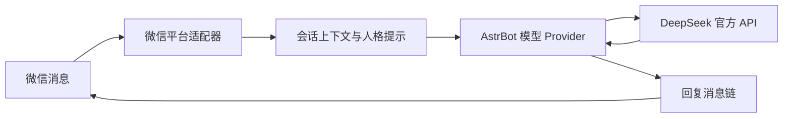

# AstrBot：微信 AI 聊天与人格配置

收录日期：2026-10-22

最近核实：2026-10-26（Asia/Shanghai）

研究状态：已读取本次图文帖全部四张图片；Docker、DeepSeek 接入和当前微信适配器已按文档与源码核实；作者运行配置未复现

## 一句话结论

AstrBot 可以在本机 Docker 中运行，把微信消息、会话上下文和人格提示交给 DeepSeek API，再将生成结果发回微信。这里的“本地接入”指机器人服务本地运行；接入 DeepSeek 官方 API 时，推理仍由远端服务完成。原帖展示了仓库、Docker 项目与聊天效果，但没有公开模型 ID、完整人格、Compose 配置或记忆设置。[S5][S6][S7][S8]

## 原始线索

### 本次抖音图文帖

- 用户短链：[https://v.douyin.com/nEw2vrdzTTk/](https://v.douyin.com/nEw2vrdzTTk/)。
- 已解析原文：[https://www.douyin.com/note/7700688501772469157](https://www.douyin.com/note/7700688501772469157)，作品 ID `7700688501772469157`。
- 标题：微信聊天ai机器人；作者：柚子；页面元数据发布时间：2026-10-26 03:24:26（Asia/Shanghai，`createTime=1792956266`）。分享口令里的“11/01 :6pm”不作为发布时间证据。
- 正文宣称：借助 GitHub 上的 AstrBot，使用 Docker 在本地接入 DeepSeek，实现微信聊天机器人。
- **实际读取范围：公开网页元数据及全部四张图片。该地址返回图文帖，页面 `awemeType=68`、图片数量为 4、视频时长为 0；本轮没有取得可供观看或转写的教程视频。** 已有下载器的详情接口返回 HTTP 403，随后从正常可访问的公开网页读取图文数据与图片，没有绕过验证码。[S5]

| 图片 | 实际可见内容 | 可以支持的判断 | 不能据此确定的内容 |
| --- | --- | --- | --- |
| 第 1 张 | `AstrBotDevs/AstrBot` 仓库、AGPL-3.0、`v4.29.3` 和 Python 3.12+ 徽章 | 作者展示的项目确为 AstrBot | 徽章不是作者容器实际运行版本的证明 |
| 第 2 张 | Docker Desktop 中 `wechatbot`、`wechat-friend` 两个运行中的项目 | 作者展示了两个 Docker 项目运行状态 | 列表未展开，镜像、端口、配置和两个项目分别使用什么软件均无法确认 |
| 第 3 张 | “双开测试”、问候和机器人索取称呼的微信对话 | 展示了文本回复及人格语气 | 不能验证真正双实例隔离、称呼持久化、底层模型或真实响应延迟 |
| 第 4 张 | 关于 token、上下文长度的聊天；回复称无法看到具体模型配置 | 展示了聊天文本 | “十万 token 量级”是生成的回复，不是模型元数据或实测上限 |

只归档两张技术裁剪图：[仓库及版本徽章](evidence/2026-10-26-repository.jpg)、[Docker 项目列表](evidence/2026-10-26-docker-projects.jpg)。完整聊天图片不进入仓库。[S5]

### 2026-10-22 的既有截图

之前收录的评论裁剪图显示作者“溺水”回复“电脑下 astrbot，填api然后扫码设置微信bot就行了”。旧报告另记录了“大肥鱼 AI”“v4pro”和人格设置线索。这些记录继续保留，不能由聊天显示名推定具体模型、API 余额读取或付款能力。[S0]

**本次“柚子”的图文帖与之前“溺水”的截图是同技术的两个来源；没有证据证明它们属于同一作品。** 本次短链补入原技术条目，旧截图对应的原视频链接仍待补。

## 技术实现

### 消息如何流转



平台适配器将消息转为框架事件；会话历史与 persona 的 `system_prompt` 组成模型输入；OpenAI 兼容 Provider 使用 `AsyncOpenAI` 的 `base_url`、`api_key` 和模型 ID 调用 `chat.completions`；输出转换为消息链返回平台。人格配置影响语气与行为，但不能保证复现某一段对白。[S1][S3][S4][S7][S9]

### Docker 与“本地”范围

官方 `compose.yml` 使用 `soulter/astrbot:latest`，将 `./data` 挂载到 `/AstrBot/data`；`6185` 是 WebUI 端口，`6199` 用于可选的 OneBot/NapCat 对接。Dockerfile 使用 Python 3.12 基础镜像并以 `python main.py` 启动。配置、会话及登录态需要持久化到挂载目录。[S6]

这个 Compose 文件没有部署 DeepSeek 权重或模型推理服务器，因此不能把“Docker + DeepSeek API”写成“离线本地运行完整 DeepSeek”。若要本地模型，需另行运行 Ollama/LM Studio 等推理服务；AstrBot 的 Ollama 文档使用 `deepseek-r1:8b` 作为模型名示例，模型能力与硬件要求要按实际权重确认，不能等同于官方在线模型。[S6][S10]

### DeepSeek 配置

AstrBot 官方教程明确给出了 DeepSeek 接入：新增 `DeepSeek` 提供商，填写 API Key 和 Base URL，保存并获取模型，再在配置文件的 AI 设置中选定对话模型。其他兼容服务可选择 `OpenAI Compatible`。Base URL 的 AstrBot 示例为 `https://api.deepseek.com/v1`；DeepSeek 官方文档给出的根地址是 `https://api.deepseek.com`。[S7][S8]

截至本次查阅，DeepSeek 官方首页示例使用 `deepseek-flash`，另列出 `deepseek-v4-pro`，并说明 Flash 当前由 DeepSeek-V4.1-Flash-1017 提供服务。复现时应以账号实际可用模型与当时官方文档为准，不机械照抄旧教程的模型别名。AstrBot 当前 Provider 还包含推理模型历史 `reasoning_content` 的兼容处理；本轮只核实代码存在，没有调用 API 验证兼容性。[S8][S9]

### 当前个人微信路径

项目文档说明 `weixin_oc` 自 v4.22.0 引入，使用扫码登录和长轮询。文档要求 iOS 微信 >= 8.0.70 或 Android >= 8.0.69，并具有 ClawBot 插件。二维码登录成功后还需保存机器人配置，token 与 account_id 由框架记录。[S2]

文档称这一适配器基于腾讯微信官方 `openclaw-weixin` 接口；源码默认访问 `https://ilinkai.weixin.qq.com` 并维护消息轮询、登录态与回复上下文 token。本轮依据 AstrBot 项目文档和代码核实这条实现路径，未独立核实腾讯对每个账号的开放范围，也没有实际扫码。[S2][S3]

个人微信、微信公众号、企业微信是不同配置入口。旧 Gewechat 教程的桥接配置不能直接当作当前 `weixin_oc` 设置。该图文帖未展示其适配器选择页面，因此作者实际使用哪一条路径仍未确定。[S1][S2][S5]

| 关键判断 | 证据状态 | 来源 |
| --- | --- | --- |
| AstrBot 支持 Docker 部署和 DeepSeek 接入 | 官方文档及代码静态核实 | S6、S7、S9 |
| Docker 本地机器人可以调用云端 DeepSeek | Compose 与官方 API 契约核实 | S6、S8 |
| 当前个人微信支持扫码、长轮询并有客户端前提 | 项目文档与源码核实；未实测账号可用性 | S2、S3 |
| 原作者使用 DeepSeek | 帖子正文宣称，未展示 Provider 配置 | S5 |
| 原作者双开、记住称呼且支持十万 token | 图片对白与列表线索，未做隔离或上限测试 | S5 |
| “大肥鱼”自己充值、赚钱或执行付款 | 旧聊天线索不足以证明工具行为 | S0 |

## 相关项目与选型

主项目为 [AstrBotDevs/AstrBot](https://github.com/AstrBotDevs/AstrBot)，AGPL-3.0。最新 release 为 [v4.29.3](https://github.com/AstrBotDevs/AstrBot/releases/tag/v4.29.3)，发布于 2026-10-24；本轮源码固定到 `832fc6d98ac25facd54b07424c16067435c118e6`（2026-10-25），它是查阅时 master 的提交，不与 release tag 混作同一版本。[S1][S6]

以下项目只作为同类选择，**没有证据表明原作者使用它们**。Star 是 2026-10-26 的查询快照，不代表接入稳定性或实际质量。[S11][S12]

| 项目 | Star 快照 | 许可证 | 文档明确的相关能力 | 选型含义 |
| --- | --- | --- | --- | --- |
| AstrBotDevs/AstrBot | 43,467 | AGPL-3.0 | 多平台、persona、DeepSeek、Docker、微信适配器 | 与原帖指向一致，适合复现同一框架 |
| zhayujie/CowAgent（原 chatgpt-on-wechat 地址会跳转到此仓库） | 47,586 | MIT | README 列出微信、DeepSeek、Docker 和工具能力 | Star 更高的相关候选；迁移需重新核对其具体微信通道 |
| langbot-app/LangBot | 18,484 | Apache-2.0 | 多平台、DeepSeek、Docker、RAG 与多 Pipeline | 适合关注多机器人管理或知识库的场景 |

本次对两个替代项目只读取仓库元信息和固定提交 README，没有运行、做性能测试或逐项审计适配器。依据现有材料，本条仍以 AstrBot 为主，不因 Star 大小替换原作者项目。

## 复现路径

**以下基于已读取的项目文档与代码整理，未实际启动容器、扫码微信或调用模型。**

1. 准备 Docker/Docker Desktop，选择要复现的 AstrBot 版本，检查其 Compose 文件、镜像版本和持久化目录。需保持在线时，本机 Docker 服务和网络也要持续运行。
2. 使用官方 Compose 启动机器人。以下是命令示意，需先完成前述配置核对；官方默认镜像为 `latest`，若需要重复得到同一环境，应记录或固定实际镜像 digest。[S6]

   ```bash
   git clone https://github.com/AstrBotDevs/AstrBot
   cd AstrBot
   docker compose up -d
   docker logs astrbot
   ```

3. 查看启动日志中的 WebUI 地址和随机初始密码。官方 Compose 映射了 6185；本机使用宿主机映射端口访问面板。登录后修改初始密码。官方文档的 `localhost` 提示要区分宿主机与容器内部网络，不能把容器内的 `localhost` 当成宿主机服务。[S6]
4. 创建 DeepSeek 官方 API Key，填写 `DeepSeek` Provider、Base URL 和当前可用模型；先“测试模型”，再选为实际配置文件的对话模型。可按官方教程用 `$DEEPSEEK_API_KEY` 引用容器环境变量；容器必须实际得到该环境变量。[S7][S8]
5. 配置简单 persona，例如名字、语气、称呼和回复长度，先在 WebUI 测试几轮。示例只用于验收，不能冒充原作者的人格全文。[S4]
6. 核对手机微信版本与 ClawBot 入口；在“机器人 → 创建机器人 → 个人微信”生成二维码，由账号本人扫码确认，登录后点击保存。[S2]
7. 从微信发送唯一测试文本，逐项检查接收日志、Provider 返回、微信回复；重启后检查登录态与历史保留。若要验证“双开”，使用不同的配置/数据目录、管理端口和相应平台会话，检查两边消息不会串到同一会话。这个隔离方案是验收建议，尚未在本轮执行。

| 验收项 | 成功标准 |
| --- | --- |
| 机器人部署 | 容器运行，WebUI 可访问，数据目录实际挂载 |
| 模型接入 | Provider 测试成功且真实对话使用已选择的模型 |
| 微信消息 | 唯一测试文本完整收发，日志可关联同一轮请求 |
| 人格及记忆 | 多轮称呼按预期；重启或新会话后按配置检验，不能用“我记住了”作唯一证据 |
| 双实例 | 可从实例配置、端口、数据目录和消息路由验证隔离 |
| 上下文与用量 | 以 Provider 元数据、请求 usage 和框架配置检验，不能采信聊天中的自报上限 |

## 适用场景与限制

适合个人问答、人格聊天和消息平台助手。云 API 模式无需在机器人主机加载完整模型权重，但仍依赖 API 额度、网络和平台登录态。图片里的 Docker 全局 CPU/内存数值不能推导 AstrBot 的最低硬件需求或单实例资源消耗。[S5][S6][S8]

persona、短期会话历史、跨会话持久记忆和主动发送是不同能力；本文核实人格配置与会话输入，未证明原帖实现了后两者。AstrBot 当前配置还提供模型上下文窗口设置及压缩策略，未知模型的 128000 兜底值只是配置默认值，不能作为原作者模型支持“十万 token”的证明。[S4][S9]

当前个人微信文档的消息表注明语音可接收并由微信云端转录为文本，但不支持发送语音；文本、图片、视频、文件支持情况需按该表和实际模型能力分别验收，不能从文本聊天效果推断全部多模态能力。[S2]

## 待核实事项

- 原帖两个 Docker 项目的具体镜像、端口、适配器、账号与配置，及 AstrBot 容器实际运行版本。
- 原作者实际 DeepSeek 模型 ID、API 服务商、完整 persona、记忆与主动消息设置。
- 用户账号是否实际具备当前微信 ClawBot 入口；扫码、重启和长时间运行稳定性。
- 旧“溺水”截图的原视频链接；本次“柚子”帖不能替代该缺链。
- 图中上下文上限、实际 token 用量、双开隔离和称呼持久化，均需配置读取与实验验证。

## 来源与证据

| 编号 | 来源与链接 | 发布日期 | 查阅日期 | 支持的结论 |
| --- | --- | --- | --- | --- |
| S0 | [既有作者评论裁剪图](evidence/08-source.jpg)及 2026-10-22 收录记录 | 原作品日期未知 | 2026-10-22；2026-10-26 复查裁剪图 | 旧作者推荐 AstrBot；保留之前的聊天线索 |
| S1 | [固定提交 README](https://github.com/AstrBotDevs/AstrBot/blob/832fc6d98ac25facd54b07424c16067435c118e6/README_zh.md)、[LICENSE](https://github.com/AstrBotDevs/AstrBot/blob/832fc6d98ac25facd54b07424c16067435c118e6/LICENSE)、[release](https://github.com/AstrBotDevs/AstrBot/releases/tag/v4.29.3)、[仓库元信息](https://api.github.com/repos/AstrBotDevs/AstrBot) | master 提交 2026-10-25；release 2026-10-24 | 2026-10-26 | 项目、平台、模型、依赖、许可证、版本与 Star 快照 |
| S2 | [个人微信接入文档](https://github.com/AstrBotDevs/AstrBot/blob/832fc6d98ac25facd54b07424c16067435c118e6/docs/zh/platform/weixin_oc.md) | 标注 v4.22.0 引入 | 2026-10-26 | 手机版本、ClawBot、扫码、长轮询和消息类型 |
| S3 | [微信客户端](https://github.com/AstrBotDevs/AstrBot/blob/832fc6d98ac25facd54b07424c16067435c118e6/astrbot/core/platform/sources/weixin_oc/weixin_oc_client.py)、[适配器](https://github.com/AstrBotDevs/AstrBot/blob/832fc6d98ac25facd54b07424c16067435c118e6/astrbot/core/platform/sources/weixin_oc/weixin_oc_adapter.py) | 同 S1 提交 | 2026-10-26 | API 路径、消息轮询、登录态与上下文 token |
| S4 | [人格管理源码](https://github.com/AstrBotDevs/AstrBot/blob/832fc6d98ac25facd54b07424c16067435c118e6/astrbot/core/persona_mgr.py) | 同 S1 提交 | 2026-10-26 | persona 的 system_prompt 配置 |
| S5 | [柚子：微信聊天ai机器人](https://www.douyin.com/note/7700688501772469157)、[读取摘要](evidence/2026-10-26-source-extract.md) | 2026-10-26 03:24:26 +08:00（页面元数据） | 2026-10-26 | 标题、作者、正文、全部四张图片与展示范围 |
| S6 | [Docker 文档](https://github.com/AstrBotDevs/AstrBot/blob/832fc6d98ac25facd54b07424c16067435c118e6/docs/zh/deploy/astrbot/docker.md)、[Compose](https://github.com/AstrBotDevs/AstrBot/blob/832fc6d98ac25facd54b07424c16067435c118e6/compose.yml)、[Dockerfile](https://github.com/AstrBotDevs/AstrBot/blob/832fc6d98ac25facd54b07424c16067435c118e6/Dockerfile) | 同 S1 提交 | 2026-10-26 | 镜像、挂载、端口、启动方式和部署范围 |
| S7 | [AstrBot 接入模型服务](https://github.com/AstrBotDevs/AstrBot/blob/832fc6d98ac25facd54b07424c16067435c118e6/docs/zh/providers/start.md) | 同 S1 提交 | 2026-10-26 | DeepSeek Provider、Base URL、模型选择、环境变量 Key |
| S8 | [DeepSeek 官方首次 API 调用](https://api-docs.deepseek.com/) | 页面未标注发布日期；以查阅时页面为准 | 2026-10-26 | OpenAI 兼容接口、官方 Base URL 与当前模型示例 |
| S9 | [OpenAI 兼容 Provider](https://github.com/AstrBotDevs/AstrBot/blob/832fc6d98ac25facd54b07424c16067435c118e6/astrbot/core/provider/sources/openai_source.py)、[配置元数据](https://github.com/AstrBotDevs/AstrBot/blob/832fc6d98ac25facd54b07424c16067435c118e6/astrbot/core/config/default.py) | 同 S1 提交 | 2026-10-26 | API 调用、system 消息、推理兼容、上下文与压缩配置 |
| S10 | [Ollama 接入文档](https://github.com/AstrBotDevs/AstrBot/blob/832fc6d98ac25facd54b07424c16067435c118e6/docs/zh/providers/provider-ollama.md) | 同 S1 提交 | 2026-10-26 | 本地推理需额外服务；deepseek-r1:8b 示例 |
| S11 | [CowAgent 固定 README](https://github.com/zhayujie/CowAgent/blob/d2a72a3cbff8dcb3b80897e8899108273e4bab29/README.md)、[仓库元信息](https://api.github.com/repos/zhayujie/CowAgent) | README 固定到查阅时 master；逐段发布日期未核实 | 2026-10-26 | 旧地址跳转、同类能力、MIT 和 Star 快照 |
| S12 | [LangBot 固定 README](https://github.com/langbot-app/LangBot/blob/33653244fc27b9e302fb3e02723021d3f77b9c84/README.md)、[仓库元信息](https://api.github.com/repos/langbot-app/LangBot) | README 固定到查阅时 master；逐段发布日期未核实 | 2026-10-26 | 多平台、DeepSeek、Docker、RAG、许可证和 Star 快照 |

## 更新记录

- 2026-10-22：确认框架名，并补充当时扫码路径的前提与旧教程差异；源码快照 `0cd42bd4dd216d8810da4e3f5fb2e381d3c6817e`。
- 2026-10-26：读取柚子的抖音图文帖全部四张图片，按同技术合并两条原文 URL；保留旧截图来源，补充 Docker/DeepSeek 配置、当前微信接入、同类项目、事实边界和验收步骤。

## 输入溯源

- 既有首批图片顺序：8；原消息：`om_x100b62aa714048a4c0f82a50d0fe709`。
- 既有原附件：`img_v3_0216n_87571ce5-ff59-404d-8c5f-6a7894b9a90g.jpg`；原图 SHA-256：`7839f4c88060d17b08cb819e64a51db16cd5a793fb059115eead8d5cd74a9c91`。原有技术裁剪继续保留。
- 本次原消息：`om_x100b62dfcb0a34bcce9941762fb3685`；原始短链及规范地址见 S5，图文读取与图片 hash 见读取摘要。两个作品未确认为同一来源。
