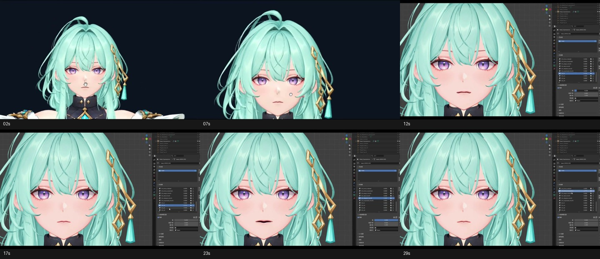
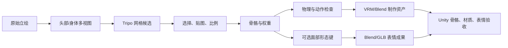

# 3D美术资产

收录日期：2026-10-24

最近核实：2026-10-25（Asia/Shanghai）

研究状态：**部分核实**。原「依亦」参考作品仍只读到封面、简介与元信息；2026-10-25 补充的「朝忆」作品已读取完整简介、作者公开补充并抽查六个视频关键帧，确认使用 Tripo + Codex + Charakuru 的线索。建模、绑定、形态键与引擎接入有官方资料及静态源码支持，尚未制作或验证对应游戏资产。

## 一句话结论

日系美型人物配半写实材质、柔和光影的视觉目标，可以通过 **Blender 主力建模 + 贴图制作 + Unity 实时渲染**实现；人物底稿可借助 VRoid Studio，精细雕刻和贴图可分别使用 ZBrush、Substance 3D Painter。最终交付应包括可编辑模型、骨骼、贴图和动作，以及引擎中的交互与性能验证。[S1][S2][S3][S4][S5][S6][S7]

新增的 AI 辅助路径是 **立绘 → Tripo 生成候选网格与绑定 → Charakuru / Codex 协助整理权重、物理和表情 → Blender 精修 → VRM 或 FBX 接入 Unity**。这条路线能降低部分重复操作，仍需要人选择候选、检查变形和验收实际游戏效果。[S10][S11][S12][S13][S14][S16]

## 原始线索

- 用户需求：喜欢参考作品的视觉风格，希望了解可以制作这种风格的 3D 建模软件，并将模型嵌入游戏。本条整理本次讨论的软件选型与制作路线。
- 原分享链接：[https://v.douyin.com/6CompqDLYcM/](https://v.douyin.com/6CompqDLYcM/)。
- 解析后链接：[https://www.douyin.com/video/7699805973577239851](https://www.douyin.com/video/7699805973577239851)。
- 作者与标题：抖音「依亦」，「又是温馨治愈爱意满满的一天 现在是（最终）幻想时间。」[S0]
- 发布日期：页面简介显示 **2026-10-23**；网页元信息标注时长 **43 秒**，未用实际视频文件核验时长。[S0]
- 实际读取范围：**封面图片、简介和网页结构化元信息**。没有完整观看视频，没有获取作者制作过程、工程文件或工具清单。
- 封面视觉观察：深色长发、美型动漫比例的脸部、针织服装、窗边柔光与浅景深。将它归纳为「日系半写实 / 风格化 3D 的参考视觉目标」属于本次画风分析；不能据此认定原作品本身由 3D 软件渲染。
- 原页面带有「日系」「二次元」「治愈」「恋爱」「AI创作浪潮计划」标签；标签不足以确认作者实际使用的模型或制作工具。[S0]

### 2026-10-25 新增线索：朝忆的 AI 建模、绑定与形态键

- 用户原短链：[https://v.douyin.com/12PJ2ng1WWU/](https://v.douyin.com/12PJ2ng1WWU/)。
- 解析后的规范链接：[视频 7700304126933058938](https://www.douyin.com/video/7700304126933058938)。
- 作者：**朝忆**；完整简介：**“AI已经进化到这种程度了？ AI建模+AI绑定+AI形态键”**，并明确写 **“使用Tripo+codex+Charakuru制作”**。[S10]
- 页面显示发布时间：**2026-10-25 02:32**，页面未单独标时区，按显示值记录；分享文本中的 `09/16` 不作为发布日期。
- 作者公开补充：“是tripo的模型”“用识图标点给模型面部框位置，让codex捏形态键这种”。这是作者对自己操作的说明，尚未取得其工程或完整操作录屏。[S10]
- 实际获取完整视频文件，`ffprobe` 核实 **31.63 秒、960×576、含音频和视频流、1,407,337 字节**。视觉抽查 **2、7、12、17、23、29 秒**；未做完整语音转写，也不宣称逐帧观看。
- 样本前段为角色面部预览，后段能看到 Blender 界面、角色口型/表情变化及形态键面板。它支持“作者在编辑可变形角色面部”的观察；这段视频没有完整展示从立绘生成网格、身体绑骨、权重转移或 Unity 导入过程，不能把标题中的整条链路写成本次已观看的操作。[S10]

## 技术实现

### 软件选型与分工

| 软件 | 负责环节 | 本次推荐用途 | 能力与费用边界 |
| --- | --- | --- | --- |
| **Blender** | 网格建模、UV、贴图绘制，以及雕刻、绑定和动画制作 | 主力工具；制作人物、头发轮廓、衣服、房间、家具，保存可编辑 `.blend` | 官方免费软件，GPL；官方明确使用 Blender 制作的作品可由创作者使用，包括商业使用。外部导入素材仍有各自许可。[S1][S2] |
| **VRoid Studio** | 日系人物的参数化制作、发型与服装调整，导出 VRM | 快速制作人物底稿，之后精修轮廓、脸部、头发与材质 | pixiv 官方以免费软件发布，官方声明支持 VRM 导出；现版本界面及其在本项目中的表现未实测。精致半写实效果仍需后续制作。[S5] |
| **ZBrush** | 精细有机雕刻、人物与高细节资产 | 辅助精修脸部、身体与服装褶皱；高模细节需整理或烘焙到游戏资产 | 商业软件；本次读取官方雕刻与角色制作介绍，没有核定具体套餐价格。Blender 自带雕刻可作为起步工具。[S6] |
| **Substance 3D Painter** | 在已有 3D 网格上绘制与输出表面纹理 | 制作皮肤、布料、针织纹理、粗糙度等；可研究其风格化滤镜 | 商业软件；官方手册确认贴图与渲染能力。具体价格未核定，风格化滤镜的视觉效果未实测。[S7][S8] |

推荐先建立 Blender 到 Unity 的基本链路，再按资产质量需要增加辅助工具。选择软件的依据是它在制作流程中承担的环节；这四款工具均未被证实是参考作品作者实际使用的软件。

### 画风由形体、材质、光照共同建立

以下是**本次制作建议，尚未实测**：

1. **形体与比例**：设计脸型、五官、身体比例、发型轮廓和衣服版型。保留动漫美型比例，同时控制游戏镜头下可读的轮廓。
2. **材质与表面**：使用贴图表达肤色、布料织纹和粗糙度；细节可以烘焙到法线等贴图，减少逐个建出纤维的需要。Substance Painter 官方支持对网格进行纹理绘制，其 Stylization 滤镜还提供笔触、颜色重映射和烘焙光照等参数。[S7][S8]
3. **光照与镜头**：在游戏引擎中配置窗边柔光、逆光、阴影、色调和适量景深。模型文件导入后仍要在实际游戏镜头下调整材质与灯光，并验收人物和环境的一致性。

### 两条导入路径

**路径 A：Blender → FBX 与贴图 → Unity**

- 在 Blender 完成网格、UV、骨骼与需要的动作，保留 `.blend` 制作源文件。
- 输出 FBX 与独立贴图。Blender 官方 FBX 导出文档说明其支持网格、骨骼及动画相关导出，但动画关联等设置仍需要核对。[S3]
- Unity 6.3 官方手册明确以 FBX 为内部模型导入链路，并建议生产环境优先使用 FBX 等交换格式。[S4]
- 在 Unity 配置模型比例、骨骼与动作、材质、碰撞和交互，再保存为游戏可复用的资源。换衣服还需要相容的骨骼、服装网格和蒙皮；导入一个模型并不会自动建立换装系统。
- Blender 的复杂材质节点、程序纹理与灯光不能期待完全自动迁移。需要输出适合引擎的纹理，并在 Unity 中配置相应材质与照明。[S3]

**路径 B：VRoid Studio → VRM → Unity / UniVRM**

- VRoid Studio 官方声明支持导出 VRM。[S5]
- UniVRM 是 VRM Consortium 面向 Unity 的 VRM 实现，README 列出 VRM、glTF、运行时及编辑器导入支持。[S9]
- 这条路线适合保留角色资产与头像相关数据的起步验证；选择 VRM 版本、材质和表情导入方式后，仍需在当前 Unity 工程中检查。
- VRM 与 FBX 是不同的接入路径；若中途转入 Blender 精修，需另行核对所选导入、导出插件对骨骼、材质和表情的保留情况。本次未验证该转换。

| 关键判断 | 证据状态 | 来源 |
| --- | --- | --- |
| Blender 能制作可编辑网格、展开 UV 并直接绘制纹理 | 官方资料已核实 | S1 |
| Blender 可用于商业作品制作，软件许可与作品权属有明确说明 | 官方许可页已核实 | S2 |
| Blender 与 Unity 都有 FBX 相关导出 / 导入能力 | 官方文档已核实；未运行本项目链路 | S3、S4 |
| VRoid 支持 VRM 导出，UniVRM 提供 Unity 接入 | 官方发布声明与仓库静态核实；未测试本项目 | S5、S9 |
| ZBrush 适合高细节角色雕刻，Painter 适合网格贴图 | 官方产品页与手册已核实 | S6、S7 |
| 封面效果由这些工具就能自动、一键达到 | 未得到证据；本页给出的是需制作与验收的方案 | S0、制作建议 |
| 原视频作者使用了 Blender、VRoid、ZBrush 或 Painter | 未知 | S0 未提供制作过程 |

### 新增制作路径：Tripo + Codex + Charakuru

#### 各工具负责什么

| 环节 | 工具与本次核实内容 | 交付与边界 |
| --- | --- | --- |
| 立绘到三维候选 | Tripo；Charakuru 以头部/身体多视图分别生成候选 | 得到候选网格，不意味着拓扑、面部和衣服已达到游戏要求。[S11][S12][S13] |
| 流程和文件整理 | Charakuru 的本地确认界面、项目文件和 Agent Skills；Codex 执行图像、浏览器和 Blender 工作 | 用户确认参考图、候选、比例和动作；本次没有安装或调用这套工作流。[S12][S13] |
| 骨骼与蒙皮 | Tripo 提供自动绑骨；Charakuru 流程取骨骼位置，并通过基体转移权重 | 骨骼名称、关节位置与权重都要检查；自动绑骨不等于已有自然的面部表情。[S11][S13][S14] |
| 面部表情 | Blender Shape Keys；Charakuru 可选表情模块 + Codex 辅助 | 通过顶点偏移表现眼、口、眉；不能用“有骨骼”代替这一步。[S14][S15] |
| 摆动与导出 | Blender / VRM Add-on；Charakuru 的 springs 与 motion review | 核对头发、裙摆等物理与最终文件；接入游戏仍需运行时验收。[S13][S14] |

#### Charakuru 的实际生产流程

[nanocle/Charakuru](https://github.com/nanocle/Charakuru) 是 Nano 制作、由 Tripo 赞助的角色建模辅助套件。官方教程给出的过程是：[S12][S13]

1. 输入有权使用的全身立绘。Agent 生成头部（含头发）和身体各前/左/右/背四视图，共八张参考图；身体准备为 T-pose。
2. 在 Tripo 为头部和身体分别生成四个候选，由用户旋转查看、比较并选择。
3. 对选定部件分类、展开 UV、重绘纹理、调整头身比例。教程中的 4K 纹理是制作步骤，面向手机还需另定纹理预算。
4. 把摆放好的中性头部和身体送到 Tripo 绑骨，导入骨骼位置；可见网格和贴图按教程保留，另用套件基体转移权重。
5. 整理头发、裙摆和飘带等摆动部件，设置弹簧物理，在 motion review 查看默认 walk 或导入 VRMA 动作。
6. 核对 VRM、MToon、贴图和物理。确认模型信息后导出 `exports/avatar.vrm`，同时保留可编辑 `exports/avatar.blend` 和整个制作目录。

发布包中的 `scripts/export-rig.py`、`scripts/transfer-weights.py` 和 `scripts/spring-setup.py` 与上述分工相符。权重脚本的结果明确保留 `visualCheckRequired`；“脚本成功”不是外观验收通过。[S14]

#### 形态键如何产生，以及为什么要单独验收

Blender Shape Keys 也称 morph targets / blend shapes：在相同拓扑的网格上保存相对 Basis 的顶点偏移，再用权重混合。常用于眨眼、口型、表情与纠正关节形变。[S15][S16]

作者的“标面部位置，让 Codex 捏形态键”与 Charakuru 的可选表情流程相符：在眼、唇和眉部确定对应关系，再转移形变并做视觉精修。发布包的 `expression-transfer.py` 会沿上下唇曲线插值姿态位移，把位移平滑分配给周边皮肤，并写入 `shape_keys.key_blocks`。这是一条具体几何编辑路径；Codex 的角色是辅助判断、调用工具与调整，不应把它表述成独立的“凭文字直接生成最终角色表情模型”。[S10][S14]

官方表情指南列有 **8 种眼、10 种口、5 种眉姿态**；需要查看正面、左右斜视、侧面和中间强度，避免闭眼穿插、唇边错位及眉眼一起变形。它明确保持原本 Basis、已有键、UV、面与材质，**不自动新造口腔内部或贴图**；没有保证任意角色都无需修正。[S13][S14]

**当前 v1.1.0 的表情成果有一个重要边界**：指南与 `update-expression-authoring.mjs` 都说明返回的是可选 Blend、GLB 与比较记录；脚本结果含 `vrmUpdated: false`，已经导出的 VRM 不自动改变。因此应检查最终导出的模型是否实际包含新表情，并另行完成相应格式的导出与映射，不能因界面里能预览表情就认定旧 VRM 已具备它。[S13][S14]

#### Unity 接入时分开检查身体动作、表情和物理

这条路线可以延续本页原有 FBX / VRM 两种路径：

- **身体动作**：核对骨骼、Humanoid 映射、蒙皮与实际 idle/walk，特别是肩、肘、膝、脚底接地和服装穿插。
- **面部表情**：FBX 导出需实际携带 blend shapes，Unity 导入后检查 `SkinnedMeshRenderer` 下的 BlendShapes；Unity 官方支持动画轨和 `SetBlendShapeWeight` 脚本控制。[S16]
- **格式尺度**：Blender 常用相对键 0–1；Unity 常见默认/完全影响为 0/100，但模型可定义其他范围；VRM expressions 的绑定与组合另有语义，不能无条件按同一数值互换。[S13][S15][S16]
- **VRM 与物理**：接 UniVRM 后仍需核对 MToon、expression mapping、spring bones 和当前 Unity 渲染管线。[S9][S13]
- **移动性能**：生成网格的拓扑和面数、4K 贴图、材质槽、透明头发、骨骼数与 blend shape 数量需按实际 Android 游戏预算调整；演示近景和套件检查不能替代手机帧时间验收。

以上为资料支持的接入建议，尚未在本项目制作模型、运行 Blender 或启动 Unity。

#### 下载、版本和使用条件

- 本次查询 Charakuru **903 Stars**，仓库创建于 **2026-10-06**；固定文档 commit `8eb22f6c6700dcc310896336596682594928024c`，日期 **2026-10-23**。Stars 是查阅时快照。[S12]
- 最新发布 **v1.1.0（2026-10-23）**。官方文档强调：需下载专用 **`charakuru-1.1.0-….zip`**，GitHub 自动的 Source code 压缩包只有文档，不能把克隆仓库等同于已拿到运行套件。[S12][S13]
- 本次实际下载该 11.68 MB 发布包，列出目录，并静态读取九个相关代码/配置文件；包内有十份 Skill 入口，包括可选表情制作。未执行套件、安装 Skills、启动本地服务或调用 Tripo。[S14]
- 依赖：**Node.js 22+、桌面 Chromium 浏览器、具备图像生成和浏览器控制的编码 Agent、已登录的 Tripo、Blender 5.2+、VRM Add-on 和 Blender MCP**。它的确认界面在本机运行，图像和 Tripo 操作仍会用外部服务和用户账号，费用分开计算；不是完整离线生成器。[S12][S13]
- Tripo 官方绑骨文档支持先做 rig check，再请求骨骼/权重，导出 rigged GLB 或 FBX；API 方式需鉴权。它和 Charakuru 的 Studio 浏览器路线不同，本次没有使用任一路线。不要把支持 VRM 的骨骼命名约定等同于 API 直接返回完成的 VRM 文件。[S11]
- Charakuru 为**自定义 source-available 许可，不是 MIT / OSI 开源许可**。标准许可允许符合条件的个人或业务使用；企业年营收与累计融资分别判断，任一达到 **1 亿日元**时，业务使用需另外书面授权；向客户再分发套件代码也有单独许可要求。[S12]
- 合法使用套件得到的自有模型、贴图、动画等成果，与套件代码的许可边界分开；许可不会仅因使用套件而要求成果付费或限制其发行。同捆基体、表情素材和示例角色不能作为独立素材包取出使用，原立绘与外部服务仍有自身权利条件。[S12]

视频里的示例角色不作为本游戏可直接复用的原创资产。

#### 与原有软件选型的关系

| 方案 | 优势 | 本页的建议用途 |
| --- | --- | --- |
| 直接使用 Tripo | 快速从图片生成模型并尝试自动绑骨 | 道具或角色候选的初稿；继续精修网格、贴图、绑定和表情。[S11] |
| Tripo + Charakuru + Codex | 把候选、部件整理、权重、物理和可选表情串成可检查流程 | 需要立绘到 VRM 角色时评估，接受阶段确认和外部服务依赖。[S12][S13][S14] |
| VRoid + Blender | 参数化日系人物底稿，能按原有 VRM 路线逐步精修 | 希望可控地起步并减少 AI 网格不确定性时继续保留。[S5][S9] |
| Blender 手工主力 + ZBrush/Painter 辅助 | 对形体、拓扑和材料有较细控制 | 对特定画风、游戏预算和动作质量要求高时作为最终制作基础。[S1][S6][S7] |

## 相关项目与资料

- [库内已有研究：AI 控制 Blender：Python 与 MCP 三维创作](../2026-10-22-ai-blender/README.md)：可继续参考其程序化场景、批量操作与视图反馈方案。该页自身记录的是当时的静态核查，本次没有运行其中的插件，也没有将它认定为原作品的制作工具。
- **[vrm-c/UniVRM](https://github.com/vrm-c/UniVRM)**：与路径 B 对应的实际开源接入项目，不负责生成漂亮角色。[S9]
  - 核实 commit：`efd20f62f1bf0ac3fcc34de1e497324c5197d146`，提交日期 2026-10-19。
  - 许可证：MIT；已读取 `LICENSE.txt`。
  - 关键入口（目录树核对）：`Packages/VRM10/Editor/ScriptedImporter/VrmScriptedImporter.cs`、`Packages/VRM10/Runtime/IO/Vrm10.cs`、`Packages/VRM10/Runtime/IO/Vrm10Importer.cs`。
  - README 声明新版支持 Unity 2022.3 LTS 及以后、.NET / IL2CPP、Android 等目标。属于项目维护者声明，尚未在本次目标 Unity 6.3 工程中验证。
  - 本次核查范围是 README、许可证和目录树，未做安装、源码执行或运行效果测试。

## 复现路径

**基于资料整理，未实际运行。** 本次交付是研究归档，尚未建模、绑定、制作贴图、运行 Unity 或测试手机性能。

最小验证对象建议为：**一个精修角色 + 一个带窗边阳光的小房间**。保持统一角色设计和真实游戏镜头，先验证质量，再扩展整组资产。

1. 确定原创角色设计：正面、侧面、背面，身体比例、发型、服装与色调；明确预计游戏视角和屏幕显示尺寸。
2. 在 Blender 制作角色与房间；可先以 VRoid 制作人物底稿。角色需要合适的拓扑、UV、骨骼和蒙皮。
3. 制作皮肤、头发、衣服和环境材质；按质量需要用 ZBrush 精修和烘焙高模细节，用 Painter 绘制纹理。
4. 制作 idle、walk 和一个交互动作用例；如要验证表情，增加一个可控面部表情用例。
5. 选定 FBX 或 VRM 路径导入 Unity，核对尺寸、轴向、动作、材质、贴图、碰撞和交互；使用匹配当前渲染管线的材质。
6. 在 Unity 中配置柔和窗光、阴影和色调，以运行时镜头录制角色走动、转视角与交互。
7. 在目标 Android 手机上量测帧时间、峰值内存及资源规模，记录测试设备、分辨率、画质和光照配置。

判断成功的标准：

- 制作源文件可以重新打开和编辑，角色、贴图、骨骼、动作及其关联关系明确。
- 动作中面部和服装身份稳定，关节无明显错误，脚部接地与服装穿插可接受。
- 实际游戏镜头下，人物、房屋与道具具有一致的形体、材质和光照风格。
- 游戏内可真实移动、转动视角和完成一个交互；外部渲染图不能替代这个验证。
- 目标手机上的性能达到事先约定的预算。本次没有设定或宣称达到具体帧率、面数或内存数值。

## 适用场景与限制

适合希望拥有可复用人物、连续动作、可变化视角、房间空间关系和交互物件的风格化 3D 游戏。对于当前讨论中的 Unity / C# 项目，该路线可作为三维资产接入候选，采用后仍需要具体工程验证。

面向 Android 的制作建议是：头发先研究发片，织物细节优先用纹理表达，静态室内柔光研究烘焙照明，并控制透明层、实时灯光和材质数量。这些是待验证的工程选择，不是已证明能复现封面效果的固定配方。

参考封面的精致面部和材质细节是否能在常用游戏镜头中清晰显示，取决于人物在屏幕中的大小。应在实际镜头下选定美术目标；近景展示不能替代日常游玩视角的验收。

工具许可与外部素材许可分开核对。Blender 官方允许商业制作并明确作品权属；VRoid 官方声明提醒使用 pixiv 或第三方数据时遵守其许可。若后续使用现成服装、贴图、发型或第三方角色，则随具体素材记录来源与条件。[S2][S5]

## 待核实事项

- 原作品完整视频与作者制作过程，实际生成模型、软件及是否存在可编辑 3D 资产。
- VRoid、Blender 精修、VRM / FBX 转换与当前 Unity 渲染管线的具体版本组合。
- 皮肤、头发、针织服装与窗光在实时画面中的实际质量，动作和表情的效果。
- 目标 Android 设备上的性能预算与量测结果。
- ZBrush、Painter 具体购买套餐和所选外部素材条件；本次不提供未核实的价格。
- 访问缺口：VRoid 当前产品页与 FAQ、Adobe 产品页及旧帮助入口返回 HTTP 403；改读 pixiv 官方发布声明和可访问的 Adobe Experience League 手册。Blender `latest` 的旧 FBX 文档路径返回 404，改读固定 4.5 版本文档。固定文档版本不代表本机已安装该版本。
- 新增作品的原始工程、完整建模/绑定过程，以及作者使用的 Tripo 模型版本、Charakuru 版本和具体形态键参数尚未取得。本文查阅的 v1.1.0 不等于已确认作者使用的版本。
- Charakuru 表情成果重新导出到最终 VRM/FBX、Unity 中的 blend shape 映射、骨骼动作和 spring bones 尚未实测；没有实际安装套件或调用模型服务。

## 来源与证据

| 编号 | 来源与链接 | 发布日期 | 查阅日期 | 支持的结论 |
| --- | --- | --- | --- | --- |
| S0 | [依亦原作品](https://www.douyin.com/video/7699805973577239851)；[原短链](https://v.douyin.com/6CompqDLYcM/) | 简介显示 2026-10-23 | 2026-10-24 | 标题、作者、发布日、页面时长与封面视觉；仅阅读封面、简介和元信息 |
| S1 | [Blender Modeling](https://www.blender.org/features/modeling/) | 官方现行页面，日期未标注 | 2026-10-24 | 网格、UV、纹理绘制等能力 |
| S2 | [Blender License](https://www.blender.org/about/license/) | 官方现行页面，日期未标注 | 2026-10-24 | GPL、免费使用、创作作品与商业使用说明 |
| S3 | [Blender 4.5 FBX 手册](https://docs.blender.org/manual/en/4.5/addons/import_export/scene_fbx.html) | 4.5 版本文档 | 2026-10-24 | FBX 导出、动画与材质转换边界 |
| S4 | [Unity 6.3：Model file formats reference](https://docs.unity3d.com/6000.3/Documentation/Manual/3D-formats.html) | Unity 6.3 文档；页面构建于 2026-10-24 | 2026-10-24 | FBX 导入链路与交换格式建议 |
| S5 | [pixiv：VRoid Studio 正式版免费发布](https://www.pixiv.co.jp/2021/11/01/110000) | 2021-11-01 | 2026-10-24 | 免费发布、日系人物定制、VRM 导出与第三方素材条件；不替代现版本实测 |
| S6 | [Maxon ZBrush](https://www.maxon.net/en/zbrush) | 官方现行页面，日期未标注 | 2026-10-24 | 人物、有机模型和高细节资产雕刻 |
| S7 | [Adobe Substance 3D Painter 官方手册](https://experienceleague.adobe.com/en/docs/substance-3d-painter/using/home) | 页面更新 2026-10-23 | 2026-10-24 | 在 3D 网格上绘制纹理与渲染 |
| S8 | [Adobe：Stylization](https://experienceleague.adobe.com/en/docs/substance-3d-painter/using/effects/filters/advanced-filters/stylization) | 页面更新 2026-09-30 | 2026-10-24 | 手绘风格滤镜、笔触与颜色等参数；未实际运行 |
| S9 | [UniVRM README（固定 commit）](https://github.com/vrm-c/UniVRM/blob/efd20f62f1bf0ac3fcc34de1e497324c5197d146/README.md)；[MIT 许可证](https://github.com/vrm-c/UniVRM/blob/efd20f62f1bf0ac3fcc34de1e497324c5197d146/LICENSE.txt)；[目录树](https://github.com/vrm-c/UniVRM/tree/efd20f62f1bf0ac3fcc34de1e497324c5197d146/Packages/VRM10) | commit 日期 2026-10-19 | 2026-10-24 | VRM / glTF 的 Unity 实现、项目声明的目标平台及关键入口 |
| S10 | [朝忆原作品](https://www.douyin.com/video/7700304126933058938)；[用户原短链](https://v.douyin.com/12PJ2ng1WWU/)；[六个关键帧](evidence/ai-workflow-video-keyframes.jpg) | 页面显示 2026-10-25 02:32 | 2026-10-25 | 简介声明 Tripo + Codex + Charakuru；作者公开说明面部标点与形态键；面部演示抽样 |
| S11 | [Tripo Rigging](https://developers.tripo3d.com/en/models/rig)；[Auto Rig API](https://developers.tripo3d.com/en/docs/animations-rig)；[官方绑骨功能](https://www.tripo3d.com/features/ai-auto-rigging) | 现行资料，含 v3.0-20260909 | 2026-10-25 | 自动骨骼/权重、rig check、骨骼命名与 GLB/FBX；网页与 API 路线区分 |
| S12 | [Charakuru README（固定 commit）](https://github.com/nanocle/Charakuru/blob/8eb22f6c6700dcc310896336596682594928024c/README.md)；[LICENSE](https://github.com/nanocle/Charakuru/blob/8eb22f6c6700dcc310896336596682594928024c/LICENSE)；[仓库 API](https://api.github.com/repos/nanocle/Charakuru) | commit 2026-10-23 | 2026-10-25 | 定位、依赖、版本、外部服务、自定义许可与成果边界 |
| S13 | [制作教程](https://github.com/nanocle/Charakuru/blob/8eb22f6c6700dcc310896336596682594928024c/docs/tutorial.md)；[表情制作](https://github.com/nanocle/Charakuru/blob/8eb22f6c6700dcc310896336596682594928024c/docs/expression-authoring.ja.md)；[开始使用](https://github.com/nanocle/Charakuru/blob/8eb22f6c6700dcc310896336596682594928024c/docs/getting-started.md) | 固定 commit | 2026-10-25 | 八视图、候选、UV、权重和物理、VRM 导出、可选表情与原 VRM 保留 |
| S14 | [Charakuru v1.1.0 发布页](https://github.com/nanocle/Charakuru/releases/tag/v1.1.0)；[精简研究快照](evidence/ai-workflow-research.json) | 2026-10-23 | 2026-10-25 | 实际读取 ZIP 中 `expression-transfer.py`、`transfer-weights.py`、`export-rig.py`、`spring-setup.py`、`update-expression-authoring.mjs` 等入口；仅静态检查，未执行 |
| S15 | [Blender 5.2 Shape Keys](https://docs.blender.org/manual/en/5.2/animation/shape_keys/introduction.html) | 5.2 文档 | 2026-10-25 | Basis、顶点偏移、相对键混合与面部用途 |
| S16 | [Unity 6.3 Blend Shapes](https://docs.unity3d.com/6000.3/Documentation/Manual/BlendShapes.html)；[SetBlendShapeWeight](https://docs.unity3d.com/6000.3/Documentation/ScriptReference/SkinnedMeshRenderer.SetBlendShapeWeight.html) | Unity 6.3 文档 | 2026-10-25 | FBX 形态键导入、动画和脚本控制、权重含义 |

## 更新记录

- 2026-10-24：按用户指定标题「3D美术资产」首次收录，整理本次画风分析、四款软件分工、两条引擎接入路径、最小验证方案与实际读取范围。
- 2026-10-25：按用户要求更新原条目并保留原来源，加入朝忆的 Tripo + Codex + Charakuru 视频、六个关键帧、AI 辅助建模/绑定/表情制作分工、VRM/Unity 接入和套件版本/许可条件；制作与引擎运行仍未实测。
