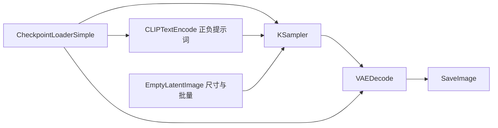

# ComfyUI：节点工作流与 API 批量图像生产

收录日期：2026-10-24

最近核实：2026-10-24，Asia/Shanghai

研究状态：部分核实。工作流、核心节点、API 和开源许可证已由官方代码与文档核实；原图文链接、作者实际生产案例及效果指标尚未核实。复现步骤未实际运行。

## 一句话结论

ComfyUI 能把模型加载、提示词编码、采样、图像编辑和保存组织成可复用的节点工作流，再通过本地 HTTP/WebSocket API 接入批处理脚本或 Agent；持续收图、自动质检和稳定保持风格仍需外围系统、模型及验收规则共同完成。[S1–S7]

## 原始线索

- 用户提供：图片 1，文件名 `img_v3_0216p_8190e440-5d7c-419b-91db-6f71243484ag.jpg`。截图提供，原链接待补。
- 平台与作者：外层为抖音图文界面，账号文字显示「西兰花花费算力（半晴PRO）」；图文内显示「半晴Pro」。两个名称与原帖的对应关系仅来自截图，未访问账号主页确认。
- 标题：截图可见「GitHub上有一个恐怖的开源项目，叫ComfyUI」。
- 日期：内嵌内容显示 `26-10-24 01:31`；这是截图显示的时间，尚未由原帖元数据核实，也不能作为 ComfyUI 项目首发日期。
- 实际读取范围：完整查看用户提供的单张截图；部分文字被右侧界面按钮遮挡。未取得原图文、视频、工作流文件或作者的运行演示。
- 主要宣称：节点可以串联文生图、图生图、ControlNet、放大及局部重绘；工作流可检查、保存和复现；接上 API 与 Agent 后可持续接收产品图、统一风格、生成变体、自动审查并导出成稿；普通电脑可本地运行。
- 隐私处理：完整截图留在本地，本条只发布技术摘录和来源标识。

## 技术实现

### 节点图如何执行

典型的文生图流程如下；这是根据官方 SD1.5 API 示例整理的基础结构，不是截图作者提供的实际工作流。[S2、S5、S10]



`CheckpointLoaderSimple` 提供模型、文本编码器与 VAE；`CLIPTextEncode` 将提示词转成条件；`KSampler` 接收模型、正负条件、潜空间图像，以及 seed、steps、cfg、采样器和 denoise 等参数；VAE 解码后由 `SaveImage` 写出图像。生成能力来自所加载的模型与算法，ComfyUI 负责组织和执行这些组件。[S2、S5]

图生图可把输入图片编码为潜空间图像，再调整 denoise；局部重绘需要图像、蒙版与对应编码/采样流程；ControlNet 通过控制模型和引导图向条件中加入约束。代码中的 `ControlNetApplyAdvanced` 接收正负条件、控制模型、引导图、强度及生效区间。模型放大与普通缩放也要区分：二者都能放大尺寸，但细节恢复效果不能等同。[S1、S2]

### 保存、复现与缓存

浏览器编辑用的保存格式与 API 提交格式不同。当前官方文档给出的 API 导出入口为 `File → Export Workflow (API)`；API 图以节点 ID 为键，节点包含 `class_type` 和 `inputs`，连线通常表示为 `[上游节点ID, 输出槽位]`。普通保存文件不能只因扩展名同为 `.json` 就直接用于提交。[S7]

`SaveImage` 可将 prompt 与额外信息写入 PNG 元数据，但代码明确受 `disable_metadata` 开关控制。要完整归档图形布局，仍应保存编辑用工作流；API 格式主要保存执行所需的数据。[S2、S7]

执行器维护缓存，检查变化并调度输出节点所依赖的计算；符合缓存条件的中间结果可以复用，并发出 `execution_cached` 事件。这减少了重复计算，但不代表所有节点都一定命中缓存。[S4]

工程判断：可靠复现还需固定模型文件及校验值、ComfyUI 与扩展节点版本、输入图片、提示词、种子、采样设置和运行环境。只保存一份工作流，不能据此承诺跨设备、跨依赖版本输出逐字节一致。

### API 与 Agent 如何衔接

本地服务已经提供核心接口，不需要为了提交工作流另行接入语言模型。Agent 可以作为上游控制者，根据业务数据选择模板、填写参数并跟踪结果。[S3、S5–S7]

| 环节 | 官方接口或代码 | 作用与边界 |
| --- | --- | --- |
| 上传素材 | `POST /upload/image`、`POST /upload/mask` | 把图片或蒙版放到服务端；仍需正确填写对应输入节点 |
| 检查节点 | `GET /object_info` | 查询安装环境里的节点类型与输入定义 |
| 提交 | `POST /prompt` | 接收 API 格式图，验证后加入执行队列，返回 `prompt_id`；验证失败返回错误信息 |
| 监听 | `/ws?clientId=...` | 接收进度、执行节点与相关事件，按 `prompt_id` 区分任务 |
| 查结果 | `GET /history/{prompt_id}` | 获取对应任务的历史与输出描述 |
| 下载 | `GET /view?filename=...&subfolder=...&type=...` | 按输出描述读取图片字节 |

官方示例采用先建立 WebSocket、提交工作流、监听同一 `prompt_id` 完成事件，再查询历史并下载图片的方式。`POST /prompt` 成功表示工作流通过提交阶段，不等于图片已生成成功。[S3、S5、S10]

可行的业务架构是「素材清单 → 参数填充 → ComfyUI 执行 → 结果取回 → 质量检查 → 成稿与记录」。这属于基于 API 的工程方案，不是已验证的原作者实现。生产使用需要补充失败处理、超时、结果核对和业务记录；自动质量检查需要额外的规则或视觉模型，并用人工标注样本验证准确率。

### 对截图宣称的核实

| 关键判断 | 证据状态 | 来源与解释 |
| --- | --- | --- |
| 文生图、图生图、ControlNet、放大、局部重绘可组织为工作流 | 已核实 | 官方功能说明、内置节点和 API 示例 [S1、S2、S5] |
| 工作流可以保存、再次执行、由程序修改参数 | 已核实 | API 格式与脚本示例 [S5、S7、S10] |
| 可连接批处理程序或 Agent | 已核实接口能力；业务方案待实现 | `/prompt`、WebSocket、历史与输出接口 [S3、S5、S6] |
| 自动保持整批图片风格一致 | 作者宣称；效果未核实 | 需要模型、参考条件、提示词及质量标准；截图没有可复查样例或指标 |
| 自动审查后直接导出合格成稿 | 作者宣称；效果未核实 | 核心示例实现生成与下载，没有证明具备业务质量判定闭环 |
| 普通电脑可以本地使用 | 已核实平台支持；性能有条件 | 官方提供 Windows、Linux、macOS 路径及多种硬件支持；具体速度与可运行模型依赖资源 [S1] |
| 免费开源意味着整条生产链无成本 | 不成立的泛化 | 核心代码为 GPL-3.0；云服务与部分 API 节点可收费，模型、扩展和算力另有条件 [S1、S8] |

## 相关项目与资料

| 项目或资料 | 与本条热点的关系 |
| --- | --- |
| [Comfy-Org/ComfyUI](https://github.com/Comfy-Org/ComfyUI) | 已核实的官方核心仓库，也是本条研究对象 |
| [ComfyUI_frontend](https://github.com/Comfy-Org/ComfyUI_frontend) | 核心 README 指向的官方前端项目；本轮未单独审查其源码 |
| [Comfy-Desktop](https://github.com/Comfy-Org/Comfy-Desktop) | 核心 README 指向的桌面封装；本轮未安装 |
| [官方 API 示例](https://docs.comfy.org/development/comfyui-server/api-examples) | 本地自动化接入的直接参考 |

官方核心仓库 owner/repo：`Comfy-Org/ComfyUI`。GitHub 元数据的创建时间为 `2023-01-17T03:15:56Z`；本次看到的是已有工具的技术介绍，截图时间不能用作新产品发布时间。

核实时 `master` 的代码快照为 `7cebca52227c63b4180ceed448cbd7ad22903b6d`，提交时间为 `2026-10-24T02:22:35Z`。本文源码链接固定到该提交。GitHub `releases/latest` 返回 `v0.42.1`，发布时间为 `2026-10-19T01:33:54Z`，发布说明为修复部分用户运行 MOSS image 模板时的崩溃。主分支快照与稳定发布不是同一版本，部署时应按所选版本复核依赖和接口。[S9]

许可证：核心仓库 `LICENSE` 为 GNU GPL version 3，GitHub SPDX 标识为 `GPL-3.0`。模型权重、第三方节点和云服务需按各自条款核对。[S8]

关键源码入口：`main.py` 为启动入口；`nodes.py` 包含内置节点；`server.py` 定义 HTTP/WebSocket 服务；`execution.py` 包含执行器、缓存与历史；`script_examples/websockets_api_example.py` 给出提交、监听和下载的完整示例。[S1–S5]

## 复现路径

**状态：基于官方代码与文档整理，未实际运行。** 本轮没有安装 ComfyUI、下载模型、启动服务或生成图片，只完成资料读取和静态核对。

1. 从官方安装入口准备独立环境，选择明确的 ComfyUI 版本，并按该版本说明配置 Python、PyTorch 与设备支持。手动安装入口为 `python main.py`；不要把本文核对的主分支快照直接视为经过生产测试的版本。[S1]
2. 准备有权使用且与工作流匹配的模型。最小示例使用 SD1.5 类基础工作流，模型文件名必须改成实际已安装名称；文本编码器、VAE 或拆分权重按该模型要求配置。[S1、S5]
3. 在界面确认基础链路可以生成一张图：模型加载 → 正负提示词 → 潜空间输入 → KSampler → VAE 解码 → SaveImage。先固定 512×512、batch size 1 与种子，记录设置。[S5]
4. 用 `File → Export Workflow (API)` 导出 `workflow_api.json`，另存编辑格式工作流用于之后修改。[S7]
5. 包装请求并提交到本地服务。下面仅是准备复现时使用的命令，**本轮未执行**：

```bash
python3 - <<'PY'
import json
from pathlib import Path

workflow = json.loads(Path('workflow_api.json').read_text(encoding='utf-8'))
payload = {'prompt': workflow}
Path('request.json').write_text(json.dumps(payload), encoding='utf-8')
PY

curl --fail-with-body \
  -H 'Content-Type: application/json' \
  --data-binary @request.json \
  http://127.0.0.1:8188/prompt
```

6. 记录返回的 `prompt_id`，参照官方示例用 WebSocket 监听并查询历史；也可由客户端按任务生命周期适度查询历史。处理报错和超时后，才按输出里的 filename、subfolder、type 调用 `/view` 下载。[S3、S5、S6]
7. 最小验收：任务有成功结果；目标输出节点包含图片；图片可以打开且尺寸匹配；保存工作流与配置后能再次提交执行。复现性实验另行比较图片与参数，不预设跨环境完全一致。
8. 扩为批量时，用清单逐项填充提示词、输入图路径、种子与输出前缀；实际节点 ID 从导出的工作流获取，不把示例里的数字固定套用。为每个业务输入保存 `prompt_id`、配置和输出路径，再增加质量检查与人工复核。

## 适用场景与限制

- 适合把已调通的生成/编辑步骤转为重复任务，例如素材变体、固定尺寸输出、带参考条件的图像加工，以及需要保留参数记录的生产实验。[S1、S3、S5]
- 对商品图的文字、Logo、比例或人物身份等严格约束，需要专项工作流和验收；节点图本身不会自动证明保真或风格一致。此项为工程判断，未验证任何商业案例。
- 本地运行仍消耗显存、内存、磁盘和时间。官方列出低显存与 CPU 等路径，并不意味着任意模型都能在任意普通电脑上高效运行。本轮无速度、显存或吞吐实测。[S1]
- 第三方节点会带来额外代码与依赖；本轮只读取官方源码，没有安装截图中未指明的扩展。[S1、S2]
- ComfyUI 的本地工作流 API、收费云服务与调用外部模型的 API/Partner Nodes 是不同使用路径，预算和接入条件应分别确认。[S1、S7]
- 主要证据均来自同一项目的官方代码与文档，尚无本轮独立运行数据或第三方性能验证。

## 待核实事项

1. 原抖音图文链接和作品 ID 缺失；无法检查完整说明、附件和评论中的补充信息。
2. 作者没有在可见截图中提供模型版本、节点清单、工作流 JSON、Agent 实现或质量标准。
3. “统一风格”“自动审查”“大规模”“更快”的具体效果、吞吐、成本与失败率未核实。
4. 本轮复现未运行；不存在可交付的生图样例或已验证的端到端生产流水线。

## 来源与证据

以下资料均于 2026-10-24 实际读取。原始截图是选题来源；表内官方材料用于核实，未混入首页的“原始链接”列。

| 编号 | 来源与链接 | 发布日期 | 查阅日期 | 支持的结论 |
| --- | --- | --- | --- | --- |
| S1 | [官方 README（固定提交）](https://github.com/Comfy-Org/ComfyUI/blob/7cebca52227c63b4180ceed448cbd7ad22903b6d/README.md) | 文档首次日期未单独确认；代码快照 2026-10-24 | 2026-10-24 | 功能、模型依赖、本地安装、前端/桌面关系、云服务与收费节点边界 |
| S2 | [nodes.py（固定提交）](https://github.com/Comfy-Org/ComfyUI/blob/7cebca52227c63b4180ceed448cbd7ad22903b6d/nodes.py) | 代码快照 2026-10-24 | 2026-10-24 | KSampler 1606 行起、ControlNetApplyAdvanced 941 行起、SaveImage 1669 行起及元数据保存逻辑 |
| S3 | [server.py（固定提交）](https://github.com/Comfy-Org/ComfyUI/blob/7cebca52227c63b4180ceed448cbd7ad22903b6d/server.py) | 代码快照 2026-10-24 | 2026-10-24 | 1162 行起的提交验证与入队、历史、上传、查看和 WebSocket 路由 |
| S4 | [execution.py（固定提交）](https://github.com/Comfy-Org/ComfyUI/blob/7cebca52227c63b4180ceed448cbd7ad22903b6d/execution.py) | 代码快照 2026-10-24 | 2026-10-24 | 730 行起的执行入口、缓存和节点执行调度 |
| S5 | [官方 WebSocket API 示例（固定提交）](https://github.com/Comfy-Org/ComfyUI/blob/7cebca52227c63b4180ceed448cbd7ad22903b6d/script_examples/websockets_api_example.py) | 代码快照 2026-10-24 | 2026-10-24 | 基础生图图结构、任务监听、历史和下载 |
| S6 | [ComfyUI Server Routes](https://docs.comfy.org/development/comfyui-server/comms_routes) | 页面未明确标注 | 2026-10-24 | 本地 HTTP/WebSocket API 契约 |
| S7 | [Workflow API Format](https://docs.comfy.org/development/api-development/workflow-api-format) | 页面未明确标注 | 2026-10-24 | 编辑格式/API 格式区别与导出入口 |
| S8 | [LICENSE（固定提交）](https://github.com/Comfy-Org/ComfyUI/blob/7cebca52227c63b4180ceed448cbd7ad22903b6d/LICENSE) | GPL v3 文本日期 2007-06-29；代码快照 2026-10-24 | 2026-10-24 | 核心代码许可证 |
| S9 | [v0.42.1 发布页](https://github.com/Comfy-Org/ComfyUI/releases/tag/v0.42.1)；[仓库元数据](https://api.github.com/repos/Comfy-Org/ComfyUI)；[核对的提交](https://github.com/Comfy-Org/ComfyUI/commit/7cebca52227c63b4180ceed448cbd7ad22903b6d) | Release 2026-10-19；提交 2026-10-24 | 2026-10-24 | 版本、创建时间、提交与发布说明；由 GitHub API 实际读取 |
| S10 | [API Examples](https://docs.comfy.org/development/comfyui-server/api-examples) | 页面未明确标注 | 2026-10-24 | HTTP 提交、WebSocket 监听与结果下载模式 |

## 更新记录

- 2026-10-24：由用户提供的 ComfyUI 截图首次收录；核对官方仓库、固定代码快照、许可证与 API 文档，记录宣传边界和未实测的复现路径。
