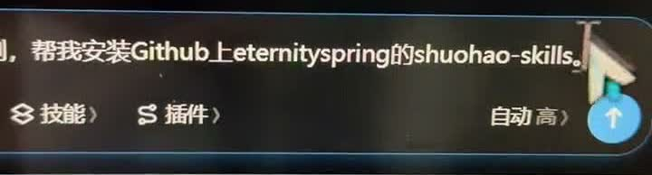

# 小说转 AI 漫剧：shuohao-skills 与同类方案选型

收录日期：2026-10-24

最近核实：2026-10-24（Asia/Shanghai）

研究状态：原视频项目、公开文档与关键源码已核实；未安装候选、未调用生成接口、未实测出片。

## 一句话结论

视频使用的是 **eternityspring/shuohao-skills**。它能把小说改编整理为角色设定、大纲、剧本、走位、分镜与视频模型投产包，适合前期生产准备；当前分镜 Skill 明确不生成图片，导出脚本也只组织提示词、清单与已有附件，因此不能把演示直接理解为装完 Skill 就自动产出完整 MP4。[S1][S2][S3]

在此次检索的同类轻量 Skill 中，没有找到星数高于原项目、又完整满足小说到成片目标的直接替代。更高星数的 **DramaClaw + Agent Kit** 提供制作后台与 Skill/MCP 接入；**Toonflow** 是图形化创作平台。若主要要求沿用现有 Agent、通过 Skill 跑完整媒体链路，星数较低的 **Drama Skills** 更值得先做样片验证。以上是基于公开实现的选型判断，尚不代表已验证实际模型效果。[S4][S5][S6][S7][S8]

## 原始线索

- 用户原始链接：[抖音分享短链](https://v.douyin.com/Dmtix-C5CUg/)。
- 解析地址：[视频 7700156852155444645](https://www.douyin.com/video/7700156852155444645)。
- 作者：毛毛毛67；标题：用豆包安装 Skill 自动制作 AI 漫剧。
- 发布日期：2026-10-24，来自原移动分享页元信息的 `create_time`，不是分享口令中的日期。[S1]
- 实际读取范围：取得原分享页元信息及视频文件，ffprobe 测得时长约 24.913 秒；按约每 3 秒抽取关键帧查看，并单独截取 00:04.5 画面。没有进行完整语音转写，也没有据此宣称完整观看或端到端复现。
- 主要宣称：在豆包“工作/本地电脑”环境安装 GitHub Skill，然后把小说改编为 AI 漫剧。
- 具体项目依据：约 00:04.5 的输入框可读到 `eternityspring` 和 `shuohao-skills`；之后画面列出 `novel-outline`、`novel-characters`、`character-refs`、`novel-art`、`novel-script`、`novel-staging`、`novel-storyboard`，与实际仓库相符。[S1][S2]



原视频展示了安装请求、技能清单和结果画面，未提供可核验的全链路任务记录、模型费用或最终 MP4 验收结果。

## 技术实现

### shuohao-skills：小说到生产准备资料

这套仓库包含 7 个 Skill：人物拆解、角色参考管理、改编大纲、美术设定、剧本、场景走位及分镜。Agent 用当前会话模型完成创作与资料整理，Node 标准库脚本负责确定性校验和报告生成。[S2]

其分镜阶段以“段 → 镜头 → 关键帧说明”组织生产：一段对应一次视频生成任务，默认不超过 15 秒；段内镜头通常为 2–5 秒。每个镜头认领剧本节拍，检查台词是否装得进镜头、节拍是否遗漏或重复、画幅与构图字段是否完整、参考图片和 H3/Seedance 提示词是否对齐。[S2]

实际输出包含 `storyboard.json`、Markdown、HTML 评审报告、配音对齐单和投产包。当前 `novel-storyboard/SKILL.md` 明写“**不出图——交付的是每格的画面提示词和它该挂哪些参考图**”，并再次强调“**本 skill 不产生这些文件**”。[S2]

`novel-storyboard.mjs` 的 `exportPack` 和 `export` 分支写出提示词、manifest，查找并复制已有分镜图、人物/场景设定图；缺失附件会进入 missing 清单。导出准备包与实际调用图像、视频、配音模型、剪辑成片是不同阶段。[S3]

### Drama Skills：媒体生产与成片环节也有实现

Drama Skills 的 11 个公开技能覆盖原著分析、分集剧本、资产、分镜、图片/视频提示词、媒体生产、剪辑和审查。`short-drama-produce` 把已确定的生产规格送到 adapter，保存任务与结果；`provider_adapters.py` 实现 GPT Image 2、Seedance、MiniMax H3、Speech 和音乐的协议构造、请求、结果查询或保存路径。[S4][S5]

`short-drama-edit` 读取实际生成的素材和剪辑单，用 ffmpeg/ffprobe 渲染及测量，处理镜序、入出点、配音、音乐、字幕和交付规格。当前代码具备相关执行路径，不代表本机已有可用供应商账号或已经跑通。[S6]

仍有明确接口边界：当前 creator-first 来源选择器尚不能声明续接视频，也不能直接提交 `GROUP-*` 多镜分组。长篇和多集流水线的连续性、失败恢复、返工次数需要实际样片验证，不能据套件介绍承诺整季无人值守。[S4]

### DramaClaw：Skill 连接制作后台

DramaClaw 的 Series 管线在官方介绍中覆盖文稿结构化、分集、剧本、分镜/首帧、配音和成片。它同时提供画布与内置 Agent；外部 Agent 可通过 Agent Kit 使用 `dramaclaw-workflows` Skill 和 MCP。[S7]

Agent Kit 本身不复制生产后台。安装前需要本机 `dramaclaw-ce` 源码、依赖环境和 API；画布操作还需要浏览器保持对应项目页面打开。Skill/MCP 负责发现、编译和执行工作流，实际项目、任务和画布写入由 CE 后台与前端 bridge 执行。[S7]

### Toonflow：图形化素材与镜头工作台

Toonflow 把文本、图片和视频节点放在无限画布中，支持模型配置、角色/场景参考、视频镜头生成、Agent、MCP 和插件扩展。当前 README 的使用步骤包括剧本/分镜、参考素材、生成镜头、预览整理和下载；下载后按需求继续处理。应按这个范围理解其当前能力，不直接推导出自动完成所有剪辑和发行环节。[S8]

| 关键判断 | 证据状态 | 来源 |
| --- | --- | --- |
| 视频对应 shuohao-skills | 元信息、关键帧和仓库技能名称交叉核实 | S1、S2 |
| shuohao 分镜有确定性时长、台词和引用检查 | 文档及源码静态核实；未运行其自测 | S2、S3 |
| shuohao 的 export 自动生成完整 MP4 | 当前读取到的实现不支持这一结论 | S2、S3 |
| Drama Skills 包含媒体供应商 adapter 和成片工具 | 代码入口已核实；未调用实际模型 | S4、S5、S6 |
| DramaClaw 可用 Skill/MCP 接入生产后台 | 官方 Agent Kit 与公共 Skill 已核实 | S7 |
| Toonflow 当前提供画布、素材管理与镜头生成 | 当前官方 README 已核实 | S8 |
| 这些方案能稳定保持长剧角色、音色和连续性 | 未实测，不能以宣传或星数代替结果 | 待样片验证 |

## 相关项目与资料

以下星数是 **2026-10-24 17:53–17:57（Asia/Shanghai）首次研究时的 GitHub API 快照**，不是长期固定值。安装量来自同轮 skills.sh。归档时固定了相关源码 commit，复核关键文件与首次研究缓存完全一致；没有把统计数字改称为后续实时值。可复查的数字与文件哈希在 [研究快照](evidence/research-snapshot.json)。

| 项目 | GitHub Stars | 类型与范围 | 选型判断 |
| --- | ---: | --- | --- |
| [shuohao-skills](https://github.com/eternityspring/shuohao-skills) | 5,023 | 7 个轻量 Skill；小说改编、资产设定、剧本、走位、分镜与投产包 | 原视频实际使用项目；适合前期，媒体链路需补齐 |
| [Drama Skills](https://github.com/zenstory-ai/drama-skills) | 3,293 | 11 个 Skill；包括媒体生产、配音、音乐和剪辑成片 | 星数较低，公开实现更接近纯 Skill 全链路目标 |
| [DramaClaw](https://github.com/dramaclaw/dramaclaw) | 6,428 | 制作平台，Agent Kit 提供 Skill + MCP | 星数更高、生产范围较完整，需要后台部署 |
| [Toonflow](https://github.com/HBAI-Ltd/Toonflow-app) | 19,181 | 图形化创作平台、模型节点与素材工作流 | 星数更高，适合画布与镜头管理；最终处理按流程验证 |

shuohao 的 `novel-storyboard` 安装量为 245；Drama Skills 的 `short-drama-produce` 约 1.5K，storyboard 与 write 各约 1.7K。**GitHub Stars 属于整个仓库，安装量属于具体 Skill；这些数不能直接混用，也不能当作出片质量分数。**[S9]

| 仓库 | 核实 commit | 许可口径与入口 |
| --- | --- | --- |
| eternityspring/shuohao-skills | 6dbddc64fed306fc96d22674cd36b717a8190d90 | Apache-2.0；`skills/novel-storyboard/SKILL.md` 与 `scripts/novel-storyboard.mjs` |
| zenstory-ai/drama-skills | fdb7b7c58017e3eae64eca382c2a85ede368dab0 | MIT；`short-drama-produce`、`provider_adapters.py`、`short-drama-edit` |
| dramaclaw/dramaclaw | f14b8e4b893f271b605d70b53cc682771dd77682 | 官方 README 说明 Elastic License 2.0 及品牌要求，托管 SaaS 有限制；`agent-kit/README.md` |
| HBAI-Ltd/Toonflow-app | 30139c931e80476caa718b31684b86383c6e83ce | 当前 MIT；README 中的画布、模型与使用步骤 |

许可是查阅版本口径，具体部署、分发与商业使用仍应以对应版本 LICENSE 和官方说明为准。[S2][S4][S7][S8]

### 星数更高但功能不等价的结果

- **JimLiu/baoyu-skills：26,918 Stars**，`baoyu-comic` 安装量约 29.8K。该 Skill 面向知识/教育漫画与漫画页生成，缺少本次目标所需的完整小说转动态漫剧生产、配音与成片环节，所以没有按“同功能高星替代”推荐。[S10]
- **漫剧老李：1,646 Stars**。当前 README 明确交付“提示词 + 接线说明书”，图片由外部平台生成；适合创作与投喂准备，也不是高于原项目星数的自动 MP4 方案。[S11]
- 此次比较不是全互联网穷举。只把已定位到官方资料、且实际读取过关键入口的候选纳入结论。

## 复现路径

**基于资料整理，未实际安装、未调用收费生成接口、未生成图片或 MP4。**

### 轻量 Skill 路线

1. 准备自己拥有或获准改编的同一段小说，限定 30–60 秒样片。
2. 在支持 Agent Skill 的现有环境中安装所选套件。下列为官方入口说明，本次未执行：

```bash
# Drama Skills：完整套件
npx skills add zenstory-ai/drama-skills -y -g

# 原项目：只安装分镜技能；完整小说改编还需要仓库里的相关上游技能
npx skills add https://github.com/eternityspring/shuohao-skills --skill novel-storyboard
```

3. 用原项目完成角色、改编大纲、剧本、走位和分镜；核对生产包是否缺图。需要实际生成时接入图像、视频、TTS 与剪辑能力。
4. 若选 Drama Skills，完成原著分析、第一集剧本、视觉资产、分镜和视频提示词，再配置自己的供应商接口。按其生产预览/确认流程执行媒体任务，随后用剪辑技能处理真正存在的素材。[S4][S6]
5. 验收最终 MP4 的时长、画幅、对白和字幕、角色/场景连续性、音色、音画同步、镜头失败率、重试及总费用。

### 更高星数的后台路线

DramaClaw 先部署 CE、安装依赖并启动本地 API，再安装 Agent Kit 的 Skill、生成 MCP 配置并连接对应项目画布。Agent Kit 说明中的 `install_skill.py --host codex` 或 `--host claude-code` 是宿主适配入口；仅复制 SKILL.md 不会替代生产服务。[S7]

Toonflow 可按官方桌面或服务器流程启动，配置自己的模型服务，在画布组织故事、参考素材与镜头；镜头下载之后的剪辑与成片效果也纳入同一份验收。[S8]

成功标准应是可播放、可复查的成片及生产记录。提示词准备成功、接口接受任务、文件存在或星数较高，都不足以单独证明角色一致性和成片质量。

## 适用场景与限制

- **小说改编前期整理**：原视频的 shuohao-skills 适合把大量文字拆成可生产的资料，尤其需要角色、节拍与参考素材约束时。
- **沿用现有 Agent 的完整 Skill 链路**：优先做 Drama Skills 短样片验证；它的公开执行入口更齐，仍需要模型账号、额度、素材与 ffmpeg/ffprobe。
- **更高星数且接受后台部署**：优先进一步评估 DramaClaw + Agent Kit；Skill、后台与模型服务一起构成实际系统。
- **图形化制作与素材管理**：比较 Toonflow，按其当前官方步骤与实际模型能力决定成片流程。
- 外部模型的图像质量、视频连续性、配音、速度与费用受所选供应商、型号、额度及素材影响。公开代码具备相应入口与实机稳定生产是两个需要分别验证的事实。

## 待核实事项

- 原视频的最终 MP4、完整生成日志、所用模型/渠道、费用及是否采用额外插件或人工剪辑。
- 豆包当时的具体版本、当前版本的导入与工具权限是否与演示一致。
- 各方案在同一小说片段上的角色和音色一致性、字幕准确率、镜头返工与总成本。
- Drama Skills 当前续接视频和 GROUP 多镜提交的接口缺口对长篇流程的影响。
- 各候选在本机的安装、依赖、供应商账号及实际成片能力。此次没有运行它们，不能标记为端到端验收通过。

## 来源与证据

| 编号 | 来源与链接 | 发布日期或版本 | 查阅日期 | 支持的结论 |
| --- | --- | --- | --- | --- |
| S1 | [原抖音作品](https://www.douyin.com/video/7700156852155444645)、[00:04.5 局部证据](evidence/video-045s-repo.jpg) | 2026-10-24 | 2026-10-24 | 作者、项目名称、安装演示与读取范围 |
| S2 | [shuohao 仓库 README](https://github.com/eternityspring/shuohao-skills/blob/6dbddc64fed306fc96d22674cd36b717a8190d90/README.md)、[shuohao 分镜 SKILL.md](https://github.com/eternityspring/shuohao-skills/blob/6dbddc64fed306fc96d22674cd36b717a8190d90/skills/novel-storyboard/SKILL.md) | 固定 commit；分镜 Skill 2.0.0 | 2026-10-24 | 交付内容、质量检查、不生成图片 |
| S3 | [shuohao 分镜脚本](https://github.com/eternityspring/shuohao-skills/blob/6dbddc64fed306fc96d22674cd36b717a8190d90/skills/novel-storyboard/scripts/novel-storyboard.mjs#L907) | 同上；另见 export 分支约 L2019 | 2026-10-24 | 导出提示词、manifest、已有附件和缺图清单 |
| S4 | [Drama Skills 生产 SKILL.md](https://github.com/zenstory-ai/drama-skills/blob/fdb7b7c58017e3eae64eca382c2a85ede368dab0/skills/short-drama-produce/SKILL.md) | 固定 commit | 2026-10-24 | 图片/视频/TTS/音乐生产，以及续接与 GROUP 的限制 |
| S5 | [供应商 adapters 源码](https://github.com/zenstory-ai/drama-skills/blob/fdb7b7c58017e3eae64eca382c2a85ede368dab0/skills/short-drama-produce/scripts/provider_adapters.py) | 同上 | 2026-10-24 | 供应商协议、真实请求与结果获取路径 |
| S6 | [剪辑成片 SKILL.md](https://github.com/zenstory-ai/drama-skills/blob/fdb7b7c58017e3eae64eca382c2a85ede368dab0/skills/short-drama-edit/SKILL.md) | 同上 | 2026-10-24 | 素材输入、剪辑单、字幕、声音、ffmpeg/ffprobe |
| S7 | [DramaClaw README](https://github.com/dramaclaw/dramaclaw/blob/f14b8e4b893f271b605d70b53cc682771dd77682/README.md)、[Agent Kit](https://github.com/dramaclaw/dramaclaw/blob/f14b8e4b893f271b605d70b53cc682771dd77682/agent-kit/README.md)、[公共 Skill](https://github.com/dramaclaw/dramaclaw/blob/f14b8e4b893f271b605d70b53cc682771dd77682/agent-kit/skills/dramaclaw-workflows/SKILL.md) | 固定 commit | 2026-10-24 | 制作管线、外部 Agent 入口、后台依赖与许可说明 |
| S8 | [Toonflow README](https://github.com/HBAI-Ltd/Toonflow-app/blob/30139c931e80476caa718b31684b86383c6e83ce/README.md) | 固定 commit | 2026-10-24 | 当前画布、模型、素材下载步骤与 MIT 说明 |
| S9 | [novel-storyboard](https://skills.sh/eternityspring/shuohao-skills/novel-storyboard)、[short-drama-produce](https://skills.sh/zenstory-ai/drama-skills/short-drama-produce)、[本次查询快照](evidence/research-snapshot.json) | 动态目录，数字保留研究时快照 | 2026-10-24 | Skill 安装量和 GitHub Stars 快照 |
| S10 | [baoyu-comic SKILL.md](https://github.com/JimLiu/baoyu-skills/blob/1567581c26ec29f4216c6e6835415bf30343b0e3/skills/baoyu-comic/SKILL.md) | 固定 commit | 2026-10-24 | 知识漫画页定位，不能等同完整动态漫剧 |
| S11 | [漫剧老李 README](https://github.com/lixiaoxiao9888-create/manju-laoli-skill/blob/6f16955c57053d77ea0ffbdbbf3a7985a3e0080a/README.md) | 固定 commit | 2026-10-24 | 提示词与接线说明书的交付边界 |

## 更新记录

- 2026-10-24：读取抖音分享元信息及关键帧，定位实际项目；比较同类候选、星数、安装量、生产入口和限制。
- 2026-10-24：在用户授权后首次收录到热点信息汇总；固定关键源码版本，并复核 7 个关键文件与首次研究缓存一致。保留未实测出片状态。
