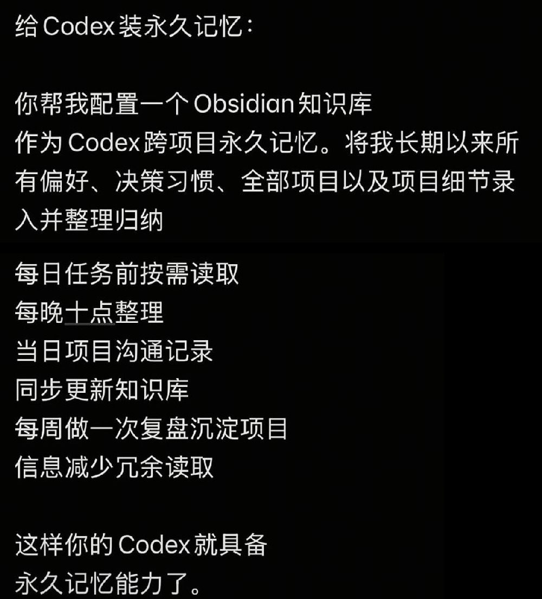
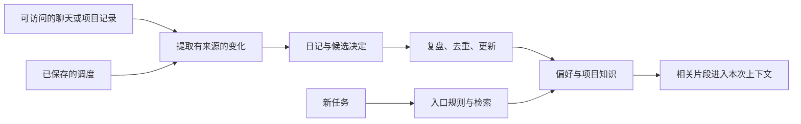

# Codex + Obsidian：跨项目记忆与定期整理

收录日期：2026-10-25

最近核实：2026-10-25，Asia/Shanghai

研究状态：**相关产品能力已核实；截图方案是工作流建议，完整搭建与定时运行未实测**。

## 一句话结论

把 Obsidian 的 Markdown 文件作为可编辑的长期资料，用 Codex 的全局/项目指令规定检索与更新，再通过独立调度整理日志，是可行的跨项目知识工作流。可靠性来自文件、读写规则、来源和运行验证，截图中的一段提示词不直接证明它们已经建立。[S1][S2][S3][S4]

**当前 Codex 已有原生本地记忆功能**，可把符合条件的历史聊天整理成本地记忆。Obsidian 可以作为人工可维护、跨工具复用的资料层；必须始终遵守的规则仍适合放在 `AGENTS.md` 或版本管理的项目文档里。[S3][S5]

## 原始线索

- 用户输入：图片 1，文件名 `img_v3_0216q_49034cf0-0750-4cfb-9ba7-6feba59d0cfg.jpg`。
- 截图作者显示为 **张三的歌AI（订阅版）**，标题为“如何让它有永久记忆！”；正文“给 Codex 装永久记忆”。
- 内容建议：配置一个 Obsidian 知识库，归档偏好、决策习惯、项目与细节；任务前按需读取；每晚十点整理当天沟通；每周复盘，以减少重复读取。
- 实际读取范围：用户完整截图中的文字；原图文链接、作品 ID、发布日期和实际配置未知。归档图只保留正文的两块裁剪，去掉手机状态栏、个人通知、头像和社交计数。[S1]
- 图中没有指定某个 Obsidian 插件、MCP 服务器、具体 Skill 或脚本，不能把后续检索出的项目认定为原作者已经采用的组件。
- 本条收录的是技术建议的研究，没有在用户机器上配置知识库、修改记忆设置或创建定时任务。



## 技术实现

### 1. 资料存储：Obsidian vault 是本地文件夹

Obsidian 官方说明：笔记是 vault 文件夹及其子目录中的 Markdown 纯文本文件。其他编辑器和程序可以读写这些文件，Obsidian 会刷新外部修改。由此，Agent 通过文件工具或终端读取笔记并不需要先增加一个特殊记忆插件。[S2]

vault 中的 `.obsidian` 是界面/插件等配置；知识内容以笔记为主。持久保存、备份、检索与被模型本次实际读取是不同环节：文件在磁盘上存在，不等于每次对话都会自动加载。

### 2. 任务入口：通过 AGENTS.md 约定怎么使用资料

当前官方文档确认，Codex 在开始工作时加载全局和项目指令：

- 全局目录默认 `~/.codex`，优先读取 `AGENTS.override.md`，否则 `AGENTS.md`。
- 项目从根目录走到当前工作目录，在各目录按优先级选取指令文件；更近的规则覆盖更广的规则。
- 指令合并有字节限制，默认 `project_doc_max_bytes` 为 **32 KiB**，所以不适合把全部聊天记录塞进全局指令。[S3]

较合理的做法是只把**知识库路径、检索流程、更新条件与少量稳定约定**写在全局入口，项目文档保留具体工程规则。下面是设计示例，不是已写入用户环境的配置：

```text
任务涉及历史偏好、项目状态或既有决定时，先读取知识库入口。
按项目名称、路径和关键词检索，只打开相关笔记。
结论引用来源和核实时间；过期状态需要重新核实。
完成后记录本次确认的变化，保留旧决定的更新关系。
没有明确来源的推测不要直接写成长期事实。
```

全局指令指向 vault 能让不同项目复用资料，但仍要求当前执行环境能访问该路径。云端环境不会仅因为本机有这个目录就自动获得其文件。[S3][S4]

### 3. 知识结构：偏好、项目事实、决定和日志分开

以下是**本次设计建议，未实际创建**：

```text
AgentMemory/
  README.md                 # 短入口和检索约定
  preferences.md            # 经确认的长期偏好
  projects/
    project-a/
      overview.md           # 目标、路径、当前阶段
      decisions.md          # 决定、原因、来源和替代关系
      status.md             # 最近状态及核实日期
  daily/
    2026-10-25.md            # 当天确认的进展与来源
  reviews/
    weekly-review.md         # 去重、过期状态、可沉淀决定
```

任务前从短入口定位项目，再检索相关页；需要具体依据时才打开日志或原资料。Obsidian 的链接、属性与标签可以辅助组织，简单文本检索也能完成起步方案。[S2][S6]

每项长期记录至少应有：**内容、适用范围、来源、确认日期、当前状态**。例如“这个仓库提交走 PR”应归属该仓库；某次临时排期不宜变成所有项目的长期规则。新决定替代旧决定时，保留 `supersedes` 或更新记录有助于避免冲突。这些是知识维护策略，不是 Obsidian 自动提供的事实判断。

### 4. 读写接口：直接文件操作与 Obsidian CLI

可选择两条路径：

| 路径 | 能力与依据 | 使用条件 |
| --- | --- | --- |
| 直接读写 Markdown | 读取、搜索、追加笔记；Obsidian 刷新外部改动 | Agent 具有目标目录的文件访问能力，不必依赖 Obsidian 正在运行。[S2] |
| Obsidian CLI | `search`、`read`、`append`、属性、链接与界面操作 | 官方当前文档建议 installer **1.12.7+** 并启用 CLI；桌面应用需运行，首条命令可启动应用。[S6] |

官方 CLI 示例可用于后续验证，**本次未执行**：

```bash
obsidian vault="AgentMemory" search query="project-a" limit=10
obsidian vault="AgentMemory" read path="projects/project-a/decisions.md"
```

指定 vault 和文件路径能避免活跃笔记或同名笔记带来的误定位。文件重命名涉及内部链接时，应考虑 Obsidian 的链接更新能力；直接改文件名不会自动证明引用已同步。[S6]

### 5. 定时整理：需要保存调度和可访问的输入

“每晚十点整理”描述一个时间要求，还需要实际创建任务、确定时区、输入范围、输出和重复执行方式。Codex/ChatGPT 官方当前 Scheduled Tasks 资料说明：

- 访问本机项目的任务需要机器开机、桌面应用运行、目录可访问。
- Web 任务可使用上传材料和已连接工具，不能直接操作本机文件夹。
- Codex CLI 和 IDE 扩展不提供 Scheduled 管理界面，可先准备和验证提示词/脚本，再通过支持的调度入口配置。[S4]

也可使用系统调度执行本地脚本，但要自行处理离线、失败、日志、输入权限和重复运行；本次没有验证任何系统调度脚本。每周复盘还需要明确日期/时间，截图只给出了频率。

设计上可用“来源记录 ID + 日期 + 项目”防止重复归档；每晚只读取新增记录，周复盘再去重并更新长期页。整理程序必须知道有哪些可读取的沟通来源；一个 Agent 不能仅凭提示词获取全部历史聊天。模型摘要可能遗漏或误解，因此重要决定应保留原始依据与修正记录。



### 6. 与原生 Codex memories 的关系

2026-10-25 实际读取的官方 Memories 页面明确：**本地 Codex 记忆默认关闭，可启用；ChatGPT Web 记忆与本地 Codex 的记忆存储/控制分开**。[S5]

本地记忆从符合条件的历史聊天中生成，不会立即对每次聊天做完整总结：会跳过仍活跃或短暂的会话，等待闲置时机，生成还可能受剩余额度阈值影响。主文件在默认 `~/.codex/memories/` 下；官方建议把它们当生成状态，不以手工编辑作为主要管理入口。`/memories` 可控制本次聊天是否使用或贡献记忆。[S5]

| 信息层 | 本次建议用途 | 为什么 |
| --- | --- | --- |
| `AGENTS.md` / 项目版本文档 | 必须遵守的规则与工程约定 | 官方明确建议固定规则保留在指令或受版本管理的文档中。[S3][S5] |
| 原生 Codex memories | 帮助回忆相关历史上下文 | 能后台生成与检索，但有资格、时间、额度和配置条件。[S5] |
| Obsidian Markdown 知识库 | 人可编辑的偏好、决定、项目页及来源 | 通用文件格式方便人工整理和其他工具复用，需建立检索/更新入口。[S2] |

这张截图的方案更适合被理解成外部知识工作流；不能由“磁盘文件长期保存”推出“模型永久、完整、永不出错地记住所有信息”。

## 关联项目与当前资料

### kepano/obsidian-skills

- [仓库](https://github.com/kepano/obsidian-skills)：实际查询 **50,043 Stars**；固定 commit `3ccff5338ea700537839b21900aa5358a0402c98`，日期 **2026-09-15**；许可证 **MIT**。[S7]
- 仓库 README 说明遵循 Agent Skills 规范，可供 Codex、Claude Code、OpenCode 等兼容 Agent 使用。
- 提供 `obsidian-markdown`、`obsidian-cli`、`obsidian-bases`、`json-canvas` 等；另有网页转 Markdown 的 Defuddle 和批量模板 Knap。
- 本次实际读取 README、LICENSE、Markdown/CLI/Knap Skill 内容作为研究资料。它们支持格式与工具操作，没有据此发现“自动归档所有聊天”或“永久正确回忆”的实现保证。
- 当前仓库 README 对 Codex 手动路径仍写 `~/.codex/skills`；实际读取的新官方 Codex 指南以用户 `$HOME/.agents/skills` 和项目 `.agents/skills` 等位置说明发现机制。后续安装应以实际 Codex 版本与当前官方指南核对，不能照旧路径宣称已加载。[S7][S8]
- 该项目是相关参考，截图没有证明作者使用了它。本次没有安装这些 Skills。

### 跨设备同步

官方 Obsidian Headless **open beta** 可在没有桌面应用时同步 vault，要求 Node.js 22+；Headless Sync 需要有效的 Obsidian Sync 订阅。它处理文件同步，不会独立替用户做聊天分析或定时摘要。[S9]

本机 Markdown 存储、跨设备同步和备份各自解决不同问题。使用远程模型时，被读入请求的笔记片段也受所选模型服务的数据路径影响；“vault 在本机”并不能说明所有推理都离线。

## 关键宣称核对

| 截图宣称/容易产生的理解 | 核实状态 | 依据 |
| --- | --- | --- |
| Obsidian 可以保存长期资料并供 Agent 使用 | 已核实 | S2、S6 |
| 可把任务前按需读取做成工作约定 | 能力有依据，方案未实测 | S3、S6 |
| 输入这段提示词就已配置跨项目记忆 | 截图未提供配置或运行证据 | S1 |
| 自动拥有全部历史偏好和项目沟通 | 取决于实际可访问来源，无法从截图确认 | S1、S5 |
| 每晚十点自动执行 | 需创建调度并满足执行条件，截图未证明已创建 | S4 |
| 当前 Codex 必须依靠 Obsidian 才有记忆 | 不符合当前官方资料：已有可启用的本地记忆 | S5 |
| Skills 或文件保存能够保证永不遗忘、判断永远正确 | 没有这样的保证 | S3、S5、S7 |

## 复现路径

**状态：仅基于实际读取的官方资料整理，未在用户环境搭建 vault、启用记忆、安装 Skill 或创建调度。**

1. 先建一个独立试验 vault，使用少量自有样例记录，确定短入口、项目页、来源和更新时间格式。
2. 在试验 Codex 配置中设置简短的全局入口与项目规则，指向明确 vault；启动两个不同样例项目，核对加载的指令及读取来源。
3. 测试一次跨会话检索：先写入一个确认决定，再启动新会话要求回答；检查回答实际引用哪条笔记和日期。加入一条新决定替代旧决定，验证不再使用旧状态。
4. 对比直接 Markdown 读写与 Obsidian CLI。CLI 路线先运行 `obsidian help` 核对当前命令，确认目标 vault，再测试搜索和指定文件读取。
5. 如选原生 Codex memories，使用官方设置或 `/memories` 检查当前支持与配置；等待符合条件的历史生成并核对来源，不把立即没更新当作失败，也不把生成文件存在当作检索正确。
6. 先手动执行一次“只归档新增日志”的提示词，确认重复执行不重复插入、修正信息有来源。之后再建立每晚与每周的实际调度，明确时区、可访问输入、结果位置和失败记录。
7. 用后续新会话检索已整理的决定，同时保留原记录，评估答案正确率、冲突处理和读取量，而不是只检查 Markdown 文件数量。

验收应至少覆盖：**跨项目读到正确记录、决策更新后用新信息、来源可追溯、重复整理无重复、调度实际运行并产生可核对结果**。这些检查本次尚未执行。

## 适用场景与限制

适合拥有多个长期项目、需要保留决策原因与工作偏好，同时希望人工编辑和跨工具复用资料的用户。起步可以使用普通 Markdown 加清晰指令，不必先搭建复杂向量数据库。[S2][S3]

文件越多越需要检索和过期标记；仅追求“全部存进去”可能造成重复、相互矛盾或每次读取过量。日/周整理只是节奏安排，事实质量仍取决于来源、范围和修正机制。

## 待核实事项

- 原抖音图文链接、作品 ID 与发布日期。
- 原作者是否实际部署了 vault、检索、定时任务或某个插件，截图没有操作证据。
- 当前用户机器的 Obsidian/Codex 版本、原生记忆和调度可用性，本次没有进行本机配置检查。
- 跨项目回忆质量、长历史导入质量、重复整理和定时运行稳定性未实测。

## 来源与证据

查阅日期均为 **2026-10-25**。官方网页实际发生了域名重定向；下表使用最终读取页面或固定源文档，而不把 HTTP 200 的空壳当成全文读取。

| 编号 | 来源与链接 | 发布/版本口径 | 支持的结论 |
| --- | --- | --- | --- |
| S1 | [截图正文](evidence/source-text.jpg) | 原作品日期未知 | 用户线索和工作流建议 |
| S2 | [Obsidian 官方数据存储源文档](https://github.com/obsidianmd/obsidian-help/blob/f333c95d23fc1e30594fa7acb9181f67ab71861c/en/Files%20and%20folders/How%20Obsidian%20stores%20data.md) | 文档快照 2026-10-24 | Markdown vault、外部编辑与刷新、配置和缓存 |
| S3 | [Codex AGENTS.md 官方指南](https://learn.chatgpt.com/docs/agent-configuration/agents-md) | 查阅时现行页面 | 全局/项目发现、覆盖优先级、32 KiB 入口限制 |
| S4 | [官方 Scheduled Tasks](https://learn.chatgpt.com/docs/automations?surface=app) | 查阅时现行页面 | 本地任务运行条件、Web/CLI/IDE 调度边界 |
| S5 | [官方 Memories](https://learn.chatgpt.com/docs/customization/memories) | 查阅时现行页面 | 原生本地记忆、默认关闭、资格/闲置/额度条件、路径与控制 |
| S6 | [Obsidian CLI 官方源文档](https://github.com/obsidianmd/obsidian-help/blob/f333c95d23fc1e30594fa7acb9181f67ab71861c/en/Extending%20Obsidian/Obsidian%20CLI.md) | 文档快照 2026-10-24；安装器建议 1.12.7+ | CLI 设置、运行应用、指定 vault、search/read/append |
| S7 | [obsidian-skills README](https://github.com/kepano/obsidian-skills/blob/3ccff5338ea700537839b21900aa5358a0402c98/README.md)、[LICENSE](https://github.com/kepano/obsidian-skills/blob/3ccff5338ea700537839b21900aa5358a0402c98/LICENSE)、[CLI Skill](https://github.com/kepano/obsidian-skills/blob/3ccff5338ea700537839b21900aa5358a0402c98/skills/obsidian-cli/SKILL.md)、[Markdown Skill](https://github.com/kepano/obsidian-skills/blob/3ccff5338ea700537839b21900aa5358a0402c98/skills/obsidian-markdown/SKILL.md)、[Knap Skill](https://github.com/kepano/obsidian-skills/blob/3ccff5338ea700537839b21900aa5358a0402c98/skills/knap/SKILL.md)、[仓库 API](https://api.github.com/repos/kepano/obsidian-skills) | 固定 commit 2026-09-15 | 相关能力、Agent 兼容声明、Stars 与 MIT；非原作者工具证据 |
| S8 | [官方 Skills 指南](https://learn.chatgpt.com/docs/build-skills) | 查阅时现行页面 | 渐进加载与当前本地 Skill 路径 |
| S9 | [官方 Headless](https://github.com/obsidianmd/obsidian-help/blob/f333c95d23fc1e30594fa7acb9181f67ab71861c/en/Extending%20Obsidian/Obsidian%20Headless.md)、[Headless Sync](https://github.com/obsidianmd/obsidian-help/blob/f333c95d23fc1e30594fa7acb9181f67ab71861c/en/Obsidian%20Sync/Headless%20Sync.md) | 文档快照 2026-10-24，open beta | 无桌面同步、Node 22+、Sync 订阅条件 |

实际读取资料的版本、哈希与未运行范围见 [研究快照](evidence/research-snapshot.json)。

## 更新记录

- 2026-10-25：首次收录截图建议；核实 vault、CLI、Codex 指令与调度，并补入当前原生本地记忆能力；整理可复现的知识结构与验收方式；未修改用户知识库、记忆设置或调度。
