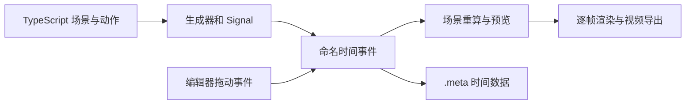

# Motion Canvas：代码动画与可拖动时间事件

收录日期：2026-10-25

最近核实：2026-10-25，Asia/Shanghai

研究状态：**项目对应关系和核心实现已核实；动画项目复现未实际运行**。

## 一句话结论

Motion Canvas 让你用 TypeScript 写清楚画面和动作，再通过编辑器拖动命名时间事件，把动作对齐到配音。代码描述“怎么动”，场景元数据保存“何时动”；非常适合技术讲解、图表、公式、流程和架构演示。[S1][S2][S3][S4]

## 原始线索

- 用户提供：[抖音分享短链](https://v.douyin.com/14v7WmZAL9E/)。
- 规范作品链接：[视频 7700368672421924111](https://www.douyin.com/video/7700368672421924111)。短链跳转已确认，分享追踪参数不归档。
- 作者：**AI不得鸟**，由作品网页读取。
- 标题：**1.9 万 Star，用代码做动画，时间点能拖**。
- 作品网页显示发布时间：**2026-10-25 06:43**；页面没有单独标注时区，按中文页面原样记录。分享文本尾部的 `05/29` 不作为作品发布日期。
- 完整简介明确写到：用代码做动画很难与配音同步；时间块可以拖；面向图表、公式、流程、架构图；可以按空格当幻灯片讲；不剪实拍；正式版停在 3.17；GitHub 搜 Motion Canvas。
- 实际读取范围：网页完整简介、作者、发布时间；完整视频文件已获取，`ffprobe` 验证 **56.47 秒、720×1280、含音频和视频流、2,410,673 字节**；视觉抽查 **5、15、25、35、45、52 秒**。未进行完整语音转写，也不宣称逐帧观看。[S1]
- 视频是作者制作的项目讲解示意；抽样画面能证明其介绍的是 Motion Canvas，但不能当成原编辑器完整实操或性能测试。


| 时间点 | 实际看到的内容 | 能支持什么 |
| --- | --- | --- |
| 00:05 | Motion Canvas、19,464 Stars、TypeScript、MIT | 项目名及作者当时的热度快照 |
| 00:15 | `makeScene2D`、`yield* circle().scale(...)` 示意 | 生成器写动作的讲解 |
| 00:25 | 生成器与配音对齐示意 | 作者解释的核心问题 |
| 00:35 | 图表、公式、流程、架构图；`beginSlide` | 作者介绍的场景和演示模式 |
| 00:45 | 不剪实拍、正式版 3.17 | 作者给出的产品边界与版本说法 |
| 00:52 | `github.com/motion-canvas` 与文档地址 | 原视频与官方项目对应 |

## 技术实现

### 1. 画面是节点，动作是生成器

官方定义包含两个部分：**用生成器编排动画的 TypeScript 库**与**可实时预览的编辑器**。`makeScene2D(function* (view) { ... })` 创建场景，`view.add(...)` 加入圆形、文字、图片等节点，节点属性支持 Signal；带目标值和时长的调用返回补间动画生成器。[S2][S3][S5]

```tsx
import {Circle, makeScene2D} from '@motion-canvas/2d';
import {createRef, waitUntil} from '@motion-canvas/core';

export default makeScene2D(function* (view) {
  const circle = createRef<Circle>();
  view.add(<Circle ref={circle} size={160} fill={'#00c7a8'} />);

  yield* waitUntil('show-result');
  yield* circle().scale(2, 0.5);
});
```

这是依据官方 API 整理的最小示例，**本次未运行**。其中 `0.5` 是秒数；`yield*` 委托并等待这一段动作，`all(...)` 等工具可以组合同时发生的动画。源码的 `threads` 负责调度生成器，使用播放上下文的时间步进；这里的线程是动画任务编排，不能理解成每个动作都使用一个操作系统线程。[S3][S5]

### 2. “时间点能拖”具体是命名时间事件

`waitUntil('show-result')` 并非在代码里写死等待 3.14 秒，而是注册一个名为 `show-result` 的时间事件。`useDuration` 向当前场景的 `timeEvents.register` 取出等待时长，`waitUntil` 再将其交给 `waitFor`。这个事件随后会显示在编辑器时间线上，供用户拖动。[S4][S6]

时间线 `Label.tsx` 的实现链路明确：

1. 鼠标指针按下时获取拖动捕获。
2. 指针水平移动量经过 `pixelsToFrames` 和 `framesToSeconds` 换算成时间偏移。
3. 松开后调用 `scene.timeEvents.set(event.name, newFrame, e.shiftKey)`。
4. `EditableTimeEvents` 更新事件目标时间，重新加载场景并重算动画。[S6]

所以这个能力主要在调整**已由代码定义的命名事件**，并非将任意动作都自动变成可编辑关键帧。事件名称应保持稳定且不在同一场景重复注册；源码会检查冲突。[S6]

### 3. 改时间保存到 `.meta`，不反向改写 TypeScript

重算后，`EditableTimeEvents` 把事件的 `name` 和 `targetTime` 写入场景元数据；Vite 的 meta 插件接收编辑器消息，将 JSON 保存到对应 `.meta` 文件。动画逻辑和时间设置可以一起进入 Git 版本管理。[S6][S7]



官方文档还给出两项细节：默认移动一个时间事件，会连带调整后续事件，适合配音某段增加或缩短停顿；拖动时按 **Shift** 可以阻止后续事件跟随。`useDuration('event')` 也可以直接用于补间动作的时长，因此时间事件既能控制开始点，也能控制持续多久。[S4][S6]

### 4. 配音、音频轨与幻灯片

配音通过 `makeProject({audio: ...})` 加入项目；编辑器显示音频轨，可以修改 audio offset，或按 Shift 拖动音频轨。工具帮助人工对齐语音提示，没有发现内置的 ASR 自动识别语义并完成所有对齐的证据。[S8]

`beginSlide('slide-name')` 定义演示停顿点。在 Presentation Mode 下会暂停，等待用户按 **空格**继续；有幻灯片导航、全屏和播放控制。这是实时讲解的交互方式，与最终导出视频的播放方式不同。[S8]

### 5. 图片、公式和视频导出

2D 包负责场景节点和绘制，核心 Renderer 驱动逐帧渲染。可以选择图片序列导出，或安装 `@motion-canvas/ffmpeg` 导出 MP4；后者把浏览器渲染出的 RGBA 帧传入 FFmpeg，并按配置混入音频。可以分别设预览和最终渲染的分辨率、缩放及帧率。[S9]

代码还包含 `Latex`、`Img` 和 `Video` 组件。**“不剪实拍”应理解为产品定位不以通用实拍剪辑为主**：官方媒体文档确实支持嵌入和播放视频，再对视频节点做动画。不能把宣传简写解读为“完全不支持任何视频素材”。[S10]

| 关键判断 | 证据状态 | 证据 |
| --- | --- | --- |
| 视频介绍的项目为 Motion Canvas | 已核实 | 原网页简介和 00:05 / 00:52 画面，S1 |
| 用 TypeScript 生成器与 Signal 编排动画 | 已核实：官方定义和源码 | S2、S3、S5 |
| 命名时间事件可以拖动并保存 | 已核实：文档与完整代码链路 | S4、S6、S7 |
| 默认后续事件跟随，Shift 可阻止 | 已核实 | S4、S6 |
| 支持配音轨与空格推进的幻灯片模式 | 已核实：文档 | S8 |
| 支持逐帧与 FFmpeg MP4 导出 | 已核实：文档与导出实现 | S9 |
| 不能嵌入任何实拍视频 | 与官方资料不符 | S10 有 Video 组件与媒体文档 |
| 完全自动理解旁白、自动完成动画和对齐 | 未核实；官方资料未给出该保证 | S2、S4、S8 |
| 本次示例已经运行或测出渲染性能 | 未运行，未测试 | 本次执行范围 |

## 相关项目与资料

### 官方项目和当前版本

- 仓库：[motion-canvas/motion-canvas](https://github.com/motion-canvas/motion-canvas)，创建于 **2022-08-03**；2026-10-25 查询时 **19,469 Stars**，与视频 19,464 的快照差异很小，但 Stars 会持续变化。[S2]
- 本次固定源码：`7b91435c301d530351dcf5ebb91dd139c002e405`，提交于 **2026-07-02**，提交内容是文档域名更新。实际读取 README、核心/2D/创建器、时间事件与编辑器、渲染和 FFmpeg 相关文件。[S2]
- 最新正式 GitHub Release：**v3.17.2，2024-12-14**；当前 main 的 core/create/ffmpeg 包声明也为 3.17.2。[S2][S3][S9]
- 核实时仓库 **archived=false**。视频“正式版停在 3.17”与 Release 一致，但“没有新正式版”不能单独证明项目彻底停止维护；最新提交也不能视为近期已发布重大功能。[S2]
- 根仓库和核心包为 **MIT**；`@motion-canvas/ffmpeg` 的 package.json 单独声明 **GPLv3**，选择导出依赖时应按具体包核对，不能把所有组成部分一概写成 MIT。[S2][S9]
- README 中的官方文档地址是 `motion-canvas.io`。本次网站读取超时，已直接读取固定 commit 下的官方 MDX 文档；搜索引擎中无连字符域名、镜像或归档站不作为本报告已经读完的官方网页。[S2][S3][S4]

### 同类工具怎么选

Stars 为 **2026-10-25 GitHub API 快照**。功能依据各自实际读取的 README/许可证整理，未做统一动画或渲染性能基准。

| 项目 | Stars | 定位和差异 | 适合的需求 |
| --- | --- | --- | --- |
| [Motion Canvas](https://github.com/motion-canvas/motion-canvas) | 19,469 | TypeScript 代码动画 + 时间事件 + 配音同步 + 实时演示；核心 MIT | 技术讲解、图表/流程和声音对齐 |
| [Remotion](https://github.com/remotion-dev/remotion) | 67,175 | React 是画面来源，支持编程/交互/Agent 创作、数据视频与批量渲染；自定义许可证 | 已有 React 技术栈、模板视频和批量数据成片 |
| [Manim Community](https://github.com/ManimCommunity/manim) | 41,841 | Python 编排数学解释动画，MIT；与 3b1b 原版有版本区别 | 数学推导、公式与科学教学 |
| [Theatre.js](https://github.com/theatre-js/theatre) | 12,793 | 视觉和代码共同控制 JS 属性，适配 Three.js、HTML/SVG；core Apache-2.0、studio AGPL-3.0 | 网页/3D 交互动画与时间线动效设计 |

**选择建议**：本条视频的“代码写动作 + 拖动时间点对齐讲解”需求，Motion Canvas 很直接；若要更高热度的代码视频系统，优先对照 Remotion；若核心是数学，优先 Manim；若核心是网页或 Three.js 动效，优先 Theatre.js。高 Stars 不自动代表对配音事件编辑更合适。[S2][S11][S12][S13]

Remotion 当前读取的 LICENSE.md 对个人、最多 3 名员工的营利组织、非营利组织或非商业评估提供免费许可；超出免费条件的组织需要公司许可。它不是可直接标注成 MIT 的替代品。Theatre.js README 也说明新版开发暂移私有仓库，公开 main 的更新时间不能代表其全部私有开发进展。[S11][S13]

## 复现路径

**状态：依据官方文档、脚手架和源码整理，未实际安装 Motion Canvas，未操作其编辑器或导出新动画。** 本次已实际运行的是原视频下载、媒体探测、关键帧提取与源码研究。

### 1. 创建普通动画项目

官方快速开始要求 Node.js **16+**，建议使用仍受支持的 Node 版本，并保留项目锁文件；该旧版文档门槛不等于所有新 Node 版本都已经验证兼容。本次已阅读创建器 `index.js` 和模板入口，下面是建议步骤，不直接执行文档里的安装动作。[S3]

```bash
node -v
npm init @motion-canvas@3.17.2
# 按提示选择项目路径、TypeScript 和所需导出器
cd <project-path>
npm install
npm start
```

官方预期编辑器地址为 `http://localhost:9000/`，以实际启动日志为准。使用普通脚手架即可；无需为了制作动画而先克隆、构建整个 Motion Canvas 开发 monorepo。[S3]

### 2. 检查命名事件和文件保存

1. 在 `src/scenes/example.tsx` 放入上文的圆形示例。
2. 确认 `src/project.ts` 通过 `./scenes/example?scene` 导入场景；`?scene` 对 Vite 转换和热更新是必需的。
3. 加入一段自有配音，配置 `makeProject({scenes: [example], audio: ...})`。
4. 找到时间线 `show-result` 事件，拖到某一句配音结束的位置，重新播放确认圆形变大的触发时刻。
5. 添加第二个命名事件，分别验证普通拖动和按 Shift 拖动对后续事件的影响。
6. 关闭重开项目，核对时间设置仍在；通过 Git diff 检查 `.meta` 的 `name` / `targetTime` 变化和场景代码，确认数据保存边界。[S3][S4][S6][S7]

验收标准：事件能拖动，重放触发时间改变，重启仍保留；图形和配音能按设定对齐。不会因为网页预览打开成功，就宣称导出与全部时间编辑已通过。

### 3. 导出一段短视频

创建项目时可直接选择 Video (FFmpeg)。已有项目可以安装 `@motion-canvas/ffmpeg`，并在 `vite.config.ts` 的插件列表加入 `ffmpeg()`；使用现有 `motionCanvas()` 配置。官方资料说明该导出器会随依赖安装 FFmpeg，本次未实测其二进制在当前主机的可用性。[S9]

在 Video Settings 选择导出器，设置短渲染范围、画幅和帧率；若要配音，打开 Include audio。点击 Render，检查 `output/` 中有可播放 MP4，用 `ffprobe` 核对尺寸、帧率、时长和音频流。[S9]

若暂时只验证核心绘制，可先导出图片序列，后续在已有剪辑流程中合成。幻灯片模式则另外用 `beginSlide` 和 PRESENT 验证空格导航；视频导出不会产生一个需要观众按空格的交互式 MP4。[S8][S9]

## 适用场景与限制

- **适用**：可复用且由代码驱动的技术讲解、图表、架构图、流程演示、公式与实时课程演示。[S1][S2]
- **门槛**：需要编程和动画时序知识；拖时间点简化配音同步，但不会自动替用户设计图形、分镜和讲解逻辑。[S3][S4]
- **AI 集成**：外部编码 Agent 可生成或修改 TSX 和数据，但原生核心是动画库与编辑器；本次未发现内置的大模型自动成片链路。与上一条 Pixelle-Video 的定位不同，后者偏模型和媒体流水线，Motion Canvas 偏确定的代码图形与事件编排。[S2][S3]
- **剪辑边界**：可以嵌入视频素材，但不据此视为专业通用 NLE。复杂实拍剪辑、多轨素材管理等需求需要另行评估。[S10]
- **画质与速度**：逐帧渲染和可调分辨率已核实；本次没有测导出速度、长视频内存、复杂图形性能或不同浏览器的一致性。[S9]
- **维护和依赖**：正式 Release 停在 2024 年的 3.17.2；仓库未归档且后续仍有提交。首次集成应检查本机 Node、浏览器、字体和 FFmpeg 的兼容性，不能把版本号直接等同于停止开发。[S2][S3][S9]

## 待核实事项

1. 编辑器真实拖动、Shift 行为、`.meta` 保存和重启恢复尚未在本机项目中操作验证。
2. 本机新动画的图片/MP4 导出、音频同步、公式字体与性能没有实测。
3. 原视频未做完整语音转写；本报告只依赖实际读取的网页简介和六个抽样关键帧。
4. 官方网站读取超时，报告依据直接获取的官方仓库文档；后续查看最新网站时应从当前 README 的链接进入。

## 来源与证据

所有资料查阅日期为 **2026-10-25**。源码文档均固定到本次 commit，避免 main 后续漂移。

| 编号 | 来源与链接 | 发布日期/版本 | 支持的结论 |
| --- | --- | --- | --- |
| S1 | [原作品](https://www.douyin.com/video/7700368672421924111)、[关键帧](evidence/video-keyframes.jpg) | 页面显示 2026-10-25 06:43 | 项目名、作者、完整简介及抽样画面 |
| S2 | [固定 README](https://github.com/motion-canvas/motion-canvas/blob/7b91435c301d530351dcf5ebb91dd139c002e405/README.md)、[LICENSE](https://github.com/motion-canvas/motion-canvas/blob/7b91435c301d530351dcf5ebb91dd139c002e405/LICENSE)、[仓库 API](https://api.github.com/repos/motion-canvas/motion-canvas)、[Release v3.17.2](https://github.com/motion-canvas/motion-canvas/releases/tag/v3.17.2) | snapshot 2026-07-02；Release 2024-12-14 | 官方定位、MIT、Stars、仓库未归档、版本 |
| S3 | [quickstart.mdx](https://github.com/motion-canvas/motion-canvas/blob/7b91435c301d530351dcf5ebb91dd139c002e405/packages/docs/docs/getting-started/quickstart.mdx)、[创建器](https://github.com/motion-canvas/motion-canvas/blob/7b91435c301d530351dcf5ebb91dd139c002e405/packages/create/index.js)、[模板](https://github.com/motion-canvas/motion-canvas/blob/7b91435c301d530351dcf5ebb91dd139c002e405/packages/create/template-2d-ts/src/scenes/example.tsx) | 固定 commit | 创建、Node 门槛、场景写法、`?scene` |
| S4 | [time-events.mdx](https://github.com/motion-canvas/motion-canvas/blob/7b91435c301d530351dcf5ebb91dd139c002e405/packages/docs/docs/getting-started/time-events.mdx) | 固定 commit | 命名事件、拖动、Shift、控制时长 |
| S5 | [SignalContext.ts](https://github.com/motion-canvas/motion-canvas/blob/7b91435c301d530351dcf5ebb91dd139c002e405/packages/core/src/signals/SignalContext.ts)、[threads.ts](https://github.com/motion-canvas/motion-canvas/blob/7b91435c301d530351dcf5ebb91dd139c002e405/packages/core/src/threading/threads.ts)、[flow.mdx](https://github.com/motion-canvas/motion-canvas/blob/7b91435c301d530351dcf5ebb91dd139c002e405/packages/docs/docs/getting-started/flow.mdx) | 固定 commit | 属性补间、生成器调度与并发编排 |
| S6 | [scheduling.ts](https://github.com/motion-canvas/motion-canvas/blob/7b91435c301d530351dcf5ebb91dd139c002e405/packages/core/src/flow/scheduling.ts)、[useDuration.ts](https://github.com/motion-canvas/motion-canvas/blob/7b91435c301d530351dcf5ebb91dd139c002e405/packages/core/src/utils/useDuration.ts)、[Label.tsx](https://github.com/motion-canvas/motion-canvas/blob/7b91435c301d530351dcf5ebb91dd139c002e405/packages/ui/src/components/timeline/Label.tsx)、[EditableTimeEvents.ts](https://github.com/motion-canvas/motion-canvas/blob/7b91435c301d530351dcf5ebb91dd139c002e405/packages/core/src/scenes/timeEvents/EditableTimeEvents.ts) | 固定 commit | 从事件注册到拖动重算的源码链路 |
| S7 | [meta.ts](https://github.com/motion-canvas/motion-canvas/blob/7b91435c301d530351dcf5ebb91dd139c002e405/packages/vite-plugin/src/partials/meta.ts) | 固定 commit | `.meta` 文件保存与热更新 |
| S8 | [media.mdx](https://github.com/motion-canvas/motion-canvas/blob/7b91435c301d530351dcf5ebb91dd139c002e405/packages/docs/docs/getting-started/media.mdx)、[presentation.mdx](https://github.com/motion-canvas/motion-canvas/blob/7b91435c301d530351dcf5ebb91dd139c002e405/packages/docs/docs/getting-started/presentation.mdx) | 固定 commit | 配音轨、偏移、beginSlide、空格导航 |
| S9 | [渲染文档](https://github.com/motion-canvas/motion-canvas/blob/7b91435c301d530351dcf5ebb91dd139c002e405/packages/docs/docs/getting-started/rendering/index.mdx)、[FFmpeg 文档](https://github.com/motion-canvas/motion-canvas/blob/7b91435c301d530351dcf5ebb91dd139c002e405/packages/docs/docs/getting-started/rendering/video.mdx)、[FFmpegExporterServer.ts](https://github.com/motion-canvas/motion-canvas/blob/7b91435c301d530351dcf5ebb91dd139c002e405/packages/ffmpeg/server/FFmpegExporterServer.ts)、[ffmpeg 包声明](https://github.com/motion-canvas/motion-canvas/blob/7b91435c301d530351dcf5ebb91dd139c002e405/packages/ffmpeg/package.json) | 固定 commit / 3.17.2 | 逐帧、MP4、音频与 GPLv3 包声明 |
| S10 | [Video.ts](https://github.com/motion-canvas/motion-canvas/blob/7b91435c301d530351dcf5ebb91dd139c002e405/packages/2d/src/lib/components/Video.ts)、[Latex.ts](https://github.com/motion-canvas/motion-canvas/blob/7b91435c301d530351dcf5ebb91dd139c002e405/packages/2d/src/lib/components/Latex.ts)、[媒体文档](https://github.com/motion-canvas/motion-canvas/blob/7b91435c301d530351dcf5ebb91dd139c002e405/packages/docs/docs/getting-started/media.mdx) | 固定 commit | 公式与嵌入视频的能力 |
| S11 | [Remotion README](https://github.com/remotion-dev/remotion/blob/a64a02770f89fd5d0de8956f6a8fc5c62bd30295/README.md)、[LICENSE.md](https://github.com/remotion-dev/remotion/blob/a64a02770f89fd5d0de8956f6a8fc5c62bd30295/LICENSE.md)、[API](https://api.github.com/repos/remotion-dev/remotion) | 本次 main 快照 | React/Agent/批量视频、热度、自定义许可 |
| S12 | [Manim README](https://github.com/ManimCommunity/manim/blob/bb380986b16273d4197bcf21e1365b5f0dcad505/README.md)、[LICENSE](https://github.com/ManimCommunity/manim/blob/bb380986b16273d4197bcf21e1365b5f0dcad505/LICENSE)、[API](https://api.github.com/repos/ManimCommunity/manim) | 本次 main 快照 | 数学动画、Python、MIT、热度 |
| S13 | [Theatre.js README](https://github.com/theatre-js/theatre/blob/6ea82b938ea49609489f6377ded693ccc6ee8f5b/README.md)、[LICENSE](https://github.com/theatre-js/theatre/blob/6ea82b938ea49609489f6377ded693ccc6ee8f5b/LICENSE)、[API](https://api.github.com/repos/theatre-js/theatre) | 本次 main 快照 | 网页/3D 动效、core/studio 许可差异、热度与开发说明 |

精简研究记录见 [research-snapshot.json](evidence/research-snapshot.json)，包含版本、资料哈希、原素材实际读取范围及未运行状态，不包含浏览器配置、Cookie、原网页追踪数据或原视频文件。

## 更新记录

- 2026-10-25：首次收录；确认原视频介绍 Motion Canvas，读取作品完整简介并抽查六个关键帧；核实命名时间事件、元数据保存、渲染与演示；比较 Remotion / Manim / Theatre.js；注明动画项目未实际复现。
