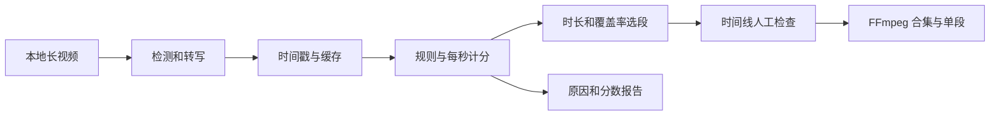

# VideoHighlighter：本地多信号高光筛选与视频导出

收录日期：2026-10-25

最近核实：2026-10-25，Asia/Shanghai

研究状态：**项目功能与核心实现已核实；独立选段算例已运行，完整视频分析与桌面应用未实测**。原抖音图文链接尚未提供。

## 一句话结论

VideoHighlighter 把场景、运动、音频、物体、动作和转写结果整理到同一条时间线上，按可配置分数选择片段，并导出高光合集、单独片段和解释报告。它适合长视频的第一轮粗筛；“精彩”取决于使用的信号、模型、规则和人的判断。[S1][S2][S3]

## 原始线索

- 用户输入：图片 1，原文件 `img_v3_0216q_2f9a863a-8569-4499-807c-188d8ff8748g.jpg`。
- 截图作者显示为：**试图驯服AI的喵喵**；标题：**AI 已经开始自动剪视频了**。
- 原抖音图文 URL、作品 ID、实际发布日期未知；首页第三列保留“截图提供，原链接待补”，不把检索仓库地址伪装成用户原链接。
- 实际读取范围：完整截图中的文章文字；未观看该作品的视频或读取其评论。归档仅保留正文裁剪，去除手机状态栏、个人通知、头像和社交计数。[S1]
- 主要宣称：2026-10-17 开源 VideoHighlighter；长视频自动找精彩片段并拼接；完全本地，基础分析无需 API Key；多维打分；可解释选择原因、自定义规则、直接导出。
- 定位结果：[Aseiel/VideoHighlighter](https://github.com/Aseiel/VideoHighlighter) 的 README 和检测文档，与截图中“本地、多信号、解释报告、自定义空间规则、合集”这组功能对应。截图未显示 owner/repo，本次依据名称与具体机制匹配，原图文出处仍待补。[S2]


## 技术实现

### 1. 分析阶段：多个独立信号，不是每次都开启全部 AI 能力

入口为 `pipeline.py` 的 `run_highlighter`，桌面界面以 `main.py` 的 Qt/PySide6 形式调用。另有 React + Tauri v2 前端与 Python FastAPI sidecar；两种界面共用引擎。[S2][S3][S9]

分析结果被转换为带时间戳的数据，例如场景切换、运动峰值、音频峰值、响度突发、物体检测、动作检测和字幕关键词命中。核心并非让一个大模型一次性“看懂几小时视频”，而是把不同检测与统计结果结合。[S3]

| 信号 | 当前项目的实现/资料 | 使用条件与边界 |
| --- | --- | --- |
| 场景、运动 | 场景/运动检测模块 | 镜头变化或运动多不自动等于值得保留 |
| 音频 | 波形 RMS、局部峰值、响度突发等 | 响声、欢呼、爆炸可能提高分数，也可能是无关噪声 |
| 物体 | YOLOX 与 OpenVINO/ONNX 等后端 | 默认 COCO 类别之外的对象需要对应模型 |
| 动作 | SigLIP2 多帧窗口，或已训练的动作模型 | 配置动作名称或训练样例，能力受画面和模型限制 |
| 视觉搜索 | CLIP 图像编码、文本查询与缓存索引 | 擅长整体场景，不能替代小物体的精确定位 |
| 字幕/语言 | 本地 Whisper、关键词检索；可选 Ollama 处理 | 转写和翻译需要各自模型，语音断言不是画面事实 |

这些判断来自实际读取的代码与官方检测文档；表中没有任何本次实测识别准确率。[S3][S4][S7]

**简单模式尤其需要单独理解**：`modules/segments/simple_run.py` 的内置预设为场景 2 分、运动峰值 5 分、响度突发 5 分，物体、动作、字幕等设为 0 或关闭；简单运行覆盖本次配置，不代表所有检测同时开启。截图的多维能力是项目可配置的能力集合。[S3]

### 2. 评分阶段：每秒累计，再按共现加成

`pipeline.py` 创建每秒分数数组，分别累积各信号贡献。物体按设定类别计分，动作可依据同类置信度的分位数分档，关键词命中也贡献对应区间。最后相加，并在多个信号同时出现时按 `multi_signal_boost` 放大。[S3]

可以概括为：

`每秒总分 = 各启用信号的计分之和 × 适用的多信号加成`

这不是统一训练出来的“观众喜爱概率”。用户设置为 0 的维度没有评分贡献；缺失或未识别到的信号也不会因为写了权重就自动产生证据。因而换一种素材，往往需要换评分设置。[S3]

### 3. 自定义规则：组合检测结果表达场景关系

`composition_rules.yaml` 定义命名事件，组合已有的检测框、计数、位置和时间窗口。官方“足球进球”例子是 **sports ball 的中心进入 net 框**，但 net 不属于默认 COCO 类别，需要先准备或训练球网检测类。[S4][S5]

```yaml
events:
  - name: ball_in_net
    label: Ball in net
    window_secs: 0.3
    persist_secs: 0.2
    rules:
      - {source: sports ball, region: net, min_count: 1}
```

这是官方文档的机制示例，**本次未运行球赛检测**。规则依据框中心、区域和计数作判断，不是完整的 3D 球门/进球裁判系统。`window_secs` 用来平滑，`persist_secs` 保留短暂丢失的检测；其数值和检测误差会影响触发结果。[S4][S5]

组合规则重新读取已缓存的检测，不需要为每次改规则重跑整个模型。更改模型、采样或转写条件则可能导致检测缓存失效。调整“怎么看检测”与调整“怎么做检测”的成本不同。[S3][S4][S5]

### 4. 选段与剪辑：分数排名、时长预算和覆盖率

固定片长模式调用 `select_fixed_window_segments`：按分数排序，置信度用于打破同分；围绕候选秒扩展片段，跳过与已选片段重叠的区间，在预算内继续选择，最后按原时间顺序排列。[S6]

- `coverage=0`：主要按全局分数取片段，可能集中在同一段视频。
- 提高 coverage：给时间桶设置额度，使合集更分散，但不是剧情理解或叙事完整性的保证。
- `MAX`：只把正分秒当候选，得不到足够高分时可以短于时长上限。
- `EXACT`：允许零分秒参与，以填满时长预算；“长度满足要求”不能当作“每段都精彩”。

当 `clip_time=0` 时，项目走变长的自动分段模式，可结合场景、动作序列和其他信号设置最短/最长片长与合并间隔。最终由 FFmpeg 切片、规范化参数并合成，单独片段有带原始时间范围的文件名。[S3][S6][S8]



### 5. 可解释性：报告列出真实计分依据

报告记录每个保留片段的信号贡献、物体/动作命中、置信度、加成、实际配置，以及有分但未入选的片段。官方报告文档还区分“转写里说过”和“检测实际测得”：语言模型可写章节说明，但边界与数值由前面的检测和计算提供。[S2][S10]

因此“解释为什么选”有具体实现基础，但它主要解释**这套设置怎样得到这个结果**，并不证明某段客观精彩、模型没有误检，或旁白中的所有事实为真。

## 截图宣称核对

| 宣称 | 核实结果 | 依据 |
| --- | --- | --- |
| “2026-10-17 开源” | 不宜当作首次出现日期：仓库 2025-09-19 已创建，历史 Release 更早；10 月 17 日是否为作者获知/报道日期未知 | S2 |
| 本地分析、基础无需 API Key | 与 README、安装文档和简单预设一致 | S2、S3、S9 |
| 所有模型都不需下载，首次即可完全离线 | 原截图没有给出这项条件；官方明确部分权重首次需要下载 | S4、S9 |
| 同时分析画面、动作、声音和字幕 | 项目支持这些可选信号；简单模式并不全部启用 | S3、S4 |
| 球赛进球、监控异动、游戏欢呼都能抓 | 属于可配置场景，需模型/规则/阈值；不是本次实测效果 | S4、S5 |
| 解释原因、自定义规则、导出 | 相关文档与源码入口均存在 | S5、S8、S10 |
| 给几小时视频就能轻松出精彩合集 | 支持长视频使用场景；速度和质量仍依赖机器、模型与素材，本次未测长视频 | S2、S9 |

## 已实际运行的独立算例

已完整审阅 `highlight_select.py`，确认其入口仅依赖 NumPy 和数据数组，再单独加载该模块。**没有安装桌面应用、启动检测器、下载模型或分析真实视频。**

输入：60 秒的假想视频、片长 8 秒、总预算 16 秒；仅在 8/20/44/57 秒设置 10/9/8/7 分，其余为 0。实际运行结果：[selection-probe.json](evidence/selection-probe.json)。

| 情况 | 实际选出的区间（秒） | 说明 |
| --- | --- | --- |
| MAX，coverage=0 | 4–12、16–24 | 集中挑最高分附近 |
| MAX，coverage=1 | 4–12、40–48 | 提高覆盖率后跨时间段选择 |
| 全零分，MAX | 空列表 | 没有正分候选就不出段 |
| 全零分，EXACT | 0–8、8–16 | 仍能凑满预算，不能由时长反推内容价值 |

这验证了独立选段函数的机制，不构成物体、动作、转写、视频解码或成片质量测试。

## 相关项目与版本

- 官方仓库：[Aseiel/VideoHighlighter](https://github.com/Aseiel/VideoHighlighter)。2026-10-25 查询时 **305 Stars**，创建时间 **2025-09-19**，仓库未归档。[S2]
- 本次固定源码：`772bc42521d2d156c0d42aef4d8b1c702febd677`，commit 时间 **2026-10-23**，版本声明 **0.14.2**。
- 最新正式发布 **0.14.2，2026-10-24**；此前有 0.14.0（10 月 18 日）及更早版本，不能把截图日期当作仓库起点。[S2]
- 主项目许可证 **AGPL-3.0**；官方另提供商业授权。Free 是当前仓库，Pro 是独立收费版本，部分实时物体/动作覆盖与其他扩展属于 Pro；基础离线分析、报告和规则不因此变成收费功能。[S2][S9]
- 本地不等于无条件零资源：模型权重、依赖、磁盘、推理时间仍有成本；需要先下载依赖/权重，准备完成后本地模型路线才适合断网运行。Ollama 可选用于本地语言处理，也支持按用户配置连接别的服务。[S2][S9]
- macOS：文档列有实验性的 Core ML 加速。`docs/MAC-GPU.md` 写 Whisper 在 CPU，但当前 `transcript.py` 已有 MPS 设备选择、与 CPU 参考结果比较以及失败回退；因此 Mac 后端状态应查实际日志，不直接照搬较旧文档。本次未测当前 Mac 的任何推理后端。[S7][S9]

### 同类方案比较

Stars 为 **2026-10-25 快照**，功能比较来自实际读取的 README，未做统一素材基准。

| 项目 | Stars / 许可 | 适合什么 | 与本项目的侧重点差异 |
| --- | --- | --- | --- |
| [VideoHighlighter](https://github.com/Aseiel/VideoHighlighter) | 305 / AGPL-3.0 | 本地事件/物体/动作驱动的高光粗筛与解释报告 | 更重多信号检测、规则和时间线 |
| [AutoClip](https://github.com/zhouxiaoka/autoclip) | 9,706 / MIT | 访谈、播客、演讲的语义切片与平台成片包装 | 模型可自选，支持本地/云端分析、字幕、取景和发布包 |
| [Auto-Editor](https://github.com/WyattBlue/auto-editor) | 5,614 / Unlicense | 按静音、音量或运动剪去空白，导出剪辑时间线 | 更直接的规则粗剪，不依赖“理解精彩剧情” |

**建议**：要按事件、动作或物体筛选且查看原因，重点评估 VideoHighlighter；要把访谈拆成带标题、字幕和平台包装的短片，先对照热度更高的 AutoClip；只想切掉停顿和静音，Auto-Editor 更直接。三个项目的 Stars 不构成质量排序。[S11][S12]

## 复现路径

**完整应用复现未运行。** 已阅读源码入口与依赖，独立算例只覆盖上述选择函数。

1. 从官方 Releases 选择适合操作系统的构建；或在独立 Python 环境中克隆项目、锁定本报告 commit，再按官方 `requirements.txt` 安装后运行 `python main.py`。不同平台的 OpenVINO、ONNX、Torch、Qt 依赖需要实际验证；不把源码安装示例写成已在本机成功。
2. 先用一段自有的 2–5 分钟样片做 Simple 分析，检查场景、运动和响度信号、合集、单段和报告。先保证基础剪辑与预览正常，再扩大素材时长。
3. 按需求开启转写、物体、动作或视觉搜索，提前准备所需权重；若要翻译或语言章节说明，另配本地 Ollama 与模型。首次下载完后再检查断网可用性。
4. 在时间线上人工核对每个候选区间与报告贡献，尤其是关键词误识别、纯噪声、镜头切换和动作误判。
5. 试调评分、coverage、片长与 MAX/EXACT，验证成片长度、内容连续性和单段时间范围。保存一套符合素材类型的配置，复用缓存重算。
6. 用 `ffprobe` 核对输出音视频流、画幅与时长，再人工检查开始/结束截断和音画同步。体育场景还要用已知标注算召回率与误报率；不能仅凭成片文件存在判定模型有效。[S3][S4][S6][S8][S9]

成功标准：基础流程完成，候选时间段可解释，剪辑可播放，选段符合样片人工标注；后续才评估数小时素材的速度、内存、缓存和稳定性。

## 待核实事项

- 原抖音图文链接、作品 ID 和发布日期，当前只收到截图。
- 截图中 2026-10-17 的来源；仓库历史不支持把它直接写成首次开源日期。
- 当前主机完整桌面/模型安装、首次下载与断网测试未执行。
- 游戏、球赛、监控和访谈的真实检测精度与成片效果、数小时输入耗时和资源占用未测。
- Mac 文档与 Whisper 后端源码存在更新差异，需要实际日志和样片验证。

## 来源与证据

查阅日期均为 **2026-10-25**。核心代码与文档固定至本次 commit；检索摘要仅用于定位项目。

| 编号 | 来源与链接 | 支持的结论 |
| --- | --- | --- |
| S1 | [截图正文](evidence/source-text.jpg) | 用户原线索、宣称与日期文字 |
| S2 | [README](https://github.com/Aseiel/VideoHighlighter/blob/772bc42521d2d156c0d42aef4d8b1c702febd677/README.md)、[LICENSE](https://github.com/Aseiel/VideoHighlighter/blob/772bc42521d2d156c0d42aef4d8b1c702febd677/LICENSE)、[仓库 API](https://api.github.com/repos/Aseiel/VideoHighlighter)、[0.14.2](https://github.com/Aseiel/VideoHighlighter/releases/tag/0.14.2) | 定位、创建时间、热度、版本、离线说明、Free/Pro 与许可 |
| S3 | [pipeline.py](https://github.com/Aseiel/VideoHighlighter/blob/772bc42521d2d156c0d42aef4d8b1c702febd677/pipeline.py)、[simple_run.py](https://github.com/Aseiel/VideoHighlighter/blob/772bc42521d2d156c0d42aef4d8b1c702febd677/modules/segments/simple_run.py)、[config.yaml](https://github.com/Aseiel/VideoHighlighter/blob/772bc42521d2d156c0d42aef4d8b1c702febd677/config.yaml) | 入口、各信号分数、加成、简单模式、缓存与配置 |
| S4 | [DETECTION-GUIDE.md](https://github.com/Aseiel/VideoHighlighter/blob/772bc42521d2d156c0d42aef4d8b1c702febd677/docs/DETECTION-GUIDE.md) | YOLOX、SigLIP2、CLIP、空间规则、模型条件与限制 |
| S5 | [compose_events.py](https://github.com/Aseiel/VideoHighlighter/blob/772bc42521d2d156c0d42aef4d8b1c702febd677/modules/rules/compose_events.py)、[composition_signals.py](https://github.com/Aseiel/VideoHighlighter/blob/772bc42521d2d156c0d42aef4d8b1c702febd677/modules/rules/composition_signals.py) | 自定义组合规则与缓存结果复用 |
| S6 | [highlight_select.py](https://github.com/Aseiel/VideoHighlighter/blob/772bc42521d2d156c0d42aef4d8b1c702febd677/modules/segments/highlight_select.py)、[auto_segments.py](https://github.com/Aseiel/VideoHighlighter/blob/772bc42521d2d156c0d42aef4d8b1c702febd677/modules/segments/auto_segments.py)、[实际算例](evidence/selection-probe.json) | 固定/变长选段、coverage、MAX/EXACT 与算例结果 |
| S7 | [audio_peaks.py](https://github.com/Aseiel/VideoHighlighter/blob/772bc42521d2d156c0d42aef4d8b1c702febd677/modules/audio/audio_peaks.py)、[transcript.py](https://github.com/Aseiel/VideoHighlighter/blob/772bc42521d2d156c0d42aef4d8b1c702febd677/modules/audio/transcript.py) | RMS/峰值、Whisper、本地转写与 MPS 选择 |
| S8 | [video_cutter.py](https://github.com/Aseiel/VideoHighlighter/blob/772bc42521d2d156c0d42aef4d8b1c702febd677/modules/media/video_cutter.py)、[clip_export.py](https://github.com/Aseiel/VideoHighlighter/blob/772bc42521d2d156c0d42aef4d8b1c702febd677/modules/media/clip_export.py)、[combine_videos.py](https://github.com/Aseiel/VideoHighlighter/blob/772bc42521d2d156c0d42aef4d8b1c702febd677/modules/media/combine_videos.py) | FFmpeg 裁切、单段时间命名与合集 |
| S9 | [INSTALL.md](https://github.com/Aseiel/VideoHighlighter/blob/772bc42521d2d156c0d42aef4d8b1c702febd677/docs/INSTALL.md)、[MAC-GPU.md](https://github.com/Aseiel/VideoHighlighter/blob/772bc42521d2d156c0d42aef4d8b1c702febd677/docs/MAC-GPU.md)、[依赖](https://github.com/Aseiel/VideoHighlighter/blob/772bc42521d2d156c0d42aef4d8b1c702febd677/requirements.txt)、[frontend README](https://github.com/Aseiel/VideoHighlighter/blob/772bc42521d2d156c0d42aef4d8b1c702febd677/frontend/README.md) | 安装、模型下载、Mac 后端、两种界面 |
| S10 | [REPORTS.md](https://github.com/Aseiel/VideoHighlighter/blob/772bc42521d2d156c0d42aef4d8b1c702febd677/docs/REPORTS.md)、[highlight_report.py](https://github.com/Aseiel/VideoHighlighter/blob/772bc42521d2d156c0d42aef4d8b1c702febd677/modules/report/highlight_report.py) | 得分解释、检测与转写的区分、报告 |
| S11 | [AutoClip README](https://github.com/zhouxiaoka/autoclip/blob/3d3b5edf9ffa595a764b0919e6dbd4ce8acaca84/README.md)、[API](https://api.github.com/repos/zhouxiaoka/autoclip) | 字幕/语义成片、平台包装、可选本地或云端模型、热度与 MIT |
| S12 | [Auto-Editor README](https://github.com/WyattBlue/auto-editor/blob/be18d01b3438eb86bfaf75703bea09183141887b/README.md)、[API](https://api.github.com/repos/WyattBlue/auto-editor) | 按音量、运动粗剪、导出剪辑时间线、热度与 Unlicense |

版本、资料哈希与实际执行范围见 [研究快照](evidence/research-snapshot.json)。

## 更新记录

- 2026-10-25：首次收录截图线索；定位并核实 VideoHighlighter，校正开源日期口径，解释简单预设、多信号评分和规则条件；运行独立选段算例；比较 AutoClip / Auto-Editor；完整应用未实测、原图文链接待补。
