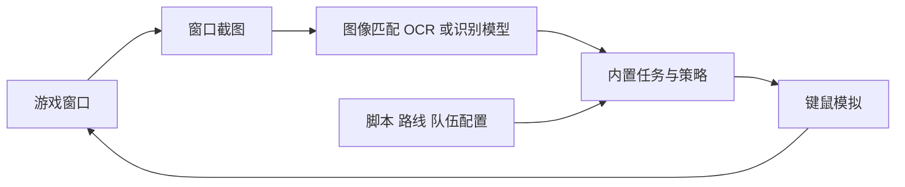

# BetterGI：原神画面识别、脚本调度与日常任务自动化

收录日期：2026-10-26

最近核实：2026-10-26（Asia/Shanghai）

研究状态：已确认原视频项目，读取正式版/开发分支源码与官方文档；功能和环境静态核实，未安装或运行游戏任务

## 一句话结论

视频对应 [babalae/better-genshin-impact](https://github.com/babalae/better-genshin-impact)，即 **BetterGI · 更好的原神**。它通过窗口截图、图像/OCR/模型识别、键鼠模拟和预设策略实现拾取、剧情、战斗、寻路等自动化；不是一个不需要配置、能理解并完成所有原神任务的通用 AI 代肝。官方“一条龙”说明包括使用历练点完成日常、领取奖励，仍受任务、队伍、画面和资源条件限制。[S1][S2][S3]

## 原始线索

- 用户短链：[https://v.douyin.com/6CgtttZgi84/](https://v.douyin.com/6CgtttZgi84/)。
- 完整视频：[https://www.douyin.com/video/7700606045111310568](https://www.douyin.com/video/7700606045111310568)，作品 ID `7700606045111310568`。
- 作者：AI指挥官Felix；标题：“原神也有开源代肝了？日常任务自动搞定！”
- 页面发布时间：2026-10-25 22:04:22（Asia/Shanghai，`create_time=1792937062`）。分享口令“07/18 :3pm”不作为发布日期。
- 实际读取：标题、正文、元数据与完整 43.033 秒视频的逐秒画面、烧录字幕；未单独转写音轨。

画面展示 BetterGI 仓库、README 功能、游戏战斗片段和豆包协助安装示例。战斗片段标注“视频2倍速”；未展示完整日常流程、真实耗时、账号长期运行记录或商业收益数据。原视频的“代肝赚钱”“无成本”只作为作者说法记录，不据此推荐经营服务或宣称经济收益已验证。[S1]

本条只归档[仓库路径裁剪](evidence/source-project.jpg)和[读取摘要](evidence/source-extract.md)，未提交玩家 UID、完整游戏截图或桌面聊天画面。

## 技术实现

### 画面识别和模拟操作

项目将窗口画面作为输入。官方文档提供 BitBlt、WindowsGraphicsCapture 等截图方式；已读 `BitBltCapture.cs` 建立窗口捕获会话、检查尺寸并返回图像帧。图像输入通过功能模块识别 UI 和场景，项目依赖包含 OpenCV 与 ONNX Runtime；这里的 AI 主要是计算机视觉和任务逻辑，不代表每一步都调用聊天大模型。[S2][S4]

以自动拾取为例，`AutoPickTrigger.cs` 在截图中找交互图标和文本区域，再使用 Yap/Paddle OCR 相关识别入口读取文字，结合黑白名单判断后调用键盘接口。代码还区分聊天图标、齿轮图标等情形。`Simulation.cs` 使用 Windows 输入模拟接口，按键与鼠标状态也是实际执行的一部分。[S4]

官方 README 说明不修改游戏文件、不读写游戏内存，以视觉算法和模拟操作实现。本轮已读捕获、识别与输入入口支持这一技术路径，但未全面审计安装包或所有社区脚本；“不修改游戏本体”也不能推导为官方认可或保证不会被检测，项目 FAQ 自身保留此限制。[S2][S3]

### 任务范围与“一条龙”

| 模块 | 项目明确描述的能力 | 实际边界 |
| --- | --- | --- |
| 实时任务 | 自动拾取、剧情选择、派遣/奖励领取、快速传送、半自动钓鱼 | 根据特定 UI 与配置触发，不能概括任意剧情决策 |
| 独立任务 | 自动秘境、七圣召唤 PVE、钓鱼、伐木、烹饪等 | 每项都有启动位置、策略或场景条件 |
| 地图追踪 | 识别左上角小地图，按路线完成采集/移动/战斗 | 依赖地图特征、地图层、方向锁定和路线脚本 |
| 调度器 | 组织 JS、地图追踪、键鼠录制等脚本为配置组 | 配置组与脚本版本需要匹配，不是任意任务生成器 |
| 一条龙 | 按配置执行内置日常与配置组，再检查奖励 | README 明确提到日常使用历练点，不等于解完所有委托 |

当前 `OneDragonTask.cs` 从配置恢复启用任务、依序执行，再进行奖励检查与结束动作；配置组异常会记录并允许继续后续流程。因此看到“一条龙结束”不能直接断言每个子任务和领取动作都成功，验收需要看逐任务日志及实际奖励状态。[S4]

### 策略与路线的作用

官方自动战斗文档把队伍识别与策略执行分开：策略中不在当前队伍的角色动作会被忽略，部分高级语法不检查角色切换成功，需按策略要求配置。存在策略文件不等于当前账号队伍就能稳定完成战斗。[S5]

路径追踪通过小地图定位，文档要求地图锁定方向、16:9 且至少 1920×1080，并说明某些特征不明显区域表现较差。键鼠录制又有纯回放的误差；不同任务应分别验证，不能用一次拾取成功替代地图/战斗验收。[S5]

脚本仓库 `babalae/bettergi-scripts-list` 区分 JS、路径、战斗和七圣召唤策略。调度器文档要求首次使用先更新脚本仓库；所读版本说明它不会自行更新。社区脚本的许可和适用条件要按具体条目核对，不能自动套用程序本体许可。[S5][S6]

## 相关项目与资料

### 正式版与开发分支

| 来源 | 本次核实快照 | 含义 |
| --- | --- | --- |
| 最新正式 Release | [0.66.0](https://github.com/babalae/better-genshin-impact/releases/tag/0.66.0)，2026-09-26；tag commit `0af68c28f6b0e714d5304625ce644736d508022e` | 安装版 EXE 与便携 7z 均可见；本轮未下载约 465–504 MB 的安装包 |
| 正式版工程 | 目标 `net8.0-windows10.0.22621.0`；README 指向 .NET 8 | 正式版复现按其运行时说明处理 |
| 当前默认分支 | `refactor/20260930`，固定提交 `ae4f785c92dc976bbbc282fd84c5bb9bfd648260`，2026-10-26 | 当前开发源码，与正式版不是同一环境快照 |
| 开发工程 | 目标 `net10.0-windows10.0.22621.0`；README 说发布包自带 .NET 10 | 不能把新分支运行时说法倒套到旧正式版 |

代码许可证为 GPL-3.0；Star 在 2026-10-26 查询为 16,907。官方文档只支持 Windows 10+ 64 位，不支持 Mac 原生或手机端直接运行；项目界面能识别云原神不意味着可在 Android 上运行 BetterGI。[S2][S3]

### 同类与生态对照

| 项目 | Star 快照 | 关系与本轮读取范围 |
| --- | --- | --- |
| BetterGI | 16,907 | 原视频对应的一体化 Windows 工具，已读 README 和关键入口 |
| [bettergi-scripts-list](https://github.com/babalae/bettergi-scripts-list) | 649 | BetterGI 的内容仓库，不是独立替代；本轮只读 README 与仓库元信息 |
| [Genshin Impact Assistant](https://github.com/infstellar/genshin_impact_assistant) | 2,726 | 同为图像识别/模拟按键，README 列出战斗、秘境和部分委托；仓库已归档，未测试当前游戏兼容 |

GIA 实际 LICENSE 为 AGPL-3.0，README 写 GPL-v3，存在许可描述差异，复用应依据实际许可文件。本轮未安装或做替代方案性能测试；没有发现足以据此取代原项目的更高 Star 同功能候选。[S7]

## 复现路径

**以下基于正式版、官方文档与源码整理，未安装、运行游戏、使用账号、导入脚本或执行任何游戏任务。**

1. 在 Windows 10+ 64 位环境选择明确版本，优先从官方 Release 取相应安装版或便携包，记录版本与下载校验。正式 0.66.0 按 .NET 8 条件准备，开发源码则核对 .NET 10；不要只执行视频里给助手的一句话就跳过环境检查。
2. 配置简体中文游戏界面、推荐 1920×1080、默认亮度和无画面滤镜；按任务选择捕获方式，确认图像与输入日志可用。需要管理员权限的原因由官方说明为游戏与模拟输入权限匹配。[S3]
3. 配置停止当前脚本的快捷键，再用一个可控的拾取场景验证截图、文字识别与按键链路。区分“无识别日志”和“有日志但按键未执行”，再处理具体问题。[S3][S5]
4. 逐项选择任务，不直接同时开启完整日常链。战斗先核对队伍/策略，寻路先核对地图与路线，委托奖励先核对历练点和奖励可领取状态。
5. 更新并检查所需脚本，使用小配置组串联已经验证的任务。记录开始状态、结束状态、每项任务日志与所得奖励；一次完整日常链完成后再验证重启或游戏 UI 更新后的行为。

| 验收项 | 可判断成功的标准 |
| --- | --- |
| 基础图像与输入 | 捕获画面正常，识别结果与实际物品一致，动作只在指定场景发生 |
| 战斗 | 配队识别与策略对应，战斗/领奖真实完成，失败和重试有记录 |
| 路线 | 起点、方向锁定、地图层与路线一致，异常位置可停止 |
| 日常链 | 每个子任务有结果；奖励状态核对，不仅采信结束通知 |
| 兼容性 | 固定软件、游戏、脚本和队伍版本后重复验证，显示设置变化另验 |

## 适用场景与限制

适合研究计算机视觉驱动的桌面自动化、游戏 UI 识别、脚本状态和任务编排。官方建议机器能中画质 60 帧流畅运行原神，并提示画面尺寸/分辨率变化需重启、滤镜可能影响识别；本轮未测量资源占用或日常节省时间。[S3]

“开源免费”指软件本体，不等于运行设备、网络、人工维护和商业代练没有成本。官方文档也没有承诺所有委托、队伍和更新后 UI 都可自动完成。视频战斗片段加速播放，不能用画面时长估算真实效率。[S1][S3]

作者项目声明模拟操作仍可能被游戏规则/检测处理，所以不能把不用内存注入扩大为“保证不封号”。这一点来自已读取的项目 FAQ，本文没有运行检测、试图规避检测或替账号作保证。[S2][S3]

## 待核实事项

- 视频的完整软件/游戏/脚本版本、队伍、具体日常配置及未加速运行记录。
- 当前重构分支与 0.66.0 的功能差异、安装包内容及依赖兼容。
- 不同账号/队伍/地图场景的成功率、真实耗时、游戏更新后的识别稳定性。
- “代肝赚钱”“无成本”没有账单、运营或长期账号证据；保留为作者宣传说法。

## 来源与证据

| 编号 | 来源 | 日期及本轮支持的结论 |
| --- | --- | --- |
| S1 | [Felix 原视频](https://www.douyin.com/video/7700606045111310568)、[读取摘要](evidence/source-extract.md) | 发布 2026-10-25，查阅 2026-10-26；项目、加速片段、功能列表与未验证说法 |
| S2 | [开发分支固定 README](https://github.com/babalae/better-genshin-impact/blob/ae4f785c92dc976bbbc282fd84c5bb9bfd648260/README.md)、[LICENSE](https://github.com/babalae/better-genshin-impact/blob/ae4f785c92dc976bbbc282fd84c5bb9bfd648260/LICENSE)、[仓库元信息](https://api.github.com/repos/babalae/better-genshin-impact) | 提交及查阅 2026-10-26；功能、默认分支、技术声明、GPL 与 Star |
| S3 | [0.66.0 Release](https://github.com/babalae/better-genshin-impact/releases/tag/0.66.0)、[正式版 README](https://github.com/babalae/better-genshin-impact/blob/0af68c28f6b0e714d5304625ce644736d508022e/README.md)、[官方上手文档](https://github.com/huiyadanli/bettergi-docs/blob/787768891a67e3d5223caa5883887dafeabbb17c/src/quickstart.md) | Release 2026-09-26，查阅 2026-10-26；系统、截图、语言、分辨率和上手条件 |
| S4 | [项目工程](https://github.com/babalae/better-genshin-impact/blob/ae4f785c92dc976bbbc282fd84c5bb9bfd648260/BetterGenshinImpact/BetterGenshinImpact.csproj)、[正式版工程](https://github.com/babalae/better-genshin-impact/blob/0af68c28f6b0e714d5304625ce644736d508022e/BetterGenshinImpact/BetterGenshinImpact.csproj)、[拾取](https://github.com/babalae/better-genshin-impact/blob/ae4f785c92dc976bbbc282fd84c5bb9bfd648260/BetterGenshinImpact/GameTask/AutoPick/AutoPickTrigger.cs)、[捕获](https://github.com/babalae/better-genshin-impact/blob/ae4f785c92dc976bbbc282fd84c5bb9bfd648260/Fischless.GameCapture/BitBlt/BitBltCapture.cs)、[输入](https://github.com/babalae/better-genshin-impact/blob/ae4f785c92dc976bbbc282fd84c5bb9bfd648260/BetterGenshinImpact/Core/Simulator/Simulation.cs)、[一条龙](https://github.com/babalae/better-genshin-impact/blob/ae4f785c92dc976bbbc282fd84c5bb9bfd648260/BetterGenshinImpact/GameTask/OneDragon/OneDragonTask.cs) | 查阅 2026-10-26；实际目标框架与关键源码入口 |
| S5 | [调度器](https://github.com/huiyadanli/bettergi-docs/blob/787768891a67e3d5223caa5883887dafeabbb17c/src/feats/autos/dispatcher.md)、[地图追踪](https://github.com/huiyadanli/bettergi-docs/blob/787768891a67e3d5223caa5883887dafeabbb17c/src/feats/autos/pathing.md)、[自动秘境/战斗](https://github.com/huiyadanli/bettergi-docs/blob/787768891a67e3d5223caa5883887dafeabbb17c/src/feats/task/domain.md) | 查阅 2026-10-26；停止快捷键、更新、地图、策略与任务边界 |
| S6 | [脚本仓库 README](https://github.com/babalae/bettergi-scripts-list/blob/0a1699632f59d08a56b54876945c8df03496f2fa/README.md)、[元信息](https://api.github.com/repos/babalae/bettergi-scripts-list) | 查阅 2026-10-26；脚本种类、版本内容与 Star |
| S7 | [GIA 固定 README](https://github.com/infstellar/genshin_impact_assistant/blob/9d3357bbe6c50b5aff410d5695da4bd52e0dc26e/README.md)、[许可接口](https://api.github.com/repos/infstellar/genshin_impact_assistant/license)、[仓库元信息](https://api.github.com/repos/infstellar/genshin_impact_assistant) | 查阅 2026-10-26；相关候选、部分委托、已归档和许可差异 |

## 更新记录

- 2026-10-26：确认 BetterGI，核实视觉/输入/脚本路径、正式版与开发分支差异、日常任务边界和复现验收，未执行账号任务。
