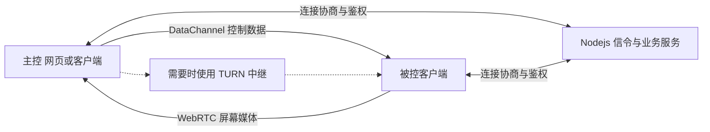

# BilldDesk：WebRTC 远程桌面、开源版与 Pro 的边界

收录日期：2026-10-26

最近核实：2026-10-26（Asia/Shanghai）

研究状态：视频项目、公开源码和官网说明已核实；“完全开源、不限流”需要区分版本与服务，未进行远程连接或性能实测

## 一句话结论

原视频指向 [galaxy-s10/billd-desk](https://github.com/galaxy-s10/billd-desk)，用 WebRTC 传输屏幕与控制数据，配合网页、桌面和移动客户端实现远程桌面。**公开的 BilldDesk 开源版采用 MIT；BilldDesk Pro 源码需要购买，具有付费功能，公共服务也存在连接风控。** 视频把不同范围合在“完全开源、不限流”里介绍，不能作为现行官网服务无任何限制的保证。[S1][S2][S3][S8]

## 原始线索

- 用户短链：[https://v.douyin.com/3VII7081ScM/](https://v.douyin.com/3VII7081ScM/)。
- 完整作品：[https://www.douyin.com/video/7700453353424684726](https://www.douyin.com/video/7700453353424684726)，ID `7700453353424684726`。
- 作者：AI-算法小鬼；标题：“远程操控开源、不限流工具，支持平台远程桌面控制”。
- 页面元数据发布时间：2026-10-25 12:11:51（Asia/Shanghai）；分享口令“11/20 :4pm”不作为发布日期。
- 实际读取：网页标题、正文、视频元数据，完整下载 29.652 秒视频，查看覆盖全时段的逐秒画面及烧录字幕；未单独转写音轨，未安装客户端或建立远程连接。[S1]

| 视频时段（约） | 实际展示 | 证据范围 |
| --- | --- | --- |
| 00:00–00:04 | BilldDesk Pro 标识、“完全开源且不限流”字幕 | 作者宣称，需继续核对官方范围 |
| 00:05–00:07 | billd-desk 仓库、galaxy-s10、约 8K Star | 可确认项目，[项目裁剪](evidence/source-project.jpg) |
| 00:08–00:19 | 跨平台、屏幕墙、编解码、群控、自定义中继等功能列表 | 产品资料展示，没有逐项实际操作验收 |
| 00:20–00:25 | 官网与 WebRTC、Flutter、Vue、Nodejs 技术栈 | 与项目文档相符 |
| 00:26–00:29 | 作者整理的使用手册 | 未取得手册链接，内容未完整读取 |

## 技术实现

### 屏幕、信令与控制的分工

公开桌面端使用 Electron/Vue。`electron-main/index.ts` 引用 `desktopCapturer` 获取屏幕源，监听 IPC 消息并通过 `@nut-tree-fork/nut-js` 等系统输入接口处理鼠标与键盘动作；这是公开 Electron 代码的路径，不代表 Pro 的重写实现。[S4]

`src/hooks/webrtc/remoteDesk.ts` 将屏幕轨道加入 PeerConnection，创建 offer/answer 并通过 WebSocket 消息交换。`src/utils/network/webRTC.ts` 创建 `RTCPeerConnection` 与 `MessageChannel`，支持结构化控制消息和二进制 Blob。其 ICE 配置可读取自定义 Coturn 地址；信令服务负责协商，媒体可以走 WebRTC 选中的直连或中继路径。[S5]

代码提供码率参数与 `getStats` 等入口，设置的是传输目标或上限，并不保证真实帧率、吞吐和时延。直连或中继要通过所选 ICE candidate pair 与实际统计核验；“有 WebRTC”不能证明每次连接都走 P2P。[S5]

项目生态还列出 `billd-desk-server`、`billd-desk-flutter` 和 `billd-desk-admin`。服务端 README 列出 Koa2、Socket.io、MySQL、Redis 与 Coturn 等组件。本轮读取了服务端 README，未审计全部服务端/Flutter/管理端代码，也未将客户端 MIT 自动套用于每个关联仓库。[S2][S7]

### 开源、免费、不限流分别指什么

| 范围 | 已读取的一手说明 | 本报告判断 |
| --- | --- | --- |
| 开源版源码 | `README_OpenSource.md` 与 `LICENSE.txt` 给出开源版及 MIT；明确没有稳定版，提示不建议开发者用于生产环境 | 公开源码可研究与按许可复用；不能承诺即装即用或稳定兼容 |
| Pro 源码 | 主 README 明确“BilldDesk Pro 不开源，源码需要购买” | Pro 的源码购买与开源版 MIT 是不同授权路径 |
| 免费客户端 | 主 README 写可免费体验，同时列出高码率/帧率/画质等付费功能 | 免费体验不代表所有功能免费 |
| 公共服务 | 官网 FAQ 明确“连接中断，显示风控了”，原因是使用人数多；提到 VIP 解除风控与更多中继选择 | 公共服务存在准入或资源限制；“不限流”不能作为当前服务保证 |
| 自建服务 | 项目支持自定义 API、WebSocket 与中继，文档提供 MySQL/Redis/Coturn 配置线索 | 可以自主配置资源；吞吐仍由网络、机器和中继能力决定，本轮未完成私有化部署 |

以上来自实际读取的项目文档及[官网 FAQ 摘录](evidence/official-scope-extract.md)，不是对官网风控进行实测。[S2][S3][S6][S8]

此外，官方文档自身有冲突：主 README 的 Pro 免费帧率比较表写 30 帧，开源 README 表写 60 帧；部分表格写隐私屏、虚拟屏免费，而主 README 的付费段落将其列入付费功能。Android 被控、Linux、开机自启等项目也存在表格与勾选列表不一致。**当前费用、免费额度和平台能力应以具体版本、账号页面与实测为准，本文不选择一个冲突数字冒充统一口径。**[S2][S3]

### 平台支持范围

主 README 的当前明确列表包含 Windows 10/11、Windows Server 2019/2022、macOS 15、Android 8–16 与 Web 浏览器；Android 7 被控标为仅观看，iOS 与 Linux 未勾选。开源 README 的其他段落对 Linux/Android 又有不同记载，因此不能直接照搬视频中“电脑、网页、手机统统能用”的泛化表述。[S2][S3]

网页作为被控对象时，项目文档注明**仅观看**；浏览器页面本身不能因接入此项目就变成对整台电脑有系统输入权限的被控客户端。Mac 被控的官网 FAQ 要求屏幕录制/系统音频与辅助功能权限；这是用户实际复现需检查的条件，本轮未修改本机权限。[S2][S8]

## 相关项目与资料

- 官方主仓库：`galaxy-s10/billd-desk`；本轮固定提交 `61be620eb35b0004dc66c296f0fdd8c62700b1b9`（2026-09-22），MIT。[S2][S3]
- 公开仓库 `package.json` 当前写 `version=0.0.1`，不是官网或视频中展示的 Pro 客户端版本。[S4]
- 官网查阅时 FAQ 页面显示 `v0.615.0`；它只作为页面标识记录，不等同于已经下载或运行该版本。[S8]
- 查询 GitHub 的 latest release 接口返回 404，release 列表为空；开源 README 中引用的 `v0.76.0` release 尚未确认可用，因此下载入口指向官网并保留此缺口。[S3]
- 服务端：`galaxy-s10/billd-desk-server`，读取 README 固定到 `c73983e543341c08ce9e4fb7c52446be50b6c6a2`；其元信息未识别出许可证，目录清单未见独立 LICENSE，本轮不判定它自动继承主仓库 MIT。[S7]

### 相关候选：RustDesk

[rustdesk/rustdesk](https://github.com/rustdesk/rustdesk) 是 Star 更高的同类候选。官方 README 说明可以使用公共 rendezvous/relay 服务，也可自建；代码采用 AGPL-3.0。它与原视频指向不同，仅作为开源远程桌面与自建中继的比较，不替换原项目。[S9]

| 项目 | Star 快照（2026-10-26） | 开源范围与已读取证据 | 选型含义 |
| --- | --- | --- | --- |
| BilldDesk | 8,824 | 客户端公开代码 MIT；Pro 另有源码购买与付费功能 | 适合研究 Vue/Electron/WebRTC 路径，复现需处理旧版与 Pro 分界 |
| RustDesk | 127,061 | 公开客户端 AGPL-3.0；官方 README 提供公共/自建中继路径 | 更高关注度的候选，仍需单独核对客户端、服务端版本和平台条件 |

本轮只读取 RustDesk 固定 README、仓库元信息，没有运行或进行性能比较；Star 不代表质量或延迟的实测结论。

## 复现路径

**以下基于文档与公开源码整理，未运行客户端、开启远程服务、部署 Coturn、购买功能或控制任何设备。**

### 普通用户体验

1. 从[官网下载入口](https://desk.hsslive.cn/#/download)选择与目标系统相符的客户端，先辨明开源版/Pro 及所需功能。本轮下载、价格 hash 路由请求仍显示 FAQ，未取得独立的当前安装包和价格清单。
2. 在自有或明确获准的两台测试设备上准备主控/被控，记录客户端版本。Mac 被控检查录屏与辅助功能权限；Android 按版本验证观看与操作能力。
3. 用具体设备码与连接密码/确认流程建立会话，依次测试画面、鼠标、键盘、剪贴板和一份测试文件；Web 被控按“仅观看”验收。
4. 记录是否走直连或中继、往返时延、实际帧率/码率和断开重连表现，再讨论“流畅”。高分辨率、编解码支持与可选设置不等于所有设备都达到同样性能。
5. 若公共服务显示风控，按真实状态记录；不要把能自建服务当作已绕过公共服务资源限制。[S8]

### 开发者复现公开源码

1. 获取主仓库固定提交及相匹配的服务端/移动端版本。文档提醒开源版没有稳定版、可能不兼容旧提交；先核对配置与 API 契约。
2. 官方启动文档建议 Node 18.19.0 与 pnpm 9.1.3，说明 `pnpm i`、配置 `src/spec-config.ts` 后 `npm run dev`。需要核实当前依赖兼容和安装入口再执行；本轮已读取但未安装依赖。[S6]
3. 配置 API、WebSocket 和需要时的 Coturn 地址；部署文档分别介绍 MySQL/Redis 与 Coturn，并没有完整的一键 Compose，README 的 Docker 一键部署仍未勾选。
4. 使用 `package.json` 实际存在的脚本：Web 有 `build:prod`，Windows/Mac/Linux 有 `build:win`、`build:mac`、`build:linux`，多平台为 `build:ele`。`start-client.md` 的 `build:web` 和 `build` 在当前包脚本中不存在，不能原样当作已验证命令。[S4][S6]
5. 自建环境必须实际核对注册/鉴权、信令、媒体、输入与文件传输，各模块版本可用后才验收。公开 WebRTC 默认配置含示例中继凭据，部署时应填写自己管理的中继配置；本报告不复制那些示例凭据。

| 验收项 | 可判断成功的标准 |
| --- | --- |
| 身份与连接 | 指定测试设备验证成功，错误密码拒绝，断开后输入停止 |
| 画面与输入 | 被控画面持续返回，授权操作对应实际动作，Web 被控仅观看 |
| 链路与容量 | 从 ICE/统计确认直连或 relay，记录 RTT、实际帧率/码率与丢包 |
| 文件/剪贴板 | 测试内容正确到达，文件大小或 hash 一致 |
| 自建边界 | API、信令、中继实际使用自建地址，容量由实测资源支持 |
| 免费/付费 | 所用账号与具体版本的功能、额度和风控表现有记录 |

## 适用场景与限制

适合研究远程办公、设备协助、网页发起控制与屏幕串流。公开源码对 WebRTC、Electron 系统输入和信令分工有学习价值，但官方明确开源版存在权限/控制问题、没有稳定版；这些是复现材料本身的限制，不应在推荐中隐藏。[S3][S4]

官网公共服务、自己部署的开源系统、付费取得的 Pro 源码是不同部署范围。自建服务器仍需承担网络与机器成本；媒体中继受到两端网络及中继带宽约束。这里没有测速，因此不能将“免费流畅”转成无条件的性能承诺。[S5][S8]

视频多为官网、README 与手册画面，未展示连续远程实验、成本账单或服务端限流配置。作者显示的 8K Star 与本轮 8,824 的差异是时间快照，不构成性能证据。

## 待核实事项

- 当前 Pro 免费/付费功能与 30/60 帧等矛盾口径；本轮没有取得独立的账号价格页面。
- 开源版与 Pro 的 Android、Linux、无人值守和屏幕墙真实支持；文档表格不完全一致。
- README 的 release 下载链接当前是否可用，以及与官网版本、公开代码的对应关系。
- 原作者整理的完整使用手册链接及其准确性；没有原链接不擅自复刻手册内容。
- 两端实机远程、直连/relay、权限、速度和稳定性；服务端及关联仓库的许可/版本兼容需另行检查。

## 来源与证据

| 编号 | 来源与链接 | 发布日期 | 查阅日期 | 支持的结论 |
| --- | --- | --- | --- | --- |
| S1 | [AI-算法小鬼原视频](https://www.douyin.com/video/7700453353424684726)、[读取摘要](evidence/source-extract.md) | 2026-10-25 12:11:51 +08:00（元数据） | 2026-10-26 | 项目识别、视频范围、宣称与缺少实测 |
| S2 | [主 README](https://github.com/galaxy-s10/billd-desk/blob/61be620eb35b0004dc66c296f0fdd8c62700b1b9/README.md)、[仓库元信息](https://api.github.com/repos/galaxy-s10/billd-desk) | 固定提交 2026-09-22 | 2026-10-26 | Pro 文档、收费、平台、功能与 Star |
| S3 | [开源 README](https://github.com/galaxy-s10/billd-desk/blob/61be620eb35b0004dc66c296f0fdd8c62700b1b9/README_OpenSource.md)、[LICENSE](https://github.com/galaxy-s10/billd-desk/blob/61be620eb35b0004dc66c296f0fdd8c62700b1b9/LICENSE.txt)、[release 列表](https://api.github.com/repos/galaxy-s10/billd-desk/releases) | 同 S2 提交；release 列表为实时查询 | 2026-10-26 | 开源 MIT、无稳定版、Pro 源码购买、文档冲突与空 release |
| S4 | [package.json](https://github.com/galaxy-s10/billd-desk/blob/61be620eb35b0004dc66c296f0fdd8c62700b1b9/package.json)、[Electron 主进程](https://github.com/galaxy-s10/billd-desk/blob/61be620eb35b0004dc66c296f0fdd8c62700b1b9/electron-main/index.ts) | 同 S2 提交 | 2026-10-26 | 公开依赖、真实构建脚本、屏幕源与系统输入 |
| S5 | [远程会话 hook](https://github.com/galaxy-s10/billd-desk/blob/61be620eb35b0004dc66c296f0fdd8c62700b1b9/src/hooks/webrtc/remoteDesk.ts)、[WebRTC 封装](https://github.com/galaxy-s10/billd-desk/blob/61be620eb35b0004dc66c296f0fdd8c62700b1b9/src/utils/network/webRTC.ts)、[端点常量](https://github.com/galaxy-s10/billd-desk/blob/61be620eb35b0004dc66c296f0fdd8c62700b1b9/src/constant.ts) | 同 S2 提交 | 2026-10-26 | offer/answer、DataChannel、ICE、中继与码率统计 |
| S6 | [启动文档](https://github.com/galaxy-s10/billd-desk/blob/61be620eb35b0004dc66c296f0fdd8c62700b1b9/doc/start-client.md)、[本地环境](https://github.com/galaxy-s10/billd-desk/blob/61be620eb35b0004dc66c296f0fdd8c62700b1b9/doc/%E6%9C%AC%E5%9C%B0%E7%8E%AF%E5%A2%83.md)、[流程](https://github.com/galaxy-s10/billd-desk/blob/61be620eb35b0004dc66c296f0fdd8c62700b1b9/doc/%E6%B5%81%E7%A8%8B.md) | 同 S2 提交 | 2026-10-26 | 环境、配置、服务组件与会话步骤 |
| S7 | [服务端 README](https://github.com/galaxy-s10/billd-desk-server/blob/c73983e543341c08ce9e4fb7c52446be50b6c6a2/README.md)、[仓库元信息](https://api.github.com/repos/galaxy-s10/billd-desk-server) | 固定到服务端查阅时 main，提交截至 2025-07-15 | 2026-10-26 | 服务端生态、未稳定提示与许可核实缺口 |
| S8 | [官网](https://desk.hsslive.cn/)、[官网 FAQ](https://desk.hsslive.cn/#/faq)、[实际读取节选](evidence/official-scope-extract.md) | 未标统一发布日期；按查阅页面 | 2026-10-26 | 公共服务风控、VIP 中继、权限及数值为上限 |
| S9 | [RustDesk 固定 README](https://github.com/rustdesk/rustdesk/blob/1297da6d186e58d9096be24072ae3998cdbbf8fe/README.md)、[仓库元信息](https://api.github.com/repos/rustdesk/rustdesk) | 固定到查阅时 master；逐段发布日期未核实 | 2026-10-26 | 相关候选、公开/自建中继与 Star/许可证 |

## 更新记录

- 2026-10-26：读取原视频并确认 BilldDesk，核实公开实现、官方 Pro/开源范围与 FAQ，将“不限流”改为有条件且未经测速的作者宣称，记录文档冲突与复现缺口。
