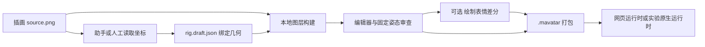

# Mesh Avatar Studio：单张插画、2D 网格绑定与可动形象

收录日期：2026-10-26

最近核实：2026-10-26（Asia/Shanghai）

研究状态：原视频项目与官方源码已确认；输入、图层构建、动画、导出和直播路径已静态核实；未为新图片制作或运行形象

## 一句话结论

[shinshin86/mesh-avatar-studio](https://github.com/shinshin86/mesh-avatar-studio) 把一张插画和可编辑的绑定参数做成会眨眼、转头、呼吸、摆动头发的 2D 网格形象。它将编程助手读图、图层构建、人工微调和运行时串起来，输出自己的 `.mavatar` 格式，支持网页、摄像头/麦克风驱动及 OBS。视频的“自动处理”和“全本地”需要按制作环节理解：高质量绑定仍需检查，绘制表情差分可能调用外部生图服务。[S1][S2][S3]

## 原始线索

- 用户短链：[https://v.douyin.com/d6w6geFR9u8/](https://v.douyin.com/d6w6geFR9u8/)。
- 完整视频：[https://www.douyin.com/video/7700784743008324900](https://www.douyin.com/video/7700784743008324900)，ID `7700784743008324900`。
- 作者：梦莱加德；标题：“让你图片转可动虚拟形象”。
- 页面元数据发布时间：2026-10-26 09:37:55（Asia/Shanghai，`create_time=1792978675`）。分享口令“04/13 :0pm”不作为发布日期。
- 实际读取：标题、正文、元数据，完整下载 40.433 秒视频，查看覆盖全时段的逐秒画面及烧录字幕；未单独转写音轨，未执行视频中的制作步骤。[S1]

| 视频时段（约） | 实际可见内容 | 本次核实范围 |
| --- | --- | --- |
| 00:00–00:05 | Mesh Avatar Studio 编辑器、控制点与角色预览；随后显示 mesh-avatar-studio 仓库名称 | 项目名称与官方界面对应，[名称裁剪](evidence/source-project.jpg) |
| 00:06–00:13 | 眼睛轮廓、项目切换；字幕称提供分层 PSD 后自动处理、拆部件并绑定 | 作者说法；官方当前主流程需另行核对 |
| 00:14–00:25 | 眼睛/嘴部控制点、预览滑条、眨眼与口型；字幕称新手几分钟能完成 | 示例编辑效果，不代表任意新图的完整制作耗时 |
| 00:26–00:33 | 字幕提及自带运行时、导出 mavatar、纯本地运行 | 格式与运行时另由官方文档和代码确认 |
| 00:34–00:40 | 眼睛/嘴部区域编辑，字幕称文件都在浏览器本地、不上传云端 | 当前项目存储和外部生图范围需要拆开理解 |

视频主要演示现成项目的编辑与预览，没有完整展示从用户新图到导出、直播的全部流程，未提供对应 rig 或输出文件。本次读取范围和媒体 hash 见[来源摘要](evidence/source-extract.md)。

## 技术实现

### 从插画到可播放资源



官方主流程使用 `source.png` 与 `rig.draft.json`。助手先在图像网格中读出头部、眼睛、嘴、发束、身体和可选手/饰品的位置，填写几何与影响范围；这些参数决定图层怎么切、网格怎么变形。官方指南要求视觉坐标检查、局部放大、叠加图与固定姿态审查，不是仅靠上传图片就保证绑定准确。[S2][S3]

`tools/build-layers.py` 用 NumPy、Pillow 和 OpenCV，按照 rig 多边形与蒙版分离眼部等图层，构建头发蒙版，并用局部图像修补生成移除可动部分后的 base。输出 `built/`、`layers.json` 和完整的 `rig.json`，不需要在动画播放时运行分割模型。[S4]

**视频提到分层 PSD，但当前官方指南明确推荐正面、头肩出镜、透明背景 PNG；本次读取的创建/构建入口围绕 `source.png` 工作，没有确认保留并导入 PSD 分层的路径。** 不将分层 PSD 写成必需条件，也不声称该工具可以自动理解任意 PSD 的全部部件。[S2][S4]

### 动作如何产生

运行时 `createMeshAvatar.js` 在 WebGL2 canvas 上绘制网格和纹理；`rig.js` 包含眼睛开合、嘴形、头部转向与身体呼吸等参数及局部影响权重，`motion.js` 提供待机/动作变化，物理模块处理发束等次级运动。头部转动是在 2D 纹理和网格上模拟深度，没有生成完整 3D 角色模型。[S5]

没有绘制差分时，眼睛和嘴以网格/程序形状变化表达动作。闭眼、半闭眼、元音嘴型等绘制差分可改善效果，由助手或人工生图/绘图后，再用 `build-sprites.py` 依据蒙版导入。官方说明 Codex 的生图能力可生成差分，其他助手可以准备提示词与蒙版给外部工具；源码本身不是一个自带通用图像生成模型的应用。[S3][S4]

口型运行时接受声音的归一化响度及参数；应用负责播放声音并向形象输入数值。只有加载 `.mavatar` 不会自动播放声音、启动麦克风或提供 ASR/TTS/对话模型。[S6]

### 摄像头、麦克风和 OBS

Live 页面使用浏览器 `getUserMedia` 获取摄像头/麦克风；Web Worker 中的 MediaPipe Face Landmarker 输出面部混合形状和变换矩阵，运行时把这些控制数值用于姿态。麦克风通过 Web Audio 分析输入音量，不把麦克风采样接到扬声器或录制；声音驱动嘴部开合。[S7]

Studio Live 提供本地 OBS 浏览器来源地址与透明/绿幕背景，Live 页面应保持运行。独立网页 Player 也可读取 `.mavatar`、运行面部追踪和口型，但官方说明它没有 Studio 的直播地址：可用 Chrome/Edge 的独立形象窗口，配合 OBS 窗口采集和绿幕色度键。[S2][S7]

### `.mavatar` 与集成范围

`.mavatar` 是 ZIP 归档，格式版本当前为 1，通常包含 `avatar.json`、`rig.json`、`built/layers.json`、PNG 图层与可选 `sprites/`；原图 `source.png` 可选。没有原图仍可播放，但不能完整编辑或重建。关闭“包含原图”也不会移除已构建的图像资源。[S6]

项目提供 `mesh-avatar` JavaScript 运行时、React 包和 HTML 自定义元素。它导出的是自有格式；本文没有取得 `.moc3`、Live2D Cubism 或 VTube Studio 直接导入兼容的证据，不能把视频的“虚拟形象”当作这些格式的可替代文件。

当前仓库还包含实验性 Rust/wgpu 运行时与 C ABI，以及面向 macOS 的透明桌面形象程序；可读取同一归档和已构建项目，适合作为桌面形象集成的研究方向。官方明确原生 crate 尚未发布，桌面行为未在 Windows/Linux 验证，原生版没有摄像头追踪等完整浏览器能力。本轮没有构建原生程序。[S8]

### “本地运行”与文件保存

Studio 本地开发服务器监听 `127.0.0.1`，项目保存到 `projects/<name>/`；编辑器可通过本机 API 保存、导出和重建，另有浏览器选文件夹/下载 JSON 的路径。浏览器的近期历史和偏好不等于把全部项目图片存入浏览器缓存，官方参考文档明确近期历史不存图像数据。[S2][S7]

官方说明当前 Live 的摄像头和音频在本机处理，只把动作数值通过本地 WebSocket 传到直播画面，MediaPipe 资源也由本地提供。本次核实了相关代码与文档，没有进行网络抓包；不能据此替任意二次部署版本保证相同隐私行为。[S7]

**制作环节另有外部数据路径**：编程助手采用何种模型/服务决定读图处理位置；官方 Agent 指南明确绘制差分会把原图与蒙版发送给生图工具，并要求在该步骤先征求同意。因此“项目默认不上传摄像头/麦克风”不能扩大成“所有助手与生图制作都不上传图片”。安装依赖也不等同于完全离线安装。[S3][S7]

| 关键判断 | 证据状态 | 来源 |
| --- | --- | --- |
| 原项目为 Mesh Avatar Studio | 视频名称、仓库名与官方 UI/示例对应 | S1、S2 |
| 单张插画可经绑定与图层构建变成 2D 可动形象 | 官方指南与构建/运行时代码静态核实 | S3–S5 |
| 任意图片/PSD 一键自动拆分、几分钟高质量完成 | 作者泛化宣称；未完整展示新图制作，官方要求检查和修正 | S1、S3 |
| 支持自有 .mavatar、网页与 OBS | 官方格式和运行时路径核实，未运行 | S2、S6、S7 |
| 所有环节都不上传且文件全在浏览器 | 过于笼统；本机项目目录和可选外部生图是实际路径 | S3、S7 |
| 任意素材均能变成通用 Live2D/3D 模型 | 本次无相关格式与完整建模证据 | S5、S6 |

## 相关项目与资料

主仓库：`shinshin86/mesh-avatar-studio`；本轮固定源码 `9e4a3f65a89498c5d003c9f16cfe3b8bd186c091`（2026-10-25），根包 `0.1.0` 且标为 private。GitHub 查阅时最新 release 为 [mesh-avatar-react@0.1.1](https://github.com/shinshin86/mesh-avatar-studio/releases/tag/mesh-avatar-react%400.1.1)，这是一个子包的发布标签，不写成整个 Studio 的稳定安装版号。[S2][S6]

代码许可证为 MIT。示例 Miko 图片单独适用角色条款，不在代码 MIT 覆盖范围内；MediaPipe 及所带模型有独立 Apache-2.0 说明。本文只保留项目名称相关裁剪，没有打包示例角色素材。[S2]

### 同类方案比较

以下是功能路径的比较，不是原作者实际使用的替代项目。Star 是 2026-10-26 快照；两个候选只读取 README、仓库元信息与必要许可，没有做功能或性能实测。

| 方案 | Star | 主要路径 | 选型含义 |
| --- | --- | --- | --- |
| Mesh Avatar Studio | 1,134 | 插画 → 可编辑 rig/图层 → 自有网格运行时/OBS | 适合愿意用助手加人工修正制作网页/直播形象 |
| Inochi2D/inochi-creator | 1,253 | 绑定分层 2D 纹理、变形后由 Inochi2D 生态运行；代码 BSD-2-Clause | 更偏传统的可控 2D 木偶制作，需单独学习其绑定与格式，不能推定全自动 |
| KlingAIResearch/LivePortrait（KwaiVGI 旧地址会跳转） | 19,312 | 源肖像 + 驱动视频/模板，经模型生成动画结果 | 更高关注度的肖像动画路线；README 输出 MP4，不等同于可编辑的 .mavatar 资产 |

LivePortrait `LICENSE` 为 MIT 代码许可，并特别说明 InsightFace 的检测模型仅用于非商业研究，商业用途需替换相应检测模型。其源码许可不自动覆盖所有模型权重。这里记录与选型相关的真实许可差异，不把“Star 更高”当作对 Mesh Avatar Studio 的功能替代证明。[S9][S10]

## 复现路径

**根据已读取文档与入口整理，未安装项目、启动编辑器、访问摄像头/麦克风、调用编程助手生图或创建新形象。**

1. 准备 Node.js 22.17+、Git；仅编辑器/Live 需要 Node，重建图层还需 uv、Python 3.10+、NumPy/Pillow/OpenCV，助手的固定姿态审查使用 Playwright Chromium。获取固定版本后检查 `package.json` 和安装脚本，再安装依赖与运行 doctor。[S2][S3]

   ```bash
   git clone https://github.com/shinshin86/mesh-avatar-studio
   cd mesh-avatar-studio
   git checkout 9e4a3f65a89498c5d003c9f16cfe3b8bd186c091
   npm install
   npm run doctor
   npm run dev
   ```

2. 先用只读示例观察动作；修改时复制为个人项目。给一张正面透明 PNG，在 `projects/<name>/` 创建项目并填写与源图尺寸一致的 rig；用局部网格、叠加图核对眼睛、嘴和发束位置。[S3]
3. 运行图层构建，读取 built 图层/头发蒙版，再渲染固定姿态：闭眼、张嘴、左右转头、倾斜与头发摆动，检查残留虹膜、脸部拉伸、撕裂和图层接缝。修正后的轮廓要保存并重建，单独移动滑条不能修复错误的切图。[S3][S4]
4. 可选绘制闭眼/嘴型/表情差分。按实际使用的生图服务和数据路径处理，生成后导入 sprites 并重新审查。没有差分也能播放，效果需按实际图像判断。
5. 在编辑器保存并导出 `.mavatar`，使用 `validate-avatar` 检查格式。导入后验证图层、动作和 metadata；若不包含原图，按“可播放、不可完整重建”验收。[S6]
6. 在 Live 页面启用需要的摄像头/麦克风，做中性表情校准，测试头转、左右眼与嘴形，再添加 OBS 浏览器来源或 Player 独立窗口采集。启动摄像头和麦克风是明确的用户操作，本轮没有执行。[S7]

| 验收项 | 成功标准 |
| --- | --- |
| 输入与绑定 | 原图尺寸匹配 rig，眼睛轮廓沿眼白/睫毛、嘴线对准、发束影响不落到脸部 |
| 图层构建 | base、眼部、头发等输出可读，局部没有明显补图或裁切错误 |
| 动作 | 闭眼无残余虹膜，转头不撕裂、张嘴不拉坏下巴，头发运动不牵扯衣服 |
| 归档 | .mavatar 可校验、导入和播放；原图包含选项符合后续编辑需求 |
| 驱动与直播 | 校准后姿态/口型按预期，OBS 背景及待机行为正确，Live 页面停止后可识别状态 |
| 本地范围 | 实际部署的项目位置与网络行为符合所用版本，外部助手/生图数据路径独立确认 |

## 适用场景与限制

适合半身插画的可动头像、网页角色、OBS 虚拟直播和桌面形象研究。复现质量取决于素材适合度、坐标绑定、蒙版与差分；大角度侧脸、眼睛/面部被遮挡、帽子眼镜和复杂前景会增加手工修正。官方要求连续看图与姿态检查，视频的“新手几分钟”没有可复用的完整测试口径。[S3]

这是 2D 图层/网格变形路线，无法从一张正面图自动补齐全身、背面、标准 3D 骨骼或商业 Live2D 工程。JavaScript 运行时本身提供动画控制，聊天、记忆、TTS、ASR 和游戏交互要由宿主应用另行集成；原生 C ABI 仍为实验性接口。[S5][S6][S8]

代码免费开源，但所选编程模型、生图服务和原始插画各有成本/使用条件。Miko 示例的角色许可与代码 MIT 独立，不能直接把示例图作为自由素材包分发。[S2]

## 待核实事项

- 视频实际使用的源码版本、示例绑定/表情文件，以及从新图开始的完整耗时与效果。
- 分层 PSD 的直接导入与层级保留能力；当前已读的主流程是 PNG 和手工/助手 rig。
- 新图片上的闭眼、嘴形、头发和遮挡处理质量；本轮没有创建形象。
- 摄像头校准、不同浏览器、OBS、多形象运行的性能与实际网络行为。
- 与 Live2D/VTube Studio 或具体游戏引擎的直接格式兼容；原生 Windows/Linux 行为和 C ABI 长期稳定性。

## 来源与证据

| 编号 | 来源与链接 | 发布日期 | 查阅日期 | 支持的结论 |
| --- | --- | --- | --- | --- |
| S1 | [梦莱加德原视频](https://www.douyin.com/video/7700784743008324900)、[读取摘要](evidence/source-extract.md) | 2026-10-26 09:37:55 +08:00（元数据） | 2026-10-26 | 项目识别、画面、宣称与读取边界 |
| S2 | [官方中文 README](https://github.com/shinshin86/mesh-avatar-studio/blob/9e4a3f65a89498c5d003c9f16cfe3b8bd186c091/README.zh.md)、[LICENSE](https://github.com/shinshin86/mesh-avatar-studio/blob/9e4a3f65a89498c5d003c9f16cfe3b8bd186c091/LICENSE)、[仓库元信息](https://api.github.com/repos/shinshin86/mesh-avatar-studio) | 固定提交 2026-10-25 | 2026-10-26 | 项目主流程、依赖、MIT 与示例独立条款、Star |
| S3 | [Agent 指南英文](https://github.com/shinshin86/mesh-avatar-studio/blob/9e4a3f65a89498c5d003c9f16cfe3b8bd186c091/docs/agent-guide.md)、[中文](https://github.com/shinshin86/mesh-avatar-studio/blob/9e4a3f65a89498c5d003c9f16cfe3b8bd186c091/docs/agent-guide.zh.md) | 同 S2 提交 | 2026-10-26 | 坐标检查、绑定、PNG、差分及外部生图范围 |
| S4 | [创建项目](https://github.com/shinshin86/mesh-avatar-studio/blob/9e4a3f65a89498c5d003c9f16cfe3b8bd186c091/tools/new-project.py)、[构建图层](https://github.com/shinshin86/mesh-avatar-studio/blob/9e4a3f65a89498c5d003c9f16cfe3b8bd186c091/tools/build-layers.py)、[导入差分](https://github.com/shinshin86/mesh-avatar-studio/blob/9e4a3f65a89498c5d003c9f16cfe3b8bd186c091/tools/build-sprites.py) | 同 S2 提交 | 2026-10-26 | 本地图像处理、蒙版、图层与 sprites |
| S5 | [创建运行时](https://github.com/shinshin86/mesh-avatar-studio/blob/9e4a3f65a89498c5d003c9f16cfe3b8bd186c091/packages/runtime/src/engine/createMeshAvatar.js)、[rig](https://github.com/shinshin86/mesh-avatar-studio/blob/9e4a3f65a89498c5d003c9f16cfe3b8bd186c091/packages/runtime/src/engine/rig.js)、[motion](https://github.com/shinshin86/mesh-avatar-studio/blob/9e4a3f65a89498c5d003c9f16cfe3b8bd186c091/packages/runtime/src/engine/motion.js) | 同 S2 提交 | 2026-10-26 | WebGL2、参数与 2D 变形 |
| S6 | [虚拟形象格式](https://github.com/shinshin86/mesh-avatar-studio/blob/9e4a3f65a89498c5d003c9f16cfe3b8bd186c091/docs/format.md)、[运行时 README](https://github.com/shinshin86/mesh-avatar-studio/blob/9e4a3f65a89498c5d003c9f16cfe3b8bd186c091/packages/runtime/README.md)、[package.json](https://github.com/shinshin86/mesh-avatar-studio/blob/9e4a3f65a89498c5d003c9f16cfe3b8bd186c091/package.json) | 同 S2 提交 | 2026-10-26 | .mavatar、宿主 API、声音范围及命令 |
| S7 | [参考文档](https://github.com/shinshin86/mesh-avatar-studio/blob/9e4a3f65a89498c5d003c9f16cfe3b8bd186c091/docs/reference.md)、[本地项目](https://github.com/shinshin86/mesh-avatar-studio/blob/9e4a3f65a89498c5d003c9f16cfe3b8bd186c091/src/server/local-projects.ts)、[媒体](https://github.com/shinshin86/mesh-avatar-studio/blob/9e4a3f65a89498c5d003c9f16cfe3b8bd186c091/src/live/media.ts)、[追踪 worker](https://github.com/shinshin86/mesh-avatar-studio/blob/9e4a3f65a89498c5d003c9f16cfe3b8bd186c091/src/live/tracking-worker.js) | 同 S2 提交 | 2026-10-26 | 本机存储、追踪、音量、OBS 与隐私说明 |
| S8 | [原生运行时指南](https://github.com/shinshin86/mesh-avatar-studio/blob/9e4a3f65a89498c5d003c9f16cfe3b8bd186c091/native/README.zh.md) | 同 S2 提交 | 2026-10-26 | Rust/wgpu、C ABI、Mac 桌面和实验限制 |
| S9 | [Inochi Creator 固定 README](https://github.com/Inochi2D/inochi-creator/blob/dba60811cff224f8cc9ce367b1d9291bfa5f7640/README.md)、[仓库元信息](https://api.github.com/repos/Inochi2D/inochi-creator) | 查阅时 v0_8 提交；逐段日期未核实 | 2026-10-26 | 可控 2D 木偶路线、BSD 与 Star |
| S10 | [LivePortrait 固定 README](https://github.com/KlingAIResearch/LivePortrait/blob/9b294b3d0536135442ea73cb01e6cb3ca7029dd3/readme.md)、[LICENSE](https://github.com/KlingAIResearch/LivePortrait/blob/9b294b3d0536135442ea73cb01e6cb3ca7029dd3/LICENSE)、[仓库元信息](https://api.github.com/repos/KlingAIResearch/LivePortrait) | 查阅时 main；首发 2024-07-04（README） | 2026-10-26 | 肖像动画、MP4 路线、权重条款与 Star |

## 更新记录

- 2026-10-26：读取原视频并确认 Mesh Avatar Studio，核实绑定/图层/运行时/格式和直播，补充 PSD、自动化与本地范围的证据边界及同类方案比较。
