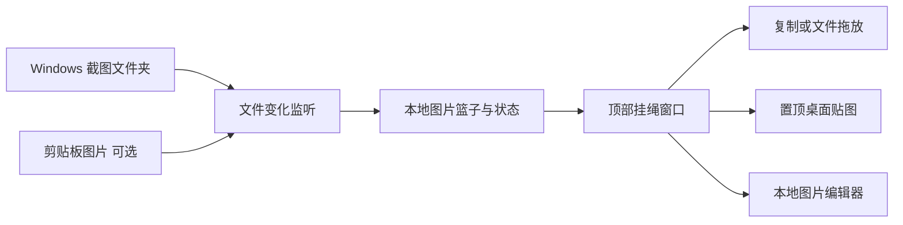

# PicRope（图绳）：Windows 截图挂绳、复制与桌面贴图

收录日期：2026-10-26

最近核实：2026-10-26（Asia/Shanghai）

研究状态：原视频项目已识别，功能与实现已按官方 README、固定提交源码及发布记录核实；未在 Windows 实机运行

## 一句话结论

视频展示的是 [Renly1994/PicRope](https://github.com/Renly1994/PicRope)，中文名“图绳”：将截图收进本地图片篮子并挂在屏幕上沿，支持点击复制、拖拽取用、置顶贴图及本地编辑。它是 Windows 10/11 64 位工具，参考了 macOS 项目 Tendedero；Mac 用户应查看上游的 Mac 版本。[S1][S2][S3][S8]

## 原始线索

- 用户原始短链：[https://v.douyin.com/z9gkJJIz0as/](https://v.douyin.com/z9gkJJIz0as/)。
- 已解析完整视频：[https://www.douyin.com/video/7700797693073718761](https://www.douyin.com/video/7700797693073718761)，作品 ID `7700797693073718761`。
- 作者：小确教你用ai。标题开头：“GitHub宝藏截图浏览工具，截图随手挂桌面”。
- 页面元数据发布时间：2026-10-26 10:28:05（Asia/Shanghai，`create_time=1792981685`）。分享口令“08/16 :8pm”不作为发布日期。
- 实际读取：网页标题、正文与视频元数据，下载完整 32.233 秒视频，以每秒一帧查看全时段画面及烧录字幕；没有单独转写音轨，也没有将素材阅读当成软件实测。
- 普通详情 API 返回 HTTP 403，移动分享页显示“抱歉出错了”；正常浏览器页面随后返回对应作品的详情与媒体，本轮据此取得视频。未绕过验证码。[S1]

| 视频时段（约） | 实际可见内容 | 证据含义 |
| --- | --- | --- |
| 00:00–00:04 | Windows 桌面上沿显示多张截图；字幕“截图完成，直接挂绳上” | 作者演示了截图暂存界面 |
| 00:05–00:11 | 从上沿拖动截图到目标应用；字幕介绍写文档、教程与参考图 | 支持原帖所说的拖拽取用，但不能证明所有应用都兼容 |
| 00:12–00:16 | 图片编辑界面，随后重新出现顶部挂图 | 作者展示了编辑流程 |
| 00:17–00:22 | 豆包安装示例；画面明确写出 `Renly1994/PicRope` | 已确认原视频对应的仓库，未以相似工具替代 |
| 00:23–00:28 | AI 回复称“PicRope · 图绳 v1.1.0 已安装成功”，列出 Windows/.NET/WebView2 条件 | 安装成功是作者画面中的回复，不能代替本轮实测 |
| 00:29–00:32 | 桌面 PicRope 图标，字幕提示双击运行 | 展示应用入口 |

原帖正文还宣称：鼠标靠近上沿展开、离开自动隐藏，全屏时自动收起。这些行为另由源码和官方 README 交叉确认。[S1][S2][S5]

## 技术实现

### 截图从哪里进入

`CapturePipeline.cs` 使用 `FileSystemWatcher` 监听截图目录的新增、变更及重命名，并排队读取图片。目录与剪贴板来源通过内容指纹及 `CaptureReceipts` 去重；关闭自动挂图时，新截图进入篮子，之后可以手动挂上。[S4]

`Win+PrtScn` 会把截图保存为文件，符合默认目录监听路径。`Win+Shift+S`、普通 `PrtScn`、微信 `Alt+A` 等截图若只进入剪贴板，需要在托盘“剪贴板收集 → 图片”打开收集；此选项默认关闭。剪贴板序列号变化触发检查，代码筛选纯图片格式后把 PNG 内容保存到本地收集目录。[S2][S4]

`Core.cs` 将程序旁的 `data` 作为默认数据根目录，保存设置、收集副本与状态。绳子最多保留最近 50 张图片的展示记录；超出的图片仍保留在本地和图片篮子，不能把这理解为“自动删除旧截图”。[S2][S4]

### 顶部挂绳与桌面贴图

`ShelfWindow.cs` 创建置顶的 WPF 窗口，周期检查鼠标位置：靠近屏幕上沿时展开，离开后按状态收起。`WindowsNative.FullScreen` 检查前台窗口与显示器范围，挂绳据此在全屏时隐藏；这是当前代码的判断方式，未测试各类游戏、无边框窗口或多显示器组合。[S5]

复制操作同时写入图片格式与文件列表，便于目标应用选择可接收的数据。拖拽使用 Windows/WPF 的 `DataFormats.FileDrop` 和 `Copy | Move` 效果，因此目标应用决定最终复制、导入或移动行为。README 说明移动完成后会自动取下图片。[S5]

单击夹子可把图片取下为独立贴图；`PinnedImageWindow.cs` 使用 `Topmost=true`，处理拖动位置及滚轮缩放；贴图上沿的图钉可将图片放回绳子。[S2][S5]

### 图片编辑是本地组件

编辑器由 C# 宿主中的 WebView2 与随包提供的 Filerobot Image Editor 4.9.1 组成。`ImageEditorWindow.cs` 将本地 `editor` 目录映射到虚拟域名，用图片 PNG 数据启动编辑器，通过 WebView2 消息接收结果；代码阻止编辑器加载该本地来源以外的资源和新窗口。[S3][S6]

官方说明支持画框、箭头、文字、裁剪与旋转。GIF、TIFF 等多帧图片只编辑第一帧，模糊和像素化作用于整张图片。项目包含这些编辑功能，不应由视频的 AI 标签推断它具有 AI 图像分析或 OCR。[S2][S6]

### 更新与网络范围

图片处理在本机完成，但 PicRope v1.1.0 包含联网检查更新：`AppUpdates.cs` 访问本仓库 GitHub Releases，读取正式版发布信息并检查下载大小、SHA-256 与程序版本。不能因此描述为“应用完全不联网”。本轮核实的是代码与发布结构，没有执行更新或验证故障恢复。[S2][S7]

| 关键判断 | 证据状态 | 来源 |
| --- | --- | --- |
| 原视频项目为 PicRope · 图绳 | 视频 00:17–00:22 明示仓库，README 名称吻合 | S1、S2 |
| 默认监听 Windows 截图文件夹，剪贴板图片需另行开启 | 官方步骤及 CapturePipeline 源码核实 | S2、S4 |
| 可自动隐藏、复制、拖放和置顶贴图 | 视频部分演示；源码和 README 核实 | S1、S2、S5 |
| 内置本地编辑器，依赖 WebView2 | 固定提交源码及 NOTICE 核实 | S3、S6 |
| 支持 Windows 10/11 x64、.NET Framework 4.8 | README、构建与安装入口核实 | S2、S7 |
| 发一句话给豆包就一定能安装成功 | 原作者的演示，依赖本地电脑能力与环境，未普遍验证 | S1 |
| PicRope 在 Mac 上可直接运行 | 当前发布物及 WPF 实现不支持此结论；Mac 应看上游 Tendedero | S7、S8 |

## 相关项目与资料

主项目：[Renly1994/PicRope](https://github.com/Renly1994/PicRope)。本轮固定源码提交 `4ce1694fdc4588de7209f27d7dafbaa53eb90bc1`，提交说明为“发布 PicRope 1.1.0：图片篮子、文字信封与应用内更新”。最新 release 是 [v1.1.0](https://github.com/Renly1994/PicRope/releases/tag/v1.1.0)，发布时间 2026-10-20，包含 Windows x64 安装 ZIP、源码 ZIP 和 `SHA256SUMS.txt`。[S2][S7]

实际 `LICENSE` 正文为 **MIT，覆盖源代码**；其附加名称与图标说明不授予上游 Tendedero 名称、图标的使用权，修改或再分发版本应使用不同名称和图标并避免声称获得上游背书。`NOTICE` 明确这是独立社区 Windows 移植，使用 PicRope 的独立名称与图标，并列出 Filerobot 与 WebView2 的第三方许可。GitHub API 将该许可显示为 `NOASSERTION`，本报告依据已读取的许可原文说明范围。[S3]

### 与上游 Tendedero 比较

PicRope 的 README 和 NOTICE 明确指向 [alejandrobujan/tendedero](https://github.com/alejandrobujan/tendedero)，不是根据相似界面猜出的关联。NOTICE 记录的上游参考提交为 `db65d2ea84ba5120b4ed90acce2b457d4ad18c4b`；本轮另读取 Tendedero 当时的 `32a3e47187fdea7b2fd43b3ab5a913f0ed33724a` README 和许可，两个快照不混同。[S3][S8]

| 维度 | PicRope · 图绳 | Tendedero |
| --- | --- | --- |
| 系统 | Windows 10/11 64 位 | macOS 14+，Apple silicon 与 Intel |
| 实现 | C#、WPF、Windows 系统接口；WebView2 编辑器 | 官方 README 列出 Swift、AppKit、SwiftUI，系统 Markup 编辑 |
| 核心用途 | 截图挂绳、篮子、复制、拖放、置顶贴图、文字信封 | 截图挂绳、复制、拖放，官方文档还列出屏幕录制与裁剪 |
| Star 快照 | 87 | 2,535 |
| 许可 | 源代码 MIT；继承上游名称与图标说明，独立品牌 | 源代码 MIT；名称和图标不包含在授权内 |
| 本轮验证 | 读取原视频、README、源码和安装入口；未运行 | 读取 README、许可与仓库元信息；未安装或测试 |

Star 为 2026-10-26 的查询快照，不代表性能或稳定性。Windows 按原视频选 PicRope；Mac 可以直接研究上游 Tendedero。原视频没有展示运行 Mac 上游版本。[S7][S8]

## 复现路径

**根据已读取的官方文档与安装/构建入口整理，未实际运行。当前研究主机为 macOS，未启动 Windows 虚拟机或安装任一应用。**

1. 在 Windows 10/11 64 位环境准备 .NET Framework 4.8；图片编辑需要 Microsoft Edge WebView2 Runtime。
2. 从本仓库 v1.1.0 Release 下载 `PicRope-1.1.0-windows-x64.zip`，完整解压；按发布的 `SHA256SUMS.txt` 核对下载文件。本轮没有下载或校验该 Windows 安装包。
3. 查看安装入口后运行 `Install.cmd`。本轮已静态读取该入口：调用 `install.ps1`，检查文件及 .NET 版本，复制程序到用户的 `%LOCALAPPDATA%\Programs\PicRope`，创建桌面快捷方式、登记卸载信息并启动程序。[S7]
4. 先用 `Win+PrtScn` 保存一张测试截图，检查它自动进入图片篮子/挂绳；再用 `Win+Shift+S` 测试剪贴板图片。后者需先开启托盘中的图片收集。
5. 依次验证顶部显示与隐藏、单击复制、拖到文档应用、夹子取下为置顶贴图、滚轮缩放，以及长按进入本地编辑器。拖放需对实际使用的目标应用分别测试。
6. 验证图片篮子与挂图的区别：用“取下放篮子”保留图片；× 或“移到回收站”会删除图片文件并同步去掉记录。先用测试图检查这些行为，避免将“隐藏”误当作“删除”。[S2][S5]
7. 重启后检查图片和设置是否保留；超过 50 张时验证旧图仍能在篮子取用；全屏与多显示器按实际设备验收。

Mac 路径：Tendedero 官方 README 提供从 Release 下载 DMG、拖入 Applications 的方式；也提供 Homebrew cask。首次可选择接管系统截图设置，该项目说明退出或关闭此选项时恢复原设置。本轮没有执行安装或改变本机截图设置。[S8]

| 验收项 | 可判断成功的标准 |
| --- | --- |
| 文件截图 | 新文件进入篮子，自动挂图设置开启时出现于绳子 |
| 剪贴板截图 | 收集关闭时不新增，开启后新复制图片进入记录 |
| 取用 | 点击后目标应用可粘贴；拖放按目标应用预期导入 |
| 贴图与编辑 | 置顶窗口可拖动缩放；编辑后结果回到本地文件 |
| 收起策略 | 顶部唤出、鼠标离开和全屏切换符合配置与实际窗口环境 |
| 留存 | 重启后记录保留，取下与删除行为可区分，旧图可从篮子重新取用 |

## 适用场景与限制

适合写文档、准备教程、频繁粘贴截图和对照界面/参考图。重点是减少在截图目录、图片查看器和目标应用之间切换。源代码的文件与剪贴板链路支持这类本地工作流，程序无需将图片上传才能完成编辑。[S2][S4][S6]

当前正式包仅 Windows x64；WebView2 缺失会影响编辑器。图片文件拖拽效果取决于目标应用；GIF/TIFF 只编辑第一帧；绳子展示 50 张与历史存储不是同一限制。开启剪贴板文字收集后，文字在本机持久保存；该开关与图片收集独立且默认关闭。[S2]

视频中的豆包用于协助安装项目，不是 PicRope 的运行依赖。仓库已读取的主功能不依赖 LLM；本轮未发现能支撑“AI 截图识别、OCR、自动写文档”的一手证据。AI 安装回复中的“全部验证通过”仅按作者画面记录，没有转述为我方检查结果。[S1][S4][S7]

## 待核实事项

- Windows 实机下不同 DPI、多显示器、全屏/无边框窗口与目标应用拖放兼容性。
- 原作者豆包安装过程的完整操作日志、下载校验和机器环境；视频不是完整安装录像。
- 本机性能、持续运行的内存/CPU、超过 50 张图片的实测表现及更新异常恢复。
- 本轮未运行 PicRope 或 Tendedero，以上软件功能核实基于文档、视频画面和源码。

## 来源与证据

| 编号 | 来源与链接 | 发布日期 | 查阅日期 | 支持的结论 |
| --- | --- | --- | --- | --- |
| S1 | [小确教你用ai：原视频](https://www.douyin.com/video/7700797693073718761)、[读取摘要](evidence/source-extract.md) | 2026-10-26 10:28:05 +08:00（元数据） | 2026-10-26 | 项目对应关系、展示效果、读取时段与边界 |
| S2 | [PicRope 固定 README](https://github.com/Renly1994/PicRope/blob/4ce1694fdc4588de7209f27d7dafbaa53eb90bc1/README.md) | 固定提交 2026-10-20 | 2026-10-26 | 系统、操作、功能、50 张展示记录与留存规则 |
| S3 | [LICENSE](https://github.com/Renly1994/PicRope/blob/4ce1694fdc4588de7209f27d7dafbaa53eb90bc1/LICENSE)、[NOTICE](https://github.com/Renly1994/PicRope/blob/4ce1694fdc4588de7209f27d7dafbaa53eb90bc1/NOTICE) | 同 S2 提交 | 2026-10-26 | MIT 范围、名称图标、移植关系、编辑器依赖 |
| S4 | [CapturePipeline.cs](https://github.com/Renly1994/PicRope/blob/4ce1694fdc4588de7209f27d7dafbaa53eb90bc1/src/CapturePipeline.cs)、[Core.cs](https://github.com/Renly1994/PicRope/blob/4ce1694fdc4588de7209f27d7dafbaa53eb90bc1/src/Core.cs) | 同 S2 提交 | 2026-10-26 | 文件监听、剪贴板、去重、本地状态与展示数量 |
| S5 | [ShelfWindow.cs](https://github.com/Renly1994/PicRope/blob/4ce1694fdc4588de7209f27d7dafbaa53eb90bc1/src/ShelfWindow.cs)、[WindowsNative.cs](https://github.com/Renly1994/PicRope/blob/4ce1694fdc4588de7209f27d7dafbaa53eb90bc1/src/WindowsNative.cs)、[PinnedImageWindow.cs](https://github.com/Renly1994/PicRope/blob/4ce1694fdc4588de7209f27d7dafbaa53eb90bc1/src/PinnedImageWindow.cs)、[App.cs](https://github.com/Renly1994/PicRope/blob/4ce1694fdc4588de7209f27d7dafbaa53eb90bc1/src/App.cs) | 同 S2 提交 | 2026-10-26 | 顶部显示、全屏隐藏、复制、拖放、置顶与回收站 |
| S6 | [ImageEditorWindow.cs](https://github.com/Renly1994/PicRope/blob/4ce1694fdc4588de7209f27d7dafbaa53eb90bc1/src/ImageEditorWindow.cs)、[editor.js](https://github.com/Renly1994/PicRope/blob/4ce1694fdc4588de7209f27d7dafbaa53eb90bc1/src/editor/editor.js) | 同 S2 提交 | 2026-10-26 | WebView2、图片数据、本地编辑和资源加载范围 |
| S7 | [v1.1.0 Release](https://github.com/Renly1994/PicRope/releases/tag/v1.1.0)、[build.ps1](https://github.com/Renly1994/PicRope/blob/4ce1694fdc4588de7209f27d7dafbaa53eb90bc1/build.ps1)、[Install.cmd](https://github.com/Renly1994/PicRope/blob/4ce1694fdc4588de7209f27d7dafbaa53eb90bc1/packaging/Install.cmd)、[install.ps1](https://github.com/Renly1994/PicRope/blob/4ce1694fdc4588de7209f27d7dafbaa53eb90bc1/packaging/install.ps1)、[AppUpdates.cs](https://github.com/Renly1994/PicRope/blob/4ce1694fdc4588de7209f27d7dafbaa53eb90bc1/src/AppUpdates.cs)、[仓库元信息](https://api.github.com/repos/Renly1994/PicRope) | release 2026-10-20 | 2026-10-26 | 包、版本、x64/.NET、安装动作、更新与 Star 快照 |
| S8 | [Tendedero README](https://github.com/alejandrobujan/tendedero/blob/32a3e47187fdea7b2fd43b3ab5a913f0ed33724a/README.md)、[LICENSE](https://github.com/alejandrobujan/tendedero/blob/32a3e47187fdea7b2fd43b3ab5a913f0ed33724a/LICENSE)、[仓库元信息](https://api.github.com/repos/alejandrobujan/tendedero) | 固定到查阅时 main，逐段发布日期未确认 | 2026-10-26 | 官方上游、Mac 平台、功能对照、许可与 Star 快照 |

## 更新记录

- 2026-10-26：从抖音原视频画面确认 PicRope · 图绳，读取固定源码与发布记录，补充上游比较、Windows/Mac 边界及未实测的复现验收路径。
