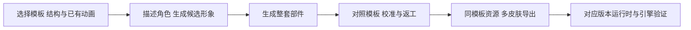

# Tooliva AI：模板驱动的 Spine 角色生成与多皮肤导出

收录日期：2026-10-26

最近核实：2026-10-31（Asia/Shanghai）；原视频的历史读取范围保留 2026-10-26 时点。

研究状态：2026-10-26 原视频已读取；2026-10-31 重新读取 Tooliva 工作台与官方教程，新增视频未取得正文或媒体、与 Tooliva 的对应关系待核实。未执行生成、导出或引擎导入。

## 一句话结论

原视频展示的是 **Tooliva AI 的 Spine 模板工作台**。官方说明先选定已有部件结构与动作的模板，再用 AI 生成角色形象、整套部件，经过校准/返工后导出。教程明确的多皮肤资源包是共享 JSON、Atlas 和各皮肤 PNG；视频正文宣称的“.spine 源文件”尚未取得文件验证。它不是已被证明能从任意图片自动发明骨骼和全部动作的一键工具。[S1][S2][S3]

上段「原视频」指已于 2026-10-26 读取的作品。**2026-10-31 的新分享还不能确认是哪一个产品**，下方单独说明本轮读取情况；不会把同作者、相似标题视为产品归属已经核实。

## 2026-10-31 新线索与本轮复核

用户继续提供同作者的 [新短链](https://v.douyin.com/pv8XkhA5D7I/)，跳转确认 [作品 7702771710579199241](https://www.douyin.com/video/7702771710579199241)。分享文本署名「开发工程师彭飞」，截断标题是「用 AI，把角色创意变成 Spine 动画 有了角...」。完整标题、正文、准确发布日期和所用产品未取得；口令 `06/24 :1pm` 不作为发布日期。

本轮依次尝试短链网页、本机原生抖音详情接口、移动分享页和带已有 cookie 的独立 Chrome 浏览器上下文。短链解析成功，详情接口没有返回 `aweme_detail`，浏览器只有「视频数据加载中」，没有视频地址。**没有下载或观看新视频，也没有读取到其字幕。** 先把这条材料作为同作者的 Spine 制作关联线索归入现有专题，索引备注明确产品关系待确认；确认是其他工具后再按实际实体拆分。

本轮的可核实结果来自另行打开的一手资料：[证据摘要](evidence/2026-10-31-source-extract.md)、[公开信息与读取状态快照](evidence/2026-10-31-research-snapshot.json)。

- **Tooliva 的模板合同仍然成立。** 当前工作台引导写明「模板决定部件结构和已有动画」。界面选中「黑铠巨刃斗士」，显示 7 个动作、44 个部件；模板画面仍提示加载中，因此只确认显示文字，没有确认动画已渲染，也没有清点全库。[S10]
- **官方教程仍说明形象、部件、校准、返工和多皮肤导出。** 其步骤是选模板 → 生成候选角色 → 生成整套部件 → 对照动画校准 → 修正变换/镜像/Warp/分割边界 → 部件返工或增加武器款式 → 导出共享 JSON、Atlas 与各皮肤 PNG。教程描述不等于本轮完成了生成或导出。[S11]
- **普通切图、序列帧和骨骼动画要按资产类型选择。** Tooliva 官方文章明确说切片 ZIP 不等于已绑定的 Spine 工程，拆成多个完整姿势 PNG 与拆成手臂、躯干等部件的用途不同；缺少的遮挡画面和关节连接需要另外处理。[S12]
- **本轮补充一个提供代码及 Claude Skill 的候选。** `GenielabsOpenSource/spine-animation-ai` 当时 616 stars；其部件定位、骨骼 JSON 和已有骨骼换肤流程可直接查源码，但采用 **PolyForm Noncommercial 1.0.0**，商业用途需要另行许可。它是比较对象，不是新视频所用工具的已确认映射。[S13]

### 本轮新增同类比较：Spine Animation AI

核实提交：[`702b71689cac826efee942ee4564fef9560d6ef8`](https://github.com/GenielabsOpenSource/spine-animation-ai/commit/702b71689cac826efee942ee4564fef9560d6ef8)，提交日期 2026-08-26 UTC；616 stars 为本轮 GitHub 采样，后续会变化。[S13]

实际源码区分两种起点：[S14]

1. **从角色图/部件开始。** `split_character.py` 可调用 Gemini 生成拆分图集，再用 OpenCV 连通区域分割得到部件；已有透明部件时可以跳过这一段。`position_parts.py` 用 SIFT 特征、FLANN 匹配和 RANSAC 相似变换求位置、缩放和旋转，小部件匹配失败时退到多尺度模板匹配，再根据重叠区与参考图的颜色接近程度计算显示顺序。源码对顺序采用得分排序；不把 README 的「拓扑排序」文字当成实际实现。`build_spine_json.py` 按输入的骨骼、slots、attachments 和动作配置生成声明为 Spine `4.2.0` 的 JSON，内置 idle、walk、run、wave、jump、attack，并允许自定义时间轴。它需要骨骼配置和验收，不能据此证明任何输入都自动得到正确绑定。
2. **从已有 Spine 骨骼开始。** `reskin-app` 打开 JSON/Atlas/PNG，使用 Gemini 重绘外观、分割遮罩并重打包皮肤，沿用原骨骼。其文档要求 Gemini API key 和可达的 SAM-3 分割服务；当前 `pipeline.py` 还区分 atlas 与 exploded 合成路径。文档中的完整换肤结果未在本机运行，不承诺缺少服务时仍可完成同样效果。

| 路线 | 起点与输出 | 已确认的区别 | 本轮实测范围 |
| --- | --- | --- | --- |
| Tooliva | 选模板，生成角色部件，导出 JSON/Atlas/PNG | 模板决定结构与已有动作，提供网页校准与返工 | 当前界面文字和官方教程；未创建任务 |
| Spine Animation AI | 角色图或分件 + 参考/骨骼配置；生成 Spine 4.2 JSON、图集及预览 | 有可查看的 Python 脚本和 Claude Skill；非商业许可，部分路径需要模型/分割服务 | README、许可、相关脚本；未运行 |
| God Mode AI | 官网宣称单图分层、自动绑定，导出 Spine 3.5–4.2 JSON/Atlas/PNG 或视频 | 另一在线候选；产品宣称的通用绑定不能作为 Tooliva 的能力 | 本轮重新读取官网；未生成或导出 |

Tooliva Spine 工作台没有确认的开源实现和 stars，不能数值比较「哪个比它星数更高」。本轮检索到的 616-star 项目更适合研究本地制作流程；是否适合项目取决于输入结构、运行结果、模型依赖和实际许可。两种在线产品也没有经过同图质量对照。[S13–S15]

**输出验收仍需实际文件。** Spine 官方文档区分 Import Project 与 Import Data；可导入的骨骼 JSON 不等于原生 `.spine` 工程。当前重新读取的 JSON 文档要求骨骼、slots、skins、animations 等数据；运行时使用还有独立 Spine 授权合同。此前未验证的 `.spine` 原生工程、导出版本与引擎兼容性仍然待核实。[S16]

## 原始线索

- 用户短链：[https://v.douyin.com/UTegETrqLhc/](https://v.douyin.com/UTegETrqLhc/)。
- 完整视频：[https://www.douyin.com/video/7700928072992882555](https://www.douyin.com/video/7700928072992882555)，作品 ID `7700928072992882555`。
- 作者：开发工程师彭飞；标题：“Ai一键生成Spine动画”。正文宣称支持游戏引擎、可导出 spine 源文件，并带 `ToolivaAi` 标签。
- 实际页面发布时间：2026-10-26 18:54:00（Asia/Shanghai，`create_time=1793012040`）。分享口令“07/23 :2pm”不作为发布日期。
- 实际读取范围：网页标题、正文和元数据，完整下载 44.581 秒视频，查看覆盖全时段的逐秒画面及烧录字幕；未单独转写音轨。

| 时段（约） | 实际展示 | 能支持的判断 |
| --- | --- | --- |
| 00:00–00:07 | 字幕“已经有了42个Spine动画模板”及作品列表 | 42 是作者当时的数量说法，未逐项核验库规模 |
| 00:08–00:24 | 近期用户角色/特效作品 | 产品作品展示，不能证明任意素材均达到同样效果 |
| 00:25–00:44 | 已有狮子角色切换 attack、die、get_hurt、idle 等动作 | 已有资源具备多个可预览动作；没有完整的新角色生成或导出过程 |

本轮随后打开 Tooliva 官网及 Spine 工作台，读取模板预览、引导、官方完整图文教程与定价页。实际选中模板显示“橙光重装机器人”、5 个动作、29 个部件；这是本次看到的单个模板，不等于视频全部模板的参数。[来源摘要](evidence/source-extract.md)

## 技术实现

### 模板与 AI 的分工

工作台引导直接说明“模板决定部件结构和已有动画”。官方教程要求先确认体型、持物方式和动作，再创建资源、填写形象与风格描述、选择形象数量。确认候选形象后生成整套部件；任务异步执行，任务记录区分形象图和完整图集任务。[S2][S3]

因此，**已经核实的是复用模板结构和动画、生成与替换角色外观的工作流**。服务端模型名称、训练方法、自动分割/骨骼映射算法未公开核实；不能由“一键”推断它对任意姿态图片都能从零完成通用自动绑定。

### 为什么还需要修正

教程提供模板与生成角色并排预览，检查头部、四肢、武器的方向、大小与连接位置。细节调整包括变换、水平/垂直镜像、Warp；轮廓错误可用钢笔选区修正分割范围。图像内容本身不合适时，可针对选定部件返工，也可以生成新的武器款式，再检查持握与动作方向。[S3]

这说明制作过程包含人工验收和修正，并非只下载首个 AI 结果即可用于游戏。相同模板下的多个已完成资源可设置不同皮肤名，共用骨骼/动画资源导出多皮肤包；“模板重用”与“生成新动作”是不同能力，本轮没有验证后者。

### 输出是什么

官方多皮肤教程明确记录：共享 JSON、Atlas 与各皮肤 PNG。Spine 官方文档说明骨骼 JSON 含 bones、slots、skins、animations 等数据，配合图集和贴图才能在运行时显示，不能把任意带 `.json` 的文件视为 Spine 骨骼数据。[S3][S5]

Spine 编辑器可通过 **Import Data** 导入相应 JSON/二进制数据，也可通过 **Import Project** 导入另一个 Spine 工程。两种文件不是同一个概念；获得可导入 JSON 不等于获得原生 `.spine` 工程。视频未展示下载内容，本轮也未导出，因此 `.spine`、二进制 `.skel`、Atlas 参数和导出版本列表仍待实物验证。[S1][S5]

### 引擎接入条件

Unity 官方运行时是 `spine-unity`，支持加载并控制 Spine 动画。Godot 官方文档提供 GDExtension 或自定义引擎模块，并列出 skeleton `.spine-json`/`.skel`、`.atlas` 和 PNG 贴图；当前文档对 JSON 扩展名与图集 Alpha 有具体要求。实际集成应按导出数据版本、运行时版本和目标引擎配置分别验证。[S6]

使用官方 Spine Runtimes 还涉及其独立许可证与 Spine Editor License；购买 Tooliva 服务或获得 AI 图片不会自动替代运行时授权。Cocos 在原视频正文中出现，但本轮未在 Cocos 导入，不能把“支持各种引擎”写成三平台验收已经通过。[S6][S7]

| 关键判断 | 证据状态 | 来源 |
| --- | --- | --- |
| 原视频为 Tooliva AI Spine 工作流 | 标签、界面与实际官网工作台/教程交叉核实 | S1–S3 |
| 模板决定部件结构与已有动画 | 工作台引导明确说明 | S2 |
| 支持 AI 形象、整套部件、校准/返工和多皮肤导出 | 官方教程已全文读取，未执行任务 | S3 |
| 已有 42 个模板 | 原作者时点宣称，未做库清点 | S1 |
| 可以直接获得 .spine 原生工程 | 原正文宣称，实际文件未取得 | S1、S3 |
| 所有引擎均可直接导入且可商用 | 范围过宽，需文件、版本、素材与运行时许可分别核对 | S5–S7 |

## 相关项目与资料

产品入口：[Tooliva AI](https://toolivaai.com/)，[Spine 工作台](https://toolivaai.com/ai-studio/spine-workbench)。本轮主入口实际跳到 `/ai-studio/?__aiStudioPath=...` 并显示工作台；旧候选域名 `gametools.toolivaai.com` 重定向到主页。以实际导航入口为准，未尝试绕过登录或收费限制。

本轮没有找到可确认就是此 Spine 工作台的开源仓库或代码许可证。检索到的 [ChinaCaesar/Tooliva](https://github.com/ChinaCaesar/Tooliva) README 指向同域下 `tool.toolivaai.com`，描述 Tauri/Rust 桌面媒体工具，其已列功能及目录检索未给出这个 Spine 工作台的实现；不能据此把线上 Spine 产品写成已开源。[S8]

定价页面月度视图在查阅时显示 Starter US$5、Creator US$19.99、Pro US$35.99；Starter 列出 Spine 工作台使用，Creator/Pro 列出积分优惠与自定义部件上传。免费试用不等于所有 Spine 生成与导出无限制免费；教程要求生成前核对按钮所需积分，本轮未测量单次费用或付款。[S4]

### 同类路径对照

| 方案 | 已读取的相关能力 | 用途与区别 |
| --- | --- | --- |
| Tooliva AI | 固定模板、AI 角色/部件、校准、多皮肤 JSON/Atlas/PNG | 适合已有模板动作能满足需求的角色外观制作 |
| [God Mode AI](https://www.godmodeai.co/) | 官网宣称单图 auto-rig，可导出 Spine 3.5–4.2、WebM、GIF | 类似目标的另一在线候选；本轮只读产品页，未做生成/质量比较 |
| [Mesh Avatar Studio](../2026-10-26-mesh-avatar-studio/README.md) | 已收录的插画绑定与自有 .mavatar 运行时 | 网格头像/直播方向，不是已确认的 Spine 导出替代 |
| [Spine 官方流程](https://en.esotericsoftware.com/spine-import) | 编辑骨骼/动画与相应数据导入 | 适合需要明确控制工程和版本的制作与验收 |

God Mode AI 的导出范围只是其官方页面说明，不作为 Tooliva 的能力或实测结果。本条没有可靠的工作台开源代码和 Star 数，不编造 GitHub 项目来填补。[S9]

## 复现路径

**基于实际读取的官网和教程整理，未上传用户素材、创建任务、购买服务、导出文件或在引擎运行。**

1. 打开 Spine 工作台，浏览模板并切换动作。先检查体型、视角、持物方式和所需 idle/run/attack 等动作；选择与目标角色接近的模板。
2. 在满足账号及积分条件后创建资源，填写名称、角色风格/配色和候选数量。记录模板、生成费用和任务 ID；选择满意形象后生成整套部件。
3. 查看异步任务状态，分别确认形象图与完整图集成功，再用模板/生成角色并排预览检查连接、朝向、透明边缘、穿插和缺失部件。
4. 用变换、镜像、Warp 与分割选区校准；必要时针对具体部件返工。新增武器款式后需测试动作全过程的持握，而非只看静止外观。
5. 把待导出的资源标为已完成；多皮肤选择同一模板下的完成资源，设置唯一皮肤名，导出后清点 JSON、Atlas、PNG。如果实际包含 `.spine`，另检查它能否由目标版本编辑器打开。
6. 读取骨骼数据版本、动画与皮肤名，验证 Atlas 区域能对应贴图；分别在目标 Spine 编辑器、Unity/Godot/Cocos 的相应运行时导入。一个网页预览成功不能替代引擎运行验证。

| 验收项 | 成功标准 |
| --- | --- |
| 生成与任务 | 候选及部件任务有成功状态，输出与指定模板/风格对应 |
| 动画质量 | 各动作无缺件/错误朝向/明显穿插，循环和武器位置正常 |
| 多皮肤包 | 皮肤名唯一，JSON/Atlas/PNG 引用完整，切换皮肤不丢附件 |
| 源工程 | 若宣称 .spine，则实际存在并可在声明版本中打开/编辑 |
| 引擎运行 | 目标版本可导入、切换动作/皮肤并打包运行，纹理/Alpha 正常 |
| 复现记录 | 模板、服务版本、积分与文件校验信息有记录，避免仅引用推广文本 |

## 适用场景与限制

适合模板动作符合需求的 2D 角色换装、怪物外观和同骨骼多皮肤制作。自定义骨骼、完全新的动作、与模板显著不同的体型和高要求变形质量仍需另行验证；官网教程提供的校准步骤本身就说明可能存在需要修正的生成结果。

代码、服务、用户输入、模板和生成素材有各自使用条件。本轮未确认作品库里全部角色可商用，也没有下载其完整图集。Spine 骨骼数据与序列帧图集是不同输出，即使都有 PNG/JSON，也不能在引擎里用同一种导入方式。[S3][S5]

## 待核实事项

- 2026-10-31 新视频的正文、演示范围与所用工具；目前只有分享文本和作品 ID，不确认它就是 Tooliva。
- Spine Animation AI 本地流程的输出质量、模型/分割服务可用性及商业许可；本轮只读代码，不以 README 演示替代运行。
- 实际单皮肤/多皮肤包、原生 .spine 文件、目标版本与在 Unity/Godot/Cocos 的运行结果。
- AI 模型、服务器处理和分割/映射实现；当前未取得工作台源码。
- 模板数量、每个模板支持的动作、单次积分、免费试用与导出权限。
- 新图的成功率、耗时、校准工作量，以及模板/作品素材的明确使用许可。

## 来源与证据

| 编号 | 来源 | 日期与本轮支持的结论 |
| --- | --- | --- |
| S1 | [彭飞原视频](https://www.douyin.com/video/7700928072992882555)、[来源摘要](evidence/source-extract.md) | 发布 2026-10-26；实际视频范围、42 模板说法与动作预览 |
| S2 | [Tooliva 首页](https://toolivaai.com/)、[工作台](https://toolivaai.com/ai-studio/spine-workbench) | 查阅 2026-10-26；产品对应、模板结构/已有动画与实际预览 |
| S3 | [官方图文教程](https://toolivaai.com/zh/tutorials/spine-workbench-guide)、[视频教程说明页](https://toolivaai.com/zh/tutorials/spine-workbench) | 查阅 2026-10-26；生成、校准、返工、多皮肤 JSON/Atlas/PNG；未播放官方教程视频 |
| S4 | [价格页](https://toolivaai.com/pricing) | 查阅 2026-10-26 的月度视图；套餐和积分范围快照 |
| S5 | [Spine Import](https://en.esotericsoftware.com/spine-import)、[JSON 格式](https://en.esotericsoftware.com/spine-json-format) | 查阅 2026-10-26；数据与工程区别、骨骼/皮肤/动画结构 |
| S6 | [spine-unity](https://en.esotericsoftware.com/spine-unity)、[spine-godot](https://en.esotericsoftware.com/spine-godot) | 查阅 2026-10-26；运行时、Godot 文件及版本集成条件 |
| S7 | [Spine Runtimes License](https://en.esotericsoftware.com/spine-runtimes-license) | 页面更新 2025-04-05，查阅 2026-10-26；独立运行时授权 |
| S8 | [Tooliva 桌面工具 README](https://github.com/ChinaCaesar/Tooliva/blob/2d5bb4f821ba04923211561c67b2376808350886/readme.md) | 查阅 2026-10-26；另一个同品牌桌面工具，非已确认的 Spine 工作台源码 |
| S9 | [God Mode AI 官网](https://www.godmodeai.co/) | 查阅 2026-10-26；相似在线产品的官方宣称，未实测 |
| S10 | [Tooliva 当前工作台](https://toolivaai.com/ai-studio/spine-workbench) | 重新读取 2026-10-31；引导仍明确模板结构与已有动画，单个模板文字为 7 动作/44 部件；图像加载未完成 |
| S11 | [当前官方图文教程](https://toolivaai.com/zh/tutorials/spine-workbench-guide) | 重新全文读取 2026-10-31；形象、部件、校准、返工、多皮肤 JSON/Atlas/PNG |
| S12 | [AI 切图与 Spine 分件](https://toolivaai.com/zh/blog/seo-ai-sprite-cutting-vs-spine-parts) | 页面日期 2026-10-17，查阅 2026-10-31；动作帧与部件不同，切片不等于骨骼绑定 |
| S13 | [Spine Animation AI README](https://github.com/GenielabsOpenSource/spine-animation-ai/blob/702b71689cac826efee942ee4564fef9560d6ef8/README.md) · [LICENSE](https://github.com/GenielabsOpenSource/spine-animation-ai/blob/702b71689cac826efee942ee4564fef9560d6ef8/LICENSE) · [仓库 API](https://api.github.com/repos/GenielabsOpenSource/spine-animation-ai) | 核实提交 2026-08-26 UTC，查阅 2026-10-31；616 stars、Claude Skill、非商业许可 |
| S14 | [split_character.py](https://github.com/GenielabsOpenSource/spine-animation-ai/blob/702b71689cac826efee942ee4564fef9560d6ef8/scripts/split_character.py) · [position_parts.py](https://github.com/GenielabsOpenSource/spine-animation-ai/blob/702b71689cac826efee942ee4564fef9560d6ef8/scripts/position_parts.py) · [build_spine_json.py](https://github.com/GenielabsOpenSource/spine-animation-ai/blob/702b71689cac826efee942ee4564fef9560d6ef8/scripts/build_spine_json.py) · [Reskin README](https://github.com/GenielabsOpenSource/spine-animation-ai/blob/702b71689cac826efee942ee4564fef9560d6ef8/reskin-app/README.md) · [pipeline.py](https://github.com/GenielabsOpenSource/spine-animation-ai/blob/702b71689cac826efee942ee4564fef9560d6ef8/reskin-app/app/backend/reskin/pipeline.py) | 查阅 2026-10-31；部件定位、模板动作、4.2 格式转换、已有骨骼换肤与依赖 |
| S15 | [God Mode AI 当前官网](https://www.godmodeai.co/) | 重新读取 2026-10-31；产品宣称单图分层/绑定，JSON/Atlas/PNG 及 Spine 3.5–4.2 导出，未实测 |
| S16 | [当前 Spine Import](https://en.esotericsoftware.com/spine-import) · [JSON 格式](https://en.esotericsoftware.com/spine-json-format) · [Runtimes License](https://en.esotericsoftware.com/spine-runtimes-license) | 重新读取 2026-10-31；工程与数据区别、结构字段、独立运行时合同；许可页更新日期 2025-04-05 |

## 更新记录

- 2026-10-26：读取原视频与官网工作台/教程，确认模板生成和多皮肤流程，记录源工程、代码和引擎实测缺口。
- 2026-10-31：保留原条目与旧来源；新增同作者 Spine 分享作为待核实关联线索，记录新视频读取失败；重新查阅当前工作台、官方教程与 Spine 文档，补充 616-star Spine Animation AI 的代码路径和非商业许可比较。目录条目数不增加。
