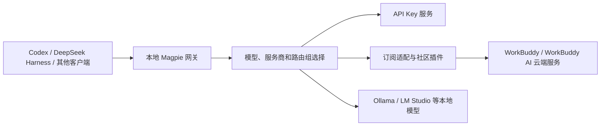

# Magpie：多 Agent 本地模型网关与 WorkBuddy 插件

收录日期：2026-10-27

最近核实：2026-10-27，Asia/Shanghai；GitHub 数据为当晚查阅快照。

研究状态：部分核实。原图文全文和全部配图已读取，网关、客户端配置和 WorkBuddy 插件实现已核对；未安装运行 Magpie，未调用任何账号的模型或核验积分扣费。

## 一句话结论

Magpie 把多个 AI 客户端接到同一个本地模型网关，再转给 API 服务、订阅账号或本地模型。原作品介绍的 WorkBuddy 请求转发有对应实现，但“token 自由”不能理解为无限额度：模型能力、价格、积分和账号可用性仍由上游决定。[S1][S2][S5][S6]

## 原始线索

- 用户原始短链：[https://v.douyin.com/rv4Cbts0aqA/](https://v.douyin.com/rv4Cbts0aqA/)。
- 解析后的同一作品：[https://www.douyin.com/note/7701321273133139547](https://www.douyin.com/note/7701321273133139547)。平台 ID：`7701321273133139547`。
- 作者：**Kk-AI**。发布时间：**2026-10-27 20:19:50，Asia/Shanghai**，来自页面 `createTime=1793103590`，分享口令中的 `08/30` 不作为发布日期。
- 实际读取范围：跟随短链访问图文页面，从页面内公开渲染数据读取完整 `desc`、作者、发布时间与图片列表；下载并视觉检查全部 **1 张、580 × 170** 配图。本素材是图文作品，未以“观看视频”描述此次读取。
- 原文宣称：Magpie 在本地转发请求，接入“wb cb”，其他智能体把 base URL 指向它，再使用每日积分中的模型；作者将其概括为“基本可以实现 token 自由”。原文还建议让 AI 桌面助手下载安装，本轮仅将这句话作为作者建议记录。
- 配图内容：左侧 **DeepSeek Harness、Codex**，中间 Magpie 鸟形标志，右侧 **WorkBuddy**，表现客户端到上游的路由关系；图中没有真实响应、用量读数或 GitHub 地址。
- 项目匹配：`yetone/magpie` 的名称、标志、路由结构及支持名单与素材一致，是高置信对应项目。原文没有写出 owner/repo 和版本，无法凭这一张图确认作者的具体安装版本、插件或真实调用结果。[S1][S2]

## 技术实现

### 1. 一个本地入口，兼容多种模型协议

Go 网关默认监听 `127.0.0.1:3425`。客户端传入消息、模型标识、工具定义及流式选项；网关根据服务商与路由组选择上游，适配请求和响应。源码注册了下列接口，README 说明它们之间的转换包含流式内容、工具调用和推理字段。[S2][S3]

| 客户端接口 | 网关入口 | 用途 |
| --- | --- | --- |
| 模型目录 | `GET /v1/models` | 读取已接入服务商的模型，获得实际模型 ID |
| OpenAI Chat Completions | `POST /v1/chat/completions` | 常见 OpenAI 兼容客户端 |
| OpenAI Responses | `POST /v1/responses` | Responses 客户端，例如 Codex 的相关调用 |
| Anthropic Messages | `POST /v1/messages` | Anthropic 格式客户端，例如 Claude Code |
| Gemini | `POST /v1beta/models/{call...}` | Gemini 原生请求 |

图中 WorkBuddy 路径的推理发生在其云端。“本地”指网关运行位置；只有选到本地模型服务时，推理才相应发生在本地。某种协议的入口存在，也不意味着每个上游模型都支持其所有能力。[S2][S6]

特别是普通 `/v1/responses` 的 WebSocket 升级，当前源码明确返回 `426`，要求使用 HTTP POST 和 SSE；不能把“支持 Responses”泛化成该入口完整支持 WebSocket。[S3]

### 2. 配置管理和转发分工

Magpie 的另一部分工作是识别已安装客户端、把所选模型和网关地址写到各自配置中，而非让所有工具共享一个配置格式。官方参考和源码列出：[S4][S7]

| 客户端 | 配置位置 | 实际作用 |
| --- | --- | --- |
| WorkBuddy | `~/.workbuddy/models.json`，支持 `WORKBUDDY_CONFIG_DIR` | 把 Magpie 模型放进 WorkBuddy 自己的选择器 |
| WorkBuddy AI | `~/.workbuddy-ai/models.json` | 国际版客户端的独立配置 |
| CodeBuddy Code | `~/.codebuddy/models.json` 与 `settings.json`，支持 `CODEBUDDY_CONFIG_DIR` | 提供模型列表，并设置会话使用的模型 |

这里存在两种方向：**WorkBuddy/CodeBuddy 作为客户端使用其他上游模型**，以及 **WorkBuddy 的套餐作为上游供其他客户端调用**。前者是配置适配，后者是订阅/插件适配。不能因为支持 CodeBuddy 客户端，就推断多了一个独立的“CB 免费积分池”。原作者的 `wb cb` 没有进一步展开，报告不替作者扩写账号关系。[S1][S4][S5][S6]

### 3. 当前 WorkBuddy 上游由社区插件提供

在核对的 Magpie commit 中，`internal/provider/workbuddy.go` 明确标记 WorkBuddy 和 WorkBuddy AI 为 **PLUGIN-SERVED**：原内置登录、模型、请求和用量实现已经迁到社区插件，保留下来的代码负责迁移旧账号、签到等配套逻辑。`migrate_workbuddy.go` 指向 `@magpie-community/opencode-workbuddy-auth`，当前最低版本 **0.1.39**；插件包快照也是 **0.1.39**。[S5][S6]

该插件区分国内版 `workbuddy` 与国际版 `workbuddy-ai`，分别连接各自服务端。插件支持浏览器登录、读取桌面登录标记及服务商自己的 API Key；其文档同时说明 WorkBuddy **5.6+** 桌面凭据加密后无法继续按旧路径读取，应改用浏览器登录。不同版本不能直接套用旧教程。[S6]

请求主要走上游 Chat Completions；国内版部分 Claude 模型另走 Anthropic Messages，而国际版没有相同 Messages 路径。插件包含模型目录读取、登录刷新、参数和工具结构适配、用量查询。文档中的某些成功样本和模型能力来自插件维护者的测试，本轮没有复测这些模型。[S6]

### 4. 额度调度改善利用率，仍有真实上限

Magpie 的路由组支持按顺序、轮换、剩余额度或重置时间等策略选择模型/账号，遇到可切换的失败时尝试其他资源。只有一个账号且没有替代路由时，上游错误仍会交给客户端。[S2]

WorkBuddy 相关实现读取积分、套餐及到期信息；国内版签到可以从用量页面或 `magpie accounts checkin` 发起。签到需要验证码时，文档要求在服务商应用中完成，不会自动解决验证码。[S6][S7]

插件另有默认关闭的 **Free models only**：打开后只列出当前可判定免费的模型，付费模型请求在本地被拒绝；价格无法读取时也不转发。源码对应 `free_only`、价格缓存和 `notFree()`。这个开关说明“接入套餐”“有赠送积分”“选择免费模型”是不同事情。[S6]

| 关键判断 | 证据状态 | 来源 |
| --- | --- | --- |
| 存在多协议本地网关和客户端配置适配 | 已核实到文档、代码；运行效果未复测 | S2、S3、S4 |
| WorkBuddy 可作为其他客户端的上游 | 已核实到插件实现；账号可用性未实测 | S5、S6 |
| 当前接入已迁到社区插件 | 已核实；最低插件版本 0.1.39 | S5、S6 |
| 原图展示 Codex、DeepSeek Harness 到 WorkBuddy 的路由 | 已读取配图；成功调用未由该图证明 | S1 |
| “基本可以实现 token 自由” | 作者宣称；没有无限额度证据 | S1；S2、S6 展示额度和失败边界 |
| 每日能领多少积分、扣费倍率及长期可用性 | 未核实 | 缺少该作者账号与服务商实时用量证据 |

## 相关项目与资料

### Magpie 的版本与源码入口

- 仓库：[yetone/magpie](https://github.com/yetone/magpie)，**MIT**，查阅快照 **23,475 stars**。
- 核对代码 commit：`e54a7d50b94899cf5b8c51206f6a893eab06b20e`。关键入口为 `internal/gateway/gateway.go`、`internal/agent/workbuddy.go`、`internal/agent/codebuddy.go`、`internal/provider/workbuddy.go` 和 `internal/provider/migrate_workbuddy.go`。
- 查询到的最新发行版：**v0.1.1744**，发布于 `2026-10-27T15:48:31Z`。代码快照与 Release 查询是两项记录，本轮未确认二者源码完全对应。[S8]
- 该版 Apple Silicon DMG 为 **26,005,772 字节**，约 **26.0 MB**；引用旧网页的“小于 15 MB”描述前应另核对具体版本和制品。[S8]
- `go.mod` 声明 **Go 1.26.8**，依赖 Wails v3、Bubble Tea 等；这与桌面界面、TUI 和 Go 网关的实现相符。使用预编译包与从源码编译的依赖门槛不同。[S2][S3]
- 社区插件仓库：[magpie-community/plugins](https://github.com/magpie-community/plugins)，**MIT**，查阅快照 **145 stars**；核对 commit `2ef8b8b5ef53edab888727d088a5973388d92a00`，WorkBuddy 包版本 **0.1.39**。[S6]

### 更高 Star 的相近项目

比较范围是“本地模型接入、配置切换、请求转发”，这些项目不是原作者配图中的软件。Star 仅是 **2026-10-27 当晚的热度快照**，不代表兼容性测试通过。[S9][S10][S11]

| 项目 | Stars 快照 / 许可证 | 重合能力 | 选择时的差异 |
| --- | --- | --- | --- |
| [Magpie](https://github.com/yetone/magpie) | 23,475 / MIT | 多 Agent 配置、多协议网关、订阅和插件、额度路由 | 本次素材的对应项目；已读到明确的 WorkBuddy 上游插件与迁移实现 |
| [CLIProxyAPI](https://github.com/router-for-me/CLIProxyAPI) | 56,614 / MIT | 将 CLI/订阅接成兼容 API；多账号、工具、流式输出、Go SDK | 偏 API 服务与嵌入式代理；本轮所读 README 没有明确的 WorkBuddy 专用支持，不能承诺直接替代该路径 |
| [CC Switch](https://github.com/farion1231/cc-switch) | 149,328 / MIT | 桌面配置管理、本地路由、协议转换与故障切换 | 偏集中管理配置和桌面使用；普通官方订阅与路由模式有边界，文档特别列出 Codex 官方账号例外；本轮未读到 WorkBuddy 专用接入证据 |

如果目标就是把 WorkBuddy 上游接给 Codex 等工具，Magpie 的专用插件与本次需求更贴近；如果目标是提供兼容 API 服务，可继续评估 CLIProxyAPI；如果主要需求是管理配置与桌面切换，可评估 CC Switch。三者都不因更高 Star 而获得额外上游额度。[S2][S6][S9][S10]

## 复现路径

**以下基于已读取文档和源码整理，未实际运行。** 本轮没有安装 Magpie、读取主机已有订阅凭据、更改客户端配置或发起真实模型请求。

1. 从 [固定版本 Release](https://github.com/yetone/magpie/releases/tag/v0.1.1744) 选择对应系统和架构的制品，按该版本 `SHA256SUMS` 核对下载。预编译桌面包优先；源码构建需满足其 `go.mod` 和平台依赖。[S8]
2. 启动应用，在 **Providers** 添加准备使用的上游。复现原作品路径时，按 **Plugins / From plugins** 添加 WorkBuddy，核对包为 `@magpie-community/opencode-workbuddy-auth` 且版本满足当前代码要求。参考文档列出的命令是 `magpie plugin add workbuddy`；插件首次使用需要 Bun，由 Magpie 获取。[S5][S6][S7]
3. 选择与账号对应的国内版或国际版，完成插件提供的登录流程；WorkBuddy 5.6+ 桌面加密登录按文档使用浏览器流程。用实际返回的模型目录选择模型，不把显示名称直接当作 API ID。[S6]
4. 在 **Agents** 页给已安装的 Codex / DeepSeek Harness 等客户端选择上游，按其配置要求新开会话。其他 OpenAI 兼容客户端可将 base URL 指向 `http://127.0.0.1:3425/v1`；Anthropic 客户端使用其对应根地址，不能把两种拼接规则混用。[S2][S4]
5. 先读取 `GET /v1/models` 确认目录，再发送一个短的流式请求；`model` 使用目录返回的准确 ID。参考文档中的本机网关占位 key 为 `magpie`，不是上游的 API Key。[S2][S3]
6. 对 Agent 场景验证一个工具调用及工具结果回传；核对路由详情中的实际服务商、模型、账号，再对照上游用量记录。普通文本成功不足以证明工具循环、长上下文和计费都正确。[S6]

可判断成功的标准：客户端收到完整流式结束事件；工具调用的参数与结果能完成一轮循环；路由指向预期上游；相同请求能在上游记录中找到。积分扣费量只有拿到对应账单/用量后才能确认。需要测试路由切换时可临时停用一个路由成员，观察是否切到配置的替代成员，不必通过耗尽真实额度来验证。[S2][S6]

## 适用场景与限制

- **适用**：多个 AI 客户端共用模型服务；在 API Key、订阅和本地模型之间切换；集中观察路由、额度和用量；用 WorkBuddy 插件接入已具备权限的账号。[S2][S6]
- **上游能力仍有差异**：国内/国际版不同，协议、模型 ID、工具参数、登录方式会变化。插件文档包含真实的认证失败、模型请求被拒绝、账号限制和额度不足分支，不能从一张路由图推广到任意账号与客户端。[S6]
- **本地网关仍会转发输入**：云端上游接收转发的上下文。Magpie 的隐私遮罩默认关闭；开启后才按其规则处理，文档也列出识别和占位符对任务的影响。[S2]
- **配置和账号管理会影响使用**：应用可写客户端配置并发现订阅登录。部署到实际工作环境前应选择所需服务商和客户端，按文档决定是否开启订阅账号发现。[S2][S4]
- **免费与计费分开判断**：MIT 与免费软件不等于模型免费；签到积分、套餐窗口、限时模型与价格信息均会变化。未取得账单不能给出“零成本”或“无限调用”的结论。[S6][S7]
- **没有本轮性能数字**：未测吞吐、首 token 延迟、稳定性、长任务成本或跨客户端行为。插件维护者的测试结果在文档中有上下文，不作为本轮实测。[S6]

## 待核实事项

1. 原作者的具体 Magpie 版本、插件配置，以及 `wb cb` 是否指同一套餐关系；原文与配图没有提供这些信息。
2. 实际账号的每日积分、到期窗口、模型列表、价格倍率，以及通过网关后的逐请求扣费。
3. 原图路线的真实成功响应与工具调用结果；本轮完整读图文和静态代码，没有实际运行链路。
4. CLIProxyAPI、CC Switch 的 WorkBuddy 专用兼容性。本轮仅比较所读一手文档，不把 README 未提及当作永久不支持。
5. 官网 `/zh/` 此次访问超时，只取得部分 HTML；实现判断以已完整读取的 GitHub 文档和代码为依据。

## 来源与证据

下表全部于 **2026-10-27** 实际读取；GitHub 源码尽量固定到本轮 commit。各项目的文档、源码及社区插件属于关联的一手实现证据，不能当作多个独立产品实测。证据摘要见 [research_snapshot.json](research_snapshot.json)。

| 编号 | 来源与链接 | 发布日期 / 版本 | 支持的结论 |
| --- | --- | --- | --- |
| S1 | [Kk-AI 抖音原图文](https://www.douyin.com/note/7701321273133139547) | 2026-10-27 20:19:50 +08:00 | 完整原文、作者、1 张路由配图、作品 ID |
| S2 | [Magpie 中文 README](https://github.com/yetone/magpie/blob/e54a7d50b94899cf5b8c51206f6a893eab06b20e/README.zh-CN.md) | 本轮代码快照 | 网关定位、多协议、路由策略、配置和隐私默认值 |
| S3 | [网关源码](https://github.com/yetone/magpie/blob/e54a7d50b94899cf5b8c51206f6a893eab06b20e/internal/gateway/gateway.go)、[go.mod](https://github.com/yetone/magpie/blob/e54a7d50b94899cf5b8c51206f6a893eab06b20e/go.mod) | 同上 | 默认地址、接口注册、普通 Responses WebSocket 边界、技术依赖 |
| S4 | [WorkBuddy 客户端适配](https://github.com/yetone/magpie/blob/e54a7d50b94899cf5b8c51206f6a893eab06b20e/internal/agent/workbuddy.go)、[CodeBuddy 适配](https://github.com/yetone/magpie/blob/e54a7d50b94899cf5b8c51206f6a893eab06b20e/internal/agent/codebuddy.go) | 同上 | 客户端配置路径与写入模型列表的分工 |
| S5 | [WorkBuddy 内置迁移说明](https://github.com/yetone/magpie/blob/e54a7d50b94899cf5b8c51206f6a893eab06b20e/internal/provider/workbuddy.go)、[迁移代码](https://github.com/yetone/magpie/blob/e54a7d50b94899cf5b8c51206f6a893eab06b20e/internal/provider/migrate_workbuddy.go) | 同上；最低插件 0.1.39 | 上游由插件提供，原内置实现退役 |
| S6 | [WorkBuddy 插件 README](https://github.com/magpie-community/plugins/blob/2ef8b8b5ef53edab888727d088a5973388d92a00/packages/workbuddy/README.md)、[index.mjs](https://github.com/magpie-community/plugins/blob/2ef8b8b5ef53edab888727d088a5973388d92a00/packages/workbuddy/index.mjs)、[package.json](https://github.com/magpie-community/plugins/blob/2ef8b8b5ef53edab888727d088a5973388d92a00/packages/workbuddy/package.json) | 0.1.39；维护者部分样本日期 2026-10-24 | 登录、国内/国际版协议、动态模型、积分、Free models only 与失败边界 |
| S7 | [官方参考文档](https://github.com/yetone/magpie/blob/e54a7d50b94899cf5b8c51206f6a893eab06b20e/docs/reference.md) | 本轮代码快照 | 客户端路径、插件命令、Bun、签到和验证码处理 |
| S8 | [Magpie v0.1.1744 Release](https://github.com/yetone/magpie/releases/tag/v0.1.1744) | 2026-10-27 15:48:31 UTC | 当前发行版、制品名称和实际大小 |
| S9 | [CLIProxyAPI README](https://github.com/router-for-me/CLIProxyAPI/blob/ad8bdd3f20bef44f0684b8a6096a216b2c76040d/README.md) | 本轮代码快照 | 兼容 API、多账号、工具和 Go SDK 对比 |
| S10 | [CC Switch README](https://github.com/farion1231/cc-switch/blob/1718a26199e626bf8d4b20485ed4791192f1ebf7/README.md) | 本轮代码快照 | 配置管理、路由与协议转换、官方账号的路由边界 |
| S11 | GitHub 仓库元信息：[Magpie](https://api.github.com/repos/yetone/magpie)、[插件](https://api.github.com/repos/magpie-community/plugins)、[CLIProxyAPI](https://api.github.com/repos/router-for-me/CLIProxyAPI)、[CC Switch](https://api.github.com/repos/farion1231/cc-switch) | 2026-10-27 查阅快照 | Stars、许可证、仓库归属；不是性能或质量指标 |

## 更新记录

- 2026-10-27：首次收录。读取完整抖音图文与全部配图，核对 Magpie/WorkBuddy 插件的版本和实现，比较两个更高 Star 的相近项目；保留未实际运行、原作者版本及计费待核状态。
