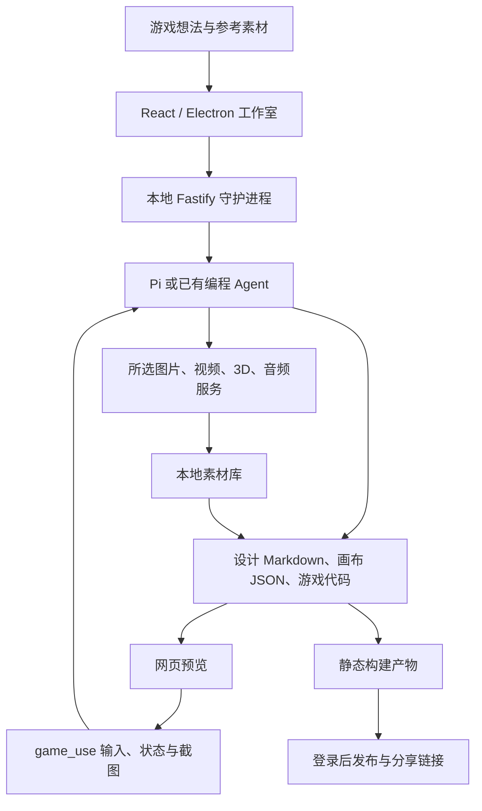

# OhMyGame：AI 游戏工作室与 beta 5 升级

收录日期：2026-10-30

最近核实：2026-10-30，Asia/Shanghai

研究状态：部分核实。官方仓库、发布记录、架构文档和关键代码已读取；原抖音视频媒体、完整标题及字幕未取得；应用及第三方模型调用未实际运行。

## 一句话结论

OhMyGame 把游戏设计、素材生成、编程、网页试玩和分享发布放在同一款本地应用中，以 Pi 或用户已有的编程 Agent 调用工具推进工作。当前发布版为 `v0.0.0-beta.5.0`，主要新增自由网页场景构成的互动故事，以及更完整的 Agent 和插件连接能力；适合先做小型网页游戏或互动剧情原型。[S2][S3][S4]

它的区别在于拥有设计画布、素材库、运行预览和实际试玩工具。源码证明这些能力存在，但本轮没有验证“一句话生成高质量商业游戏”的效果，也没有验证收益。Unity、Godot 等原生引擎项目目前不能直接使用网页游戏的 `game_use` 自动试玩链路。[S4][S5][S6]

## 原始线索

- 用户原始短链：[抖音分享](https://v.douyin.com/gl2zfm54JjA/)。
- 已解析规范链接：[视频 7702344031505879461](https://www.douyin.com/video/7702344031505879461)。短链经 `iesdouyin.com/share/video/…` 跳到此视频页面。[S1]
- 用户分享文本中的作者为 **Di Huang**，标题片段为 **“开源AI游戏工作室OhMyGame大升级 升级到B...”**。完整标题和作品发布日期没有取得；分享口令中的 `10/23` 不作为作品发布日期。
- 实际读取范围：分享文本、短链跳转及网页壳。已尝试本机接入的抖音下载器，结果为 1 条失败、0 条成功，未产生媒体文件；桌面和移动分享网页均未返回作品正文或媒体详情。因此没有声称观看视频，没有给出视频时间点。
- 作者主页显示 Di Huang 为 White Tower 创始人，正在开发 OhMyGame，并链接项目官网和 GitHub 账号 `dihuangdh`；官方 release 中也有该账号贡献记录。这支持项目归属，但不能补全视频中所有宣称。[S2][S3]
- 标题中被截断的 `B...` 不直接补写为 beta 5。以下 beta 5 内容来自本轮官方发布记录；是否正是原视频介绍的版本仍待核实。[S3]

## 技术实现

### 1. 本地界面与守护进程

React 界面通过本地 HTTP 和 SSE 与 Fastify 守护进程通信。开发模式中界面为 `127.0.0.1:43120`，守护进程为 `127.0.0.1:43110`；桌面版使用 Electron，守护进程使用可用的本地端口。项目、对话、预览和工具执行由守护进程管理。云端用于发布静态游戏产物和社区展示；提示词及媒体请求仍要发送到所选模型服务商。[S5][S8]



图中循环表示 Agent 根据一次工具返回的观察结果继续修改；不表示按每帧实时决策。

### 2. Agent、文件与素材工具

默认 Agent 来自 `@earendil-works/pi-coding-agent`；当前 `package.json` 固定 Pi 相关依赖为 `1.3.0`。项目的设计文档为 Markdown，画布采用 JSON 节点模型，网页游戏是普通 Web 项目。工作区附带规则与 Schema，让 Agent 用文件读写和编程工具修改，界面读取同一批文件。[S4][S8]

素材能力由工具及服务商适配器提供：图片、视频、3D 资产、动画、语音、音效和音乐各自需要对应服务。README 所称“40 多家服务商”属于官方支持范围说明，本轮没有逐一测试。**自带密钥不等于免费生成**：模型和媒体服务额度、费用及可用性由各服务商决定。[S4][S7]

### 3. 网页游戏试玩如何实现

`src/daemon/playtest-tools.ts` 定义 `game_use`，提供 `open / inspect / act / capture / close`。Agent 可点击、输入文字、按键、触摸、等待、改变视口，并得到 DOM、Canvas、控制台、失败请求和可选游戏状态；`capture` 返回图片给模型。[S5][S6]

当前实现通过私有 IPC 驱动 Electron 内的 Chromium 试玩窗口，访问项目的本地预览。单次 `act` 最多包含 20 个动作，按键和等待均有时长限制；工具按顺序执行，调用超时为 30 秒。README 注释明确试玩仍是“先规划一批输入、执行后看结果”的方式。因此应理解为分步试玩和回归检查，不把它描述成能够在任意动作游戏中实时反应的 AI 玩家。[S4][S5][S6]

确定性桥接可选地提供 `snapshot / reset / setSeed / step`，便于重复检查随机或时间相关逻辑。空白截图检测使用透明度和亮度方差启发式，不能单独证明画面正确或游戏好玩。[S5]

**范围限制：** `game_use` 需要 Electron 桌面进程。仅运行 `bun run dev` 的浏览器界面不会注册该工具。当前适配器支持 Web Game、升级后的 Interactive Story 和开启 Web 预览的 General Game；官方文档明确 Godot、Unity 原生项目尚无这一路运行时适配器。引擎编辑器连通与真实玩法验证是两项不同工作。[S5]

### 4. beta 5 的互动故事模型

Interactive Story 使用 Playable Nodes：每个场景都是包含图片、视频、音频和网页代码的可编程页面；节点负责画面与输入，Runtime 管理状态、跳转、存档、音乐等。节点发送 Signal，图中的 Edge 决定下一场景。菜单、对白、档案、谜题和小游戏是模板用途，不是固定节点类型。[S9]

`v0.0.0-beta.5.0` 于 **2026-10-29 10:56:03 UTC，即北京时间 18:56:03** 发布。release 还列出故事 Assets 页、39 场景《末班》示例、豆包 TTS 2.0 音色目录等更新；旧故事打开时会转换成 Web Story，旧 Story map 模板可能需要 Agent 重写。这些属于该版本的官方功能与迁移说明，本轮没有实际执行升级。[S3]

### 5. 两种连接已有 Agent 的方向

| 方向 | 谁负责对话与编程 | OhMyGame 提供的能力 |
| --- | --- | --- |
| 在 OhMyGame 内选 Claude Code、Codex 或 OpenCode | 所选 CLI，沿用其登录和原生会话 | 界面、画布、媒体、插件、撤销等 |
| 从外部 Agent 连接 OhMyGame | 外部 Agent 自己规划和写代码 | stdio MCP 工具与使用工作流的 Skill |

外部 MCP 列出项目工具、生成工具、画布检查和 `game_use`，通过 `ToolBridge` 复用内部处理逻辑。长媒体生成首次最多等待约 45 秒，未完成返回 job ID，再用 `wait_job / get_job` 获取结果。这样可以延续同一生成任务，减少因客户端超时而重复发起付费生成。外部 Skill 需要对应 MCP 服务才能获得工具能力。[S7][S10]

### 6. 发布与原生引擎插件

网页发布先生成静态构建产物，再登录并上传到 OhMyGame Cloud；重发更新同一个分享链接。源码中的 `LocalPublisher` 是开发调试用的本机快照，生命周期只覆盖当前守护进程会话，不能用它证明公网发布成功。[S4][S5][S11]

`beta.4.12` 发布记录已列出 Blender、Godot、Unity、Unreal Engine、Cocos Creator、Aseprite、Tiled、微信/抖音小游戏和 TapTap Maker 等可选 Beta 插件。因此这些连接并非都在 beta 5 首次出现，且仍需按各插件要求安装实际工具、引擎或平台 CLI。[S12][S13]

例如 Unity 插件先读取项目版本与包清单，使用官方 Unity CLI；实时编辑器控制需要 Unity 6.0 LTS 及以后和 `com.unity.pipeline`。旧版项目走已有批处理构建/测试路径。此处只是读取插件说明，没有安装插件或修改任何 Unity 项目。[S14]

| 关键判断 | 证据状态 | 来源 |
| --- | --- | --- |
| 当前公开发布版为 beta 5.0，许可证为 Apache-2.0 | 已核实元信息、发布记录、package.json 和许可证 | S3、S8、S15 |
| 有本地设计/素材/编程/预览工作室及试玩工具 | 已核实代码与文档；效果未实测 | S4、S5、S6 |
| 互动故事由自由网页场景、Signal 和状态 Runtime 构成 | 已核实文档模型；未运行 | S9 |
| Claude Code、Codex、OpenCode 可作为内部对话运行时 | 官方文档说明，未逐个实测 | S4、S10 |
| 外部 Agent 通过 MCP 调媒体、画布和试玩工具 | 已核实公开工具列表及 job 处理代码 | S7、S10 |
| Unity/Godot 编辑器连接即可使用同一套自动试玩 | 不成立；当前网页运行时适配器未覆盖原生项目 | S5、S14 |
| 一个人做游戏、上架后能赚钱 | 作者产品目标；本轮无收益证据 | S4 |
| 原视频介绍的精确版本和演示效果 | 待核实 | S1 |

## 相关项目与资料

### 官方项目快照

- 仓库：[WhiteTowerAI/ohmygame](https://github.com/WhiteTowerAI/ohmygame)。
- 本轮读取的发布分支 commit：`c30bfabda86c27084128deca5bc4bd0d4e9983eb`，版本 `0.0.0-beta.5.0`。
- GitHub 元信息快照：**1,368 stars、165 forks**，2026-10-30 查阅；后续会变化。[S15]
- 许可证：**Apache-2.0**，README 说明名称与标志不在该授权范围内；第三方模型、媒体和插件素材的权利需要分别确认。[S4][S16]
- 关键入口：`package.json`、`src/daemon/server.ts`、`src/daemon/playtest-tools.ts`、`src/daemon/external-mcp.ts`、`plugins/` 及 `docs/playable-nodes/`。[S5][S6][S7][S8][S9]

### 更高星数及相近功能的比较

比较限定为“AI 辅助游戏创作”，不用通用编程 Agent 的星数来代替具体游戏工作室能力。下表均实际读取对应官方 README 和仓库元信息；没有安装、执行或进行同任务性能比较。[S17][S18]

| 项目 | 2026-10-30 stars / 许可证 | 提供什么 | 与 OhMyGame 的区别及选择建议 |
| --- | --- | --- | --- |
| [OhMyGame](https://github.com/WhiteTowerAI/ohmygame) | 1,368 / Apache-2.0 | 桌面/网页界面、设计及素材画布、多类媒体服务、网页预览与试玩、发布连接 | 想集中制作小型网页游戏、互动剧情及多模态素材时，优先列为试用候选 |
| [Claude Code Game Studios](https://github.com/Donchitos/Claude-Code-Game-Studios) | 29,596 / MIT | Claude Code 项目模板，README 当前列出 49 agents、74 skills、15 hooks、14 rules，以及设计、开发、视觉验证、发布检查流程 | 星数明显更高，偏已有引擎项目的分工、规则和质量门槛；它不是同一类素材画布/托管发布应用，不能只凭星数判为全面替代 |
| [VibeGame](https://github.com/tettethu/VibeGame) | 286 / Apache-2.0 | Claude Code/Codex 多 Agent 框架，Phaser 2D 引擎与 Dashboard，包含从提示词到可玩游戏的流程 | 更适合研究 2D 自然语言到游戏的系统实现；README 路线图仍将 Godot、Unity 和端到端 3D 列为未完成，范围更窄 |

Claude Code Game Studios 的模板及视觉验证流程可作为长期工程组织的参考；作者关于测试游戏结果和文档成本的测量来自自己的 README，本轮没有复测。上述替代项目不作为原视频使用的组件，也不单独新增热点条目。[S17]

## 复现路径

**状态：基于已读官方资料和安装入口整理，未实际运行。** 本轮只进行了源码/文档读取和索引检查，没有安装 OhMyGame、调用模型、生成游戏或执行发布。

### 最小试用

1. 从官方 Releases 下载 macOS Apple silicon 或 Windows x64 桌面版。当前 README 将 Intel Mac / Linux 桌面包列在路线图中。[S4]
2. 设置一个语言模型服务商，或选择已有 Claude Code / Codex / OpenCode。生成正式媒体时再连接对应服务商。[S4]
3. 创建 **Web Game**，输入一个小范围需求，例如：“做一个能在桌面和触屏操作的 2D 接金币游戏，只做开始、移动、得分、失败和重开；先用简单图形验证玩法。”
4. 要求先保存设计文档，生成可玩的核心循环，再补素材；用 `game_use` 检查开始、移动、失败、重开以及窄屏显示，保留截图、控制台异常和实际测试结果。[S4][S6]
5. 验收通过后按官方发布流程登录并发布。用另一浏览器打开最终链接检查真实可玩性；只有读到发布结果并完成外部访问验证，才记录“发布成功”。[S4][S5]

最小成功标准：项目文件可保存并重开；核心输入与状态转换可操作；截图能看到玩法；关键路径无阻断异常；发布验收另需外部浏览器验证。素材美感、玩法趣味及商业价值需要后续人工评价。

### 从源码启动

工具链要求 **Bun ≥ 1.4.2、Node.js ≥ 22.19.0**。锁定本轮版本可使用以下入口；命令仅作为复现说明，本轮未执行：[S4][S8]

```bash
git clone --branch v0.0.0-beta.5.0 --depth 1 https://github.com/WhiteTowerAI/ohmygame.git
cd ohmygame
bun install --frozen-lockfile
bun run dev:desktop
```

`bun run dev` 可启动网页界面和守护进程，但自动试玩需要桌面版，不能用网页启动成功代替 `game_use` 验收。[S5]

已审查 `package.json` 和准备脚本：开发启动会准备预装插件与示例；其中会拉取锁定版本的额外 GitHub 仓库并校验。源码运行应在独立工作目录完成，依照所选功能准备网络与模型服务。此说明是运行前检查结果，不是应用已通过测试。[S8][S19]

## 适用场景与限制

- **适用：** 小型 Web Game、玩法原型、互动视觉小说/电影、设计与媒体素材集中管理，以及给已有 Agent 补充生成素材和网页试玩工具。[S4][S9][S10]
- **优先试网页链路：** 原生引擎插件需要实际引擎、CLI、版本和项目验证；没有文档依据将所有引擎宣称成同等成熟的全自动流程。[S5][S12][S14]
- **模型费用与质量：** 不按 OhMyGame 点数计费不意味着模型免费；复杂 3D、动画、音乐需要独立服务和额度，质量也受模型影响。没有本轮成本或速度 benchmark。[S4]
- **试玩能力：** 当前按批执行输入并观察，不能保证实时躲避、覆盖所有路径或自动评价游戏趣味。截图启发式也不是完整视觉判定。[S4][S5][S6]
- **发布与上架：** 分享发布需要登录；微信、抖音、TapTap、Steam 等商店的账号、审核和商业发行条件另行处理。工具连接和发布检查流程本身不证明审批通过或产生收入。[S4][S12]
- **版本迁移：** beta 5 包含旧故事转换及旧模板调整，旧项目要按 release 阅读迁移要求，本轮没有验证迁移无损。[S3]
- **隐私边界：** 项目与凭据存本地，但所选模型请求会离开本机；正式包的匿名遥测与崩溃报告、发布静态产物分别见官方说明，不能概括为“完全离线”。[S4]

## 待核实事项

1. 原抖音完整标题、作品发布日期、字幕、实际升级版本及演示时间点。
2. 桌面版的安装启动、生成质量、失败重试、模型成本和 `game_use` 试玩实际表现。
3. 官方公网发布的当前可用性，以及具体商店插件的上架与审核成功率。
4. Unity/Godot/Unreal 等原生项目在实际工具版本上的连接和验证覆盖。
5. beta 5 的旧故事升级及已有资产、存档、模板的迁移结果。

官方 README、文档、release 和代码来自同一项目，能互相核对功能定义与实现入口，不能当作独立第三方效果验证。作者主页主要用于归属核对，替代项目用于范围比较。

## 来源与证据

除 release 日期明确列出的来源外，文件的独立发布日期未知；以锁定 commit 作为查阅版本。所有查阅日期为 2026-10-30。

| 编号 | 来源与链接 | 发布日期或版本 | 查阅日期 | 支持的结论 |
| --- | --- | --- | --- | --- |
| S1 | [原抖音短链](https://v.douyin.com/gl2zfm54JjA/) / [规范视频页](https://www.douyin.com/video/7702344031505879461) | 未取得 | 2026-10-30 | 原始输入、跳转及视频 ID；未取得媒体或完整正文 |
| S2 | [Di Huang 主页](https://www.dihuang.me/) | 页面发布日期未知 | 2026-10-30 | White Tower 创始人与 OhMyGame 归属 |
| S3 | [beta 5.0 release](https://github.com/WhiteTowerAI/ohmygame/releases/tag/v0.0.0-beta.5.0) | 2026-10-29 | 2026-10-30 | 当前版本、互动故事更新与迁移说明 |
| S4 | [中文 README](https://github.com/WhiteTowerAI/ohmygame/blob/c30bfabda86c27084128deca5bc4bd0d4e9983eb/README.zh-CN.md) | 锁定 commit | 2026-10-30 | 产品能力、媒体服务、使用路径、费用和隐私边界 |
| S5 | [Runtime](https://github.com/WhiteTowerAI/ohmygame/blob/c30bfabda86c27084128deca5bc4bd0d4e9983eb/docs/runtime.md) | 锁定 commit | 2026-10-30 | 进程架构、试玩实现、适配器和发布范围 |
| S6 | [game_use 工具代码](https://github.com/WhiteTowerAI/ohmygame/blob/c30bfabda86c27084128deca5bc4bd0d4e9983eb/src/daemon/playtest-tools.ts) | 锁定 commit | 2026-10-30 | 操作种类、输入 Schema、20 动作限制及截图返回 |
| S7 | [外部 MCP 代码](https://github.com/WhiteTowerAI/ohmygame/blob/c30bfabda86c27084128deca5bc4bd0d4e9983eb/src/daemon/external-mcp.ts) | 锁定 commit | 2026-10-30 | 公开工具列表及 45 秒 job 等待逻辑 |
| S8 | [package.json](https://github.com/WhiteTowerAI/ohmygame/blob/c30bfabda86c27084128deca5bc4bd0d4e9983eb/package.json) | beta 5.0 | 2026-10-30 | Pi、React、Fastify、Electron、工具链和启动入口 |
| S9 | [Playable Nodes](https://github.com/WhiteTowerAI/ohmygame/blob/c30bfabda86c27084128deca5bc4bd0d4e9983eb/docs/playable-nodes/README.md) | 锁定 commit | 2026-10-30 | 自由网页节点、Signal、Edge 和 Runtime 分工 |
| S10 | [Agent runtimes](https://github.com/WhiteTowerAI/ohmygame/blob/c30bfabda86c27084128deca5bc4bd0d4e9983eb/docs/agent-runtimes.md) / [External agents](https://github.com/WhiteTowerAI/ohmygame/blob/c30bfabda86c27084128deca5bc4bd0d4e9983eb/docs/external-agents.md) | 锁定 commit | 2026-10-30 | 内部 CLI 与外部 MCP 连接的两种方向 |
| S11 | [LocalPublisher 代码](https://github.com/WhiteTowerAI/ohmygame/blob/c30bfabda86c27084128deca5bc4bd0d4e9983eb/src/daemon/publish/local.ts) | 锁定 commit | 2026-10-30 | 本地开发发布为会话内快照 |
| S12 | [beta 4.12 release](https://github.com/WhiteTowerAI/ohmygame/releases/tag/v0.0.0-beta.4.12) | 2026-10-22 | 2026-10-30 | 可选 Beta 插件及外部 MCP 在 beta 5 前已出现 |
| S13 | [Plugins](https://github.com/WhiteTowerAI/ohmygame/blob/c30bfabda86c27084128deca5bc4bd0d4e9983eb/docs/plugins.md) / [Beta 插件测试说明](https://github.com/WhiteTowerAI/ohmygame/blob/c30bfabda86c27084128deca5bc4bd0d4e9983eb/docs/plugin-beta-testing.zh-CN.md) | 锁定 commit | 2026-10-30 | 插件结构与引擎、工具测试门槛 |
| S14 | [Unity 插件说明](https://github.com/WhiteTowerAI/ohmygame/blob/c30bfabda86c27084128deca5bc4bd0d4e9983eb/plugins/unity/skills/unity-game/SKILL.md) | 锁定 commit | 2026-10-30 | Unity CLI、Pipeline 和项目版本要求 |
| S15 | [GitHub 仓库 API](https://api.github.com/repos/WhiteTowerAI/ohmygame) | 2026-10-30 快照 | 2026-10-30 | 1,368 stars、165 forks、仓库与许可证元信息 |
| S16 | [Apache-2.0 LICENSE](https://github.com/WhiteTowerAI/ohmygame/blob/c30bfabda86c27084128deca5bc4bd0d4e9983eb/LICENSE) | 锁定 commit | 2026-10-30 | 开源许可文本 |
| S17 | [Claude Code Game Studios README](https://github.com/Donchitos/Claude-Code-Game-Studios/blob/05ad7c8a5b8aa2aa86bbd3439ae7cf7295cac418/README.md) / [仓库 API](https://api.github.com/repos/Donchitos/Claude-Code-Game-Studios) | 05ad7c8；元信息为查阅快照 | 2026-10-30 | 更高星数的 Agent/Skill 模板及视觉 QA 范围 |
| S18 | [VibeGame README](https://github.com/tettethu/VibeGame/blob/fc9cbbe1f82c217b6d1946c00f51d309e584d826/README.md) / [仓库 API](https://api.github.com/repos/tettethu/VibeGame) | fc9cbbe；元信息为查阅快照 | 2026-10-30 | Phaser 2D 框架、Dashboard 与未完成路线图 |
| S19 | [插件准备脚本](https://github.com/WhiteTowerAI/ohmygame/blob/c30bfabda86c27084128deca5bc4bd0d4e9983eb/scripts/prepare-preinstalled-plugins.ts) / [示例准备脚本](https://github.com/WhiteTowerAI/ohmygame/blob/c30bfabda86c27084128deca5bc4bd0d4e9983eb/scripts/prepare-examples.ts) | 锁定 commit | 2026-10-30 | 开发启动拉取锁定附属仓库与校验 |

本轮必要元信息、版本及已下载证据文件哈希见同目录 [research_snapshot.json](research_snapshot.json)。不归档 Cookie、网页登录态或原始媒体。

## 更新记录

- 2026-10-30：首次收录；保留抖音短链与规范链接，核查当前 beta 5.0、关键源码、原生引擎边界及两项替代项目；原视频与应用运行均有明确未验证状态。
