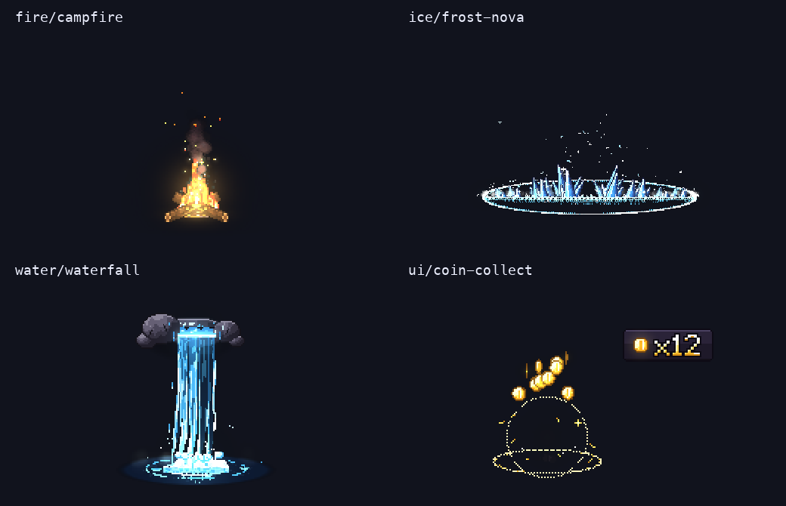

# pixelfx：244 个代码驱动像素特效与 Agent 制作流程

收录日期：2026-10-31

最近核实：2026-10-31，Asia/Shanghai；GitHub 数字采样于 18:05 左右。

研究状态：官方源码、许可和样例导出已核实；原抖音视频未读取成功。

## 一句话结论

`patch-gg/pixelfx` 把像素特效写成可修改、可重复渲染的 JavaScript 模块，配套 Claude Code Skill 和 PNG 图集导出工具。当前 **0.3.0 有 244 个效果、21 类，其中 12 个是完整招式**；适合浏览器游戏直接使用，也适合先生成图集再接入其他引擎。[S1–S4]

## 原始线索

- 用户短链：[https://v.douyin.com/Fy_L6_5nKBI/](https://v.douyin.com/Fy_L6_5nKBI/)。跳转确认作品 ID `7702725079376891177`，规范链接：[抖音作品](https://www.douyin.com/video/7702725079376891177)。
- 分享文本署名「代码侦探」，截断标题为「开源像素风游戏特效库 pixelfx：232 个像...」。完整标题、作品发布日期和正文未取得；分享口令里的 `02/22` 不作为发布日期。
- 实际读取范围：分享文本、短链跳转；复用本机原生抖音下载器的详情接口后，没有收到 `aweme_detail`，未取得媒体或字幕，不能声称看过原视频。
- 「232」与项目旧描述一致，但当前 README、目录、Skill 和 0.3.0 提交都已经更新为 244；新增的 12 个完整招式独立放在 `src/fx/moves/`。这是当前资料与分享文本的口径差异，不推断原视频发布时的版本。[S1–S4]

## 技术实现

输入是效果模块及配置，如坐标、调色板、方向、随机种子、发光强度和效果自己的参数。运行时生成像素与粒子，得到画面；离线工具则把这些画面编码成 PNG 图集和 JSON。[S2、S3]

1. **统一模块合同。** 每个效果在 `src/fx/<category>/<name>.js`，导出 `meta` 和 `draw(p, t, o)` 或 `create(o)`。目录实际枚举为 112 个直接按时间绘制的效果、132 个带模拟状态的效果，共 244 个。共享 `_lib.js` 排除在数量之外。[S2、S3；本轮枚举]
2. **两块像素缓冲。** `createFrame` 建立 `color` 与 `light` 两个 `Uint32Array`；前者存像素颜色及透明度，后者存叠加发光。`composite` 合成 RGBA，供 Canvas 显示或上传到游戏纹理。[S3]
3. **小步模拟和可重复结果。** `createFx.update(dt)` 将较大时间步拆成 120 Hz 或更细的小步；随机数使用种子。直接绘制的循环把时间取模，作者还提供循环接缝、越界、结束残留、随机性与绘制耗时检查。[S3、S4]
4. **角色动作也可编排。** 73 个模块带 `act`，包括 61 个涉及角色的效果和 12 个招式。`createAct` 加入前摇、姿势、命中停顿、震屏与靶子反应；姿势按 12 fps 节拍保持，粒子继续按运行帧率更新。`moves/fireball-throw` 把蓄力、火球飞行和爆炸串联。[S1–S3]
5. **导出保留动画信息。** 普通 `--sheet` 输出透明 PNG 和 Aseprite 风格 JSON，包括帧矩形、毫秒时长、帧率、循环、原点及动作时序。图集中的发光转换为带透明度的颜色，和实时双缓冲发光并不完全等价。[S2、S3]
6. **Skill 约束制作过程。** 它要求先找现成效果和参考，再做多个草稿、渲染、看图、修正，至少迭代三轮，最后运行检查。Skill 是 Agent 的工作方法；现有效果渲染本身不调用模型，也不需要图像生成服务。[S2、S5]

| 关键判断 | 证据状态 | 依据 |
| --- | --- | --- |
| 当前有 244 个效果、21 类、73 个带动作的模块 | 已核实 | README、0.3.0 提交及实际导入枚举 |
| 普通图集能导出透明 PNG 和有效帧坐标 | 已核实，限本轮四个样例 | 4 个图集逐帧验证，见下表 |
| 5 个样例通过官方检查 | 已实际运行 | 5 pass、0 fail、0 with warnings |
| Unity、Godot 的导入插件可直接消费这些文件 | 作者说明，未在引擎实测 | README 和 Skill；本轮只核对输出文件 |
| 可用一条提示词得到生产级像素动画 | 无证据 | 上游作者和 Skill 都强调参考、视觉判断与多轮修改 |
| 所有仓库资产均可按 MIT 使用 | 不成立 | 代码和效果是 MIT，网页展示字体另有声明 |

## 相关项目与资料

### 原项目与上游关系

- [patch-gg/pixelfx](https://github.com/patch-gg/pixelfx)：核实时 579 stars，包版本 `0.3.0`，提交 `a84159688af3ca37a4be05a0d422b94451b2e24e`，创建于 2026-10-30 UTC。代码和效果 MIT；`NOTICE.md` 明确说明部分算法改编自 Hugo Duprez / Sprite Fusion，动作播放方法参考 Hollow Crown。[S1、S4、S6]
- [Sprite Fusion Pixel Art VFX](https://www.spritefusion.com/pixel-art-vfx)：官网当时有 **25 个**开源效果，提供 TypeScript 源码、效果配方和 MCP 接入，官网说明这些效果按 MIT 可商用。它是 pixelfx 声明的上游参考，不是独立复核 pixelfx 数量的来源。[S7]
- [Hugo Duprez 的制作文章](https://www.spritefusion.com/blog/how-to-make-good-pixel-art-effects-with-claude)：发布日期 2026-10-28。建议先生成 5–10 个方向稿、看短视频、择优后持续修改，并借助游戏和艺术参考建立质量标准。[S8]

### 同类比较

先检索比较再收录。以下 stars 是本轮 GitHub 快照，随时间变化；星数高低不代替功能匹配。

| 项目 | 本轮 stars / 许可 | 侧重点 | 与 pixelfx 的关系 |
| --- | --- | --- | --- |
| [pixelfx](https://github.com/patch-gg/pixelfx) | 579 / MIT，字体例外 | 244 个可改代码的效果、Agent Skill、离线导出、角色动作 | 本条主项目，制作与接入门槛较低 |
| [Pixel Composer](https://github.com/Ttanasart-pt/Pixel-Composer) | **1,431** / MIT | 节点编辑、粒子、图像处理、时间轴与预览 | 更高星数的像素特效编辑器，适合美术直接调节点；需要自己的工程环境，未发现相同的内置 Claude Code Skill 合同 |
| [Sprite Fusion VFX](https://www.spritefusion.com/pixel-art-vfx) | 官方页面，无同一仓库 stars 口径 / 效果 MIT | 25 个效果、配方与 MCP，便于 Agent 找参考并移植 | 更适合对照上游效果质量和算法；不是比 pixelfx 更大的现成效果库 |
| [PixelGraphics](https://github.com/aarthificial/pixelgraphics) | 400 / MIT | Unity 互动植被 Shader，通过速度纹理和 emitter 响应物体 | 适合草木交互，范围更窄；README 只注明测试过 Unity 2020.2 PC/WebGL，不能当当前 Unity 版本兼容保证 |

Pixel Composer 的核实提交为 `9d4c9c679b705acac50815debde7ae41880684e2`，最新 GitHub Release 是 `1.21.0`，2026-04-28 发布；源码 README 指定 GameMaker IDE / runtime 版本，并列出可选收费扩展。PixelGraphics 核实提交为 `5d5d2dab89b2455f0ae33b7e15b8628d1f583551`。[S9、S10]

选择建议：想快速挑选、调色、接入现有效果，用 pixelfx；想让美术以节点持续制作效果，评估 Pixel Composer；想研究效果配方和 Agent 通过 MCP 读取效果，参考 Sprite Fusion。没有把近似项目当成视频作者实际使用的工具。

## 复现路径

**本轮已实际运行：** 在仓库 `.work/` 中克隆并审查入口，使用本机 Node `v24.16.0` 和 ffmpeg；没有安装 npm 依赖。现有渲染、检查与 PNG 导出仅使用 Node 标准库；本地图库的打包依赖 esbuild，本轮未启动或构建图库。[S2、S3]

可复现命令如下，执行前应核对目标提交和代码入口：

```bash
git clone https://github.com/patch-gg/pixelfx.git
cd pixelfx
git checkout a84159688af3ca37a4be05a0d422b94451b2e24e
node tools/render.mjs fire/campfire ice/frost-nova water/waterfall ui/coin-collect --sheet
node tools/check.mjs fire/campfire ice/frost-nova water/waterfall ui/coin-collect moves/fireball-throw
node tools/act.mjs moves/fireball-throw --sheet
node tools/act.mjs moves/fireball-throw --mp4 --scale 2
```

注意 `tools/act.mjs` 的 `--sheet` 和视频输出分开运行：该工具先处理图集分支，不会在同一次调用里继续生成 MP4。

| 已运行对象 | 输出帧数 | 单帧尺寸 | 结果 |
| --- | --- | --- | --- |
| `fire/campfire` | 90，30 fps，循环 | 128 × 128 | PNG/JSON 生成；RGBA 透明、全部帧矩形、文件名核对通过 |
| `ice/frost-nova` | 103，30 fps，单次 | 288 × 192 | 同上；带动作时序字段 |
| `water/waterfall` | 60，30 fps，循环 | 144 × 136 | 同上 |
| `ui/coin-collect` | 75，30 fps，单次 | 176 × 116 | 同上 |
| `moves/fireball-throw` 完整动作 | 图集 224 帧，30 fps；MP4 464 帧，60 fps | 图集单帧 368 × 256；视频 736 × 512 | PNG/JSON 和 7.733 秒 H.264 视频生成；**图集引用文件名不一致**，见下文 |

本轮官方 checker 对上述 5 个效果给出 `5 pass, 0 fail, 0 with warnings`。另行检查四个普通图集的图片尺寸、帧矩形、透明通道和 `meta.image`；记录文件哈希便于核对。查看了篝火和冰环的联系表、下方四个效果取样，以及完整招式视频按每秒抽取的关键帧；未声称完整观看视频，也没有对 244 个效果逐一验收。机器检查通过不能代替在实际场景中的视觉验收。



图像来自本轮源码渲染，不是原抖音截图。检查数据见 [research_snapshot.json](research_snapshot.json)。

**引擎接入仅依据资料整理，未实测：** 浏览器使用 `createFx` / `createAct`、按前后层绘制并合成；Unity、Godot 等优先导入 PNG/JSON，配置 nearest-neighbour、原点和帧率，按自己的角色动画对齐前摇与命中停顿。需要在暗、亮背景和目标分辨率下分别看效果，再决定是否导出变体。

## 适用场景与限制

- 适合为像素游戏补充篝火、流水、天气、收集反馈、升级、攻击命中等效果，也适合用已有算法制作变体。部分带角色的状态效果按照自带灰色角色绘制，使用自己的角色时需要重新生成或改代码。[S2、S5]
- **完整动作图集的小问题已实际发现。** `node tools/act.mjs moves/fireball-throw --sheet` 生成 `moves-fireball-throw.sheet.png`，但 JSON `meta.image` 写 `fireball-throw.png`。读取器按该字段定位图片时会失败；可把 PNG 改成该引用名，或把 JSON `meta.image` 改为真实 PNG 名。本轮只记录问题，没有修改上游源码。四个普通 `render --sheet` 样例无此问题。[S3；本轮输出]
- 实时路径在 CPU 生成像素；WebGL 游戏每帧上传纹理也有成本。作者检查器会提示慢帧，但本轮不是目标设备的并发性能测试，不能据此承诺大量效果同时运行的帧率。
- 图集把发光烘焙到颜色和透明度，亮背景下表现可能与双缓冲实时叠加不同，需要结合实际场景验收。[S3、S5]
- **许可范围具体到文件。** 代码和效果按 MIT 可修改、商用并分发，须保留版权和许可声明。`gallery/fonts/PatchPixel-Regular.woff2` 是作者自己的字体，声明 all rights reserved，不包含在 MIT 中；若复制网页图库，需另外处理字体。[S6]
- 官方 Skill 可供 Claude Code 加载，作者提供插件安装路径；本轮没有安装 Skill 到机器人，也没有测过 Agent 自动生成新效果、图库 UI、引擎导入插件或完整游戏接入。

## 待核实事项

1. 原视频的完整内容、演示时间点和发布日期仍不可得；有关当前实现的结论来自官方资料和本轮运行。
2. 244 个效果的全量视觉质量、多个种子与配置组合、低端设备性能未验收。
3. Unity/Godot 的实际导入、角色替换和亮背景下的发光效果未验证。
4. 完整动作导出 JSON 引用问题是否已在后续提交修复，需在使用时重新检查。
5. 更高星数候选是功能相近的编辑器；本轮有界检索中没有确认一个同时包含相同效果规模、动作编排和 Agent Skill 的更高星数替代品。

## 来源与证据

| 编号 | 来源与链接 | 发布日期 | 查阅日期 | 支持的结论 |
| --- | --- | --- | --- | --- |
| S1 | [pixelfx README](https://github.com/patch-gg/pixelfx/blob/a84159688af3ca37a4be05a0d422b94451b2e24e/README.md) | 核实提交 2026-10-31 UTC | 2026-10-31 | 数量、能力、动作、上游关系 |
| S2 | [package.json](https://github.com/patch-gg/pixelfx/blob/a84159688af3ca37a4be05a0d422b94451b2e24e/package.json) · [AUTHORING](https://github.com/patch-gg/pixelfx/blob/a84159688af3ca37a4be05a0d422b94451b2e24e/docs/AUTHORING.md) · [CATALOG](https://github.com/patch-gg/pixelfx/blob/a84159688af3ca37a4be05a0d422b94451b2e24e/docs/CATALOG.md) | 同一核实提交 | 2026-10-31 | 0.3.0、Node ≥18、模块合同与目录 |
| S3 | [fx.js](https://github.com/patch-gg/pixelfx/blob/a84159688af3ca37a4be05a0d422b94451b2e24e/src/core/fx.js) · [act.js](https://github.com/patch-gg/pixelfx/blob/a84159688af3ca37a4be05a0d422b94451b2e24e/src/core/act.js) · [fxlib.mjs](https://github.com/patch-gg/pixelfx/blob/a84159688af3ca37a4be05a0d422b94451b2e24e/tools/lib/fxlib.mjs) · [tools/act.mjs](https://github.com/patch-gg/pixelfx/blob/a84159688af3ca37a4be05a0d422b94451b2e24e/tools/act.mjs) | 同一核实提交 | 2026-10-31 | 缓冲、时间步、图集与完整动作导出 |
| S4 | [0.3.0 提交](https://github.com/patch-gg/pixelfx/commit/a84159688af3ca37a4be05a0d422b94451b2e24e) · [checker](https://github.com/patch-gg/pixelfx/blob/a84159688af3ca37a4be05a0d422b94451b2e24e/tools/check.mjs) | 2026-10-31 UTC | 2026-10-31 | 新增 12 招式、73 动作模块、检查能力 |
| S5 | [pixelfx Skill](https://github.com/patch-gg/pixelfx/blob/a84159688af3ca37a4be05a0d422b94451b2e24e/skills/pixelfx/SKILL.md) | 同一核实提交 | 2026-10-31 | Agent 制作流程、参考、迭代、接入边界 |
| S6 | [LICENSE](https://github.com/patch-gg/pixelfx/blob/a84159688af3ca37a4be05a0d422b94451b2e24e/LICENSE) · [NOTICE](https://github.com/patch-gg/pixelfx/blob/a84159688af3ca37a4be05a0d422b94451b2e24e/NOTICE.md) · [字体声明](https://github.com/patch-gg/pixelfx/blob/a84159688af3ca37a4be05a0d422b94451b2e24e/gallery/fonts/NOTICE.md) | 同一核实提交 | 2026-10-31 | MIT 条件、上游归属、字体例外 |
| S7 | [Sprite Fusion 开源 VFX](https://www.spritefusion.com/pixel-art-vfx) | 页面未给统一发布日期 | 2026-10-31 | 25 个效果、源码、配方、MCP、效果 MIT |
| S8 | [Hugo Duprez 制作文章](https://www.spritefusion.com/blog/how-to-make-good-pixel-art-effects-with-claude) | 2026-10-28 | 2026-10-31 | 多稿、视觉判断、参考和持续修改 |
| S9 | [Pixel Composer README](https://github.com/Ttanasart-pt/Pixel-Composer/blob/9d4c9c679b705acac50815debde7ae41880684e2/README.md) · [UI 文档](https://pixel-composer-doc.readthedocs.io/en/latest/ui/) · [1.21.0 Release](https://github.com/Ttanasart-pt/Pixel-Composer/releases/tag/1.21.0) | Release 2026-04-28 | 2026-10-31 | 节点编辑、预览、工程环境、版本 |
| S10 | [PixelGraphics README](https://github.com/aarthificial/pixelgraphics/blob/5d5d2dab89b2455f0ae33b7e15b8628d1f583551/README.md) | 核实提交 2022-06-10 UTC | 2026-10-31 | Unity 互动植被、速度纹理、历史兼容说明 |
| S11 | [pixelfx API](https://api.github.com/repos/patch-gg/pixelfx) · [Pixel Composer API](https://api.github.com/repos/Ttanasart-pt/Pixel-Composer) · [PixelGraphics API](https://api.github.com/repos/aarthificial/pixelgraphics) | 动态数据，见本地快照 | 2026-10-31 | stars、仓库创建时间、默认分支及许可识别 |

本轮摘要只保存公开仓库信息与验证结果，不包含 cookie、下载地址参数或登录凭据。上游 README、Skill 和源码属于同一项目的相关证据；不把它们计作相互独立的第三方证明。

## 渲染样例许可

`render-preview.png` 中的效果由 pixelfx 源码生成，依照其 MIT 许可保留以下声明；本报告的网页图库字体未被复制。

```text
MIT License

Copyright (c) 2026 Patch
Copyright (c) 2026 Hugo Duprez

Permission is hereby granted, free of charge, to any person obtaining a copy
of this software and associated documentation files (the "Software"), to deal
in the Software without restriction, including without limitation the rights
to use, copy, modify, merge, publish, distribute, sublicense, and/or sell
copies of the Software, and to permit persons to whom the Software is
furnished to do so, subject to the following conditions:

The above copyright notice and this permission notice shall be included in all
copies or substantial portions of the Software.

THE SOFTWARE IS PROVIDED "AS IS", WITHOUT WARRANTY OF ANY KIND, EXPRESS OR
IMPLIED, INCLUDING BUT NOT LIMITED TO THE WARRANTIES OF MERCHANTABILITY,
FITNESS FOR A PARTICULAR PURPOSE AND NONINFRINGEMENT. IN NO EVENT SHALL THE
AUTHORS OR COPYRIGHT HOLDERS BE LIABLE FOR ANY CLAIM, DAMAGES OR OTHER
LIABILITY, WHETHER IN AN ACTION OF CONTRACT, TORT OR OTHERWISE, ARISING FROM,
OUT OF OR IN CONNECTION WITH THE SOFTWARE OR THE USE OR OTHER DEALINGS IN THE
SOFTWARE.
```

## 更新记录

- 2026-10-31：首次收录；核对 244 个效果、比较更高星数候选、完成五个样例检查、记录普通图集通过和完整动作图集的引用文件名问题。
