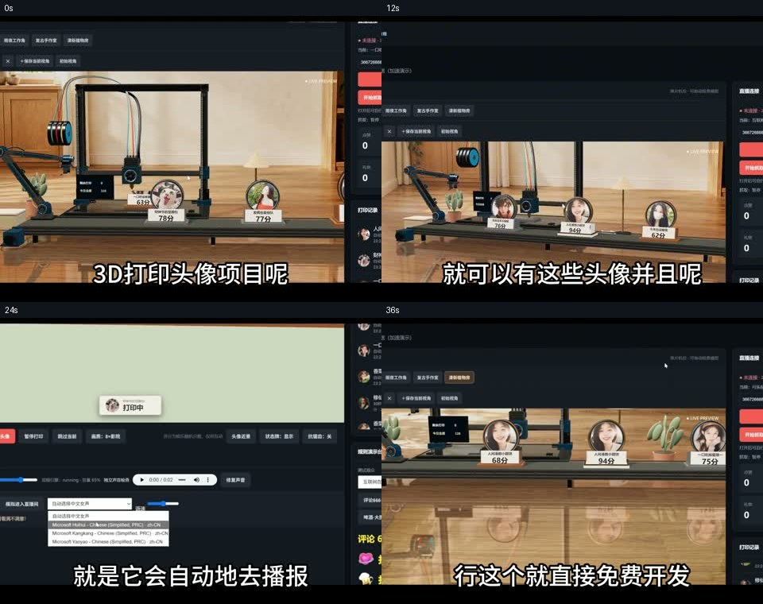
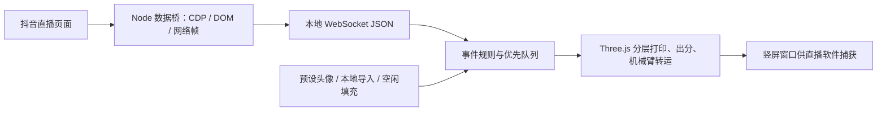
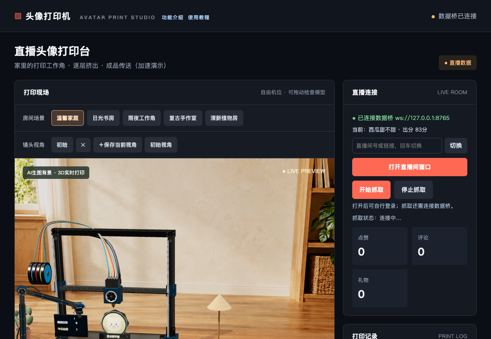

# 头像打印机：直播互动驱动的虚拟 3D 打印与数据桥

收录日期：2026-11-01

最近核实：2026-11-01，Asia/Shanghai

研究状态：**项目对应关系、关键源码与本地模拟链路已核实；真实直播接入、Windows 桌面版及跨平台接入未实测。**

## 一句话结论

视频对应 [rhfbgfgfdg999999/3d-printer-live](https://github.com/rhfbgfgfdg999999/3d-printer-live)：用 Three.js 绘制虚拟打印机、机械臂和传送带，把观众头像与昵称变成直播互动动画。它提供 Node.js 直播数据桥和 Windows WebView2 启动器，采用 MIT 许可。最有价值的是完整互动场景；最需要核对的是事件真实性：**点赞有协议与轮换回退两条路径，空闲时仍可能填入头像，分数为随机娱乐数值。** [S1–S6]

## 原始线索

- 用户提供：<https://v.douyin.com/GZElqphwX8g/>。
- 规范作品链接：<https://www.douyin.com/video/7702859683211529526>，作品 ID `7702859683211529526`。
- 作者：**志哥AI物联网手册**；发布时间：**2026-10-31 23:49，Asia/Shanghai**；视频约 **43.073 秒**。
- 完整简介末尾写明：`3D打印头像直播开源程序：rhfbgfgfdg999999/3d-printer-live`，因此项目对应关系来自视频本身，并非仅按名称猜测。[S1]
- 实际读取范围：浏览器标题、正文、详情元信息，原视频下载，以及 **0 / 12 / 24 / 36 秒**四个关键帧。未做全片语音转写，未把抽帧等同于逐帧观看。
- 普通桌面 HTTP 返回脚本空壳，移动分享页没有作品正文，本机已有下载器的详情接口返回 **403**；复用已有 Cookie 的隔离 Chrome 浏览器成功取得正文、视频详情和媒体地址。没有绕过验证码或使用付费接口。
- 作者宣称：3D 打印头像直播程序开源免费；展示本地界面、虚拟打印场景与规则，并在画面中打开 GitHub 仓库。[S1]

## 技术实现

### 从直播事件到画面

1. **输入与数据桥。** `douyin-bridge.mjs` 通过 Chrome DevTools Protocol 访问直播页面：每 300ms 用 `Runtime.evaluate` 收集 DOM 中的弹幕、头像与本场点赞数，同时监听浏览器收到的 WebSocket 网络帧，对 gzip / protobuf 数据做启发式解码。评论和礼物主要由文本解析识别；协议帧可补充昵称、头像、点赞、关注和进场事件。它不是调用抖音官方公开直播 API。[S4]
2. **头像匹配。** 观众面板、弹幕、资料卡和网络消息共同构成头像缓存；`normKey()` 去空格和装饰 emoji 后按昵称匹配。匹配不到时会点击昵称读取资料卡，仍拿不到则前端生成彩色首字头像。昵称归一化不是稳定用户 ID，同名或相近昵称存在误配可能。[S4、S6]
3. **本地消息分发。** `bridge-ws.mjs` 用 Node 标准库实现 WebSocket 握手、文本帧、ping/pong 与广播；默认端口 `8765`。前端接收 `comment`、`like`、`gift`、`join`、`follow`、`hello`、`ping` 等 JSON 消息。[S4–S6]
4. **排队规则。** `demo-rules.mjs` 把事件转成小/大头像任务；`index.html` 的 `add()` 把普通评论映射到一张小图，评论不要求出现“666”。礼物插入普通任务之前，正在打印的任务继续完成；关注也会触发一张小图，进场用于欢迎播报。[S3、S6]
5. **视觉呈现。** 前端使用 Three.js 的材质、阴影、镜面反射、局部裁切平面、头像纹理和逐层线段，形成 FDM 打印的视觉过程；机械臂按动画路径把成品移到传送带。头像是几何体上的纹理，不会从照片推理真实人脸三维模型，也没有看到实体打印机控制、STL 导出或 G-code 下发链路。[S6]
6. **声音与直播输出。** `printer-audio.mjs` 与 `gift-speech.mjs` 提供机械音效和浏览器语音播报；`live.html` 承接同一渲染画布，弹出 1080×1920 竖屏窗口。真实推流仍需直播伴侣或 OBS 等工具捕获窗口，仓库没有替用户完成平台开播。[S6、S7]

| 事件 | 当前前端行为 | 证据与边界 |
| --- | --- | --- |
| 普通评论，包括数字和 emoji | 1 张小头像；排在普通点赞任务前 | `add()` 映射为 `like` 规则、来源标为“评论”；“666”是界面示例 [S6] |
| 点赞 | 桥发出的 count 对应若干小头像 | 见下文；数量与归属不总是原始平台事件 [S4、S6] |
| 爱心 / 小心心 | 每份 1 张大头像，优先排队 | `mapGift()` + `RULES.heart` [S3、S4] |
| 啤酒 | 每份 2 张大头像，优先排队 | `RULES.beer`；本轮模拟一次礼物完成2张 [S3、S11] |
| 棒棒糖 | 每份 3 张大头像，优先排队 | `RULES.lollipop` [S3] |
| 其他礼物 | 每份 1 张大头像 | `RULES.other` [S3] |
| 关注 / 进场 | 关注触发小头像；进场欢迎播报 | 前端 `add()`；README 的事件列表未完整展开关注打印行为 [S6] |

### 点赞与自动填充：不能把展示头像等同于真实互动归属

- **协议路径：** `handleWSFrame()` 找到 `WebcastLikeMessage` 后提取用户，调用 `emitLike()`。但该路径没有读取原始 LikeMessage 的 `count`；`allowed` 来自令牌预算、每次最多3份、约每400ms补一个令牌。因此显示数是该实现放行的动画份数，不能直接当平台原始点赞数。[S4]
- **DOM 回退：** 协议点赞30秒没有出现时，以“本场点赞”的总数增量为线索，在已缓存的观众名单上 `allocateLikes()` 轮换分配，单次差值最多100。此时昵称/头像可能来自真实观众，**该观众是否点了这些赞并未被证明**。[S4]
- **协议也不是完整统计保证：** 对照项目能解码带用户及 count 的点赞消息，但 TikTok 对照项目文档也明确可能漏发单次点赞更新，尤其大直播间，不能假设每个赞必有一条事件。[S8、S9]
- **自动测试填充：** `idleTestFill()` 在30秒无观众消息、未暂停、队列不足2张时补入一张测试头像，来源为“30秒无互动·测试头像”；此检查不要求断开数据桥，已连接时也可能发生。[S6]
- **旧观众快照填充：** `hello` 在空队列时可能加入若干观众头像；另一个5秒检查在连接、空闲且有旧快照时抽取观众并以“直播间观众”来源打印。因此“数据桥已连接”“直播数据”标签不代表每次打印均由刚发生的真实互动触发。[S6]
- **娱乐分数：** `next()` 使用 `60 + Math.floor(Math.random()*36)`，范围60–95。没有调用模型评价颜值、头像质量或用户价值。[S6]

| 关键判断 | 证据状态 | 依据 |
| --- | --- | --- |
| 视频对应这个 GitHub 仓库 | 已核实 | 原视频完整简介给出 owner/repo，画面打开相同仓库 [S1] |
| 虚拟3D场景可运行 | 已核实到本地模拟 | Chrome 中生成画布并完成打印；见本轮验证 [S11] |
| 评论、礼物可转为打印任务 | 已核实到本地模拟 | 模拟 WebSocket 评论1张、啤酒2张，界面计数与记录一致 [S11] |
| 真实抖音直播中长期稳定、准确归属所有事件 | 未实测 | CDP/DOM/启发式protobuf路径存在计数、匹配与填充边界 [S4、S6] |
| 快手/TikTok直接开箱即用 | 作者描述待核实 | README标题包含三平台，但当前桥与启动器实际针对 `live.douyin.com` [S2、S4、S7] |
| 无任何依赖即可双击使用 | 与当前源码不符 | 桌面版依赖 Python、pywebview、WebView2 Runtime、Node.js [S2、S7] |

## 相关项目与资料

本轮按“头像 打印 直播”“avatar printer live”“3D打印”等关键词检索。尚未在这些结果中找到 stars 更高、可直接替换此完整虚拟打印场景的同类项目；下面两个较高 stars 项目负责**直播事件层**，不能单独代替机械臂、头像产品和传送带场景。Stars 是2026-11-01快照，不是质量或实时可用性保证。

| 项目 | 本轮 stars / 许可 | 实际解决的问题 | 与原项目关系 |
| --- | --- | --- | --- |
| [rhfbgfgfdg999999/3d-printer-live](https://github.com/rhfbgfgfdg999999/3d-printer-live) | 6 / MIT | 完整虚拟头像打印场景、规则、抖音数据桥、桌面启动器 | 原视频明确对应；场景最接近需求 |
| [saermart/DouyinLiveWebFetcher](https://github.com/saermart/DouyinLiveWebFetcher) | 1,888 / AGPL-3.0；README另有仅学习交流、限制商业用途的声明 | 抖音 Webcast WebSocket、gzip与protobuf消息解析；`liveMan.py` 从 LikeMessage 读取昵称和count | 可研究更明确的事件解析方式；不是原项目已集成的依赖，合并代码前需处理许可及作者声明 |
| [zerodytrash/TikTok-Live-Connector](https://github.com/zerodytrash/TikTok-Live-Connector) | 2,247 / AGPL-3.0-only | TikTok聊天、礼物、点赞、关注等事件的Node.js连接器 | 若做TikTok版，可评估保留场景并替换桥；不是抖音桥，也未确认原作者使用 |
| [Sanwanh/bambu-live-overlay](https://github.com/Sanwanh/bambu-live-overlay) | 0 / README声明MIT | Agent Skill：把实体拓竹打印机LAN MQTT状态叠加到OBS | 适合真实打印监控，属于不同目标；本轮只读README与搜索元信息，未安装或实测 |

对照项目源码分别固定于 `40a904bdb0561a5a9c958a95634a29681cc4fbf4` 和 `c10b040f4cb9771abd986ce51457d9f162f145c8`。TikTok连接器明确标注为非官方、非生产就绪，并使用Euler签名相关服务；接入前需核对当前服务、凭据转发选项与许可，而不是把“无需登录”扩展成所有模式无门槛。[S8、S9]

**选型建议：** 只需头像打印直播画面，先使用原项目的纯前端模拟模式确认视觉与设备性能。需要准确互动归属时，优先保留场景、审查或重写事件桥：携带稳定用户ID、原始事件ID、原始count，以及 `protocol / dom-estimated / demo / snapshot` 等来源；生产显示与统计应能区分这些来源。跨平台接入需要分别验证适配器，不能由README标题推定已实现。

## 复现路径

### 已实际运行：本机隔离纯前端与模拟消息

- 环境：macOS，Node.js `v24.16.0`，本机Chrome，临时Playwright控制器；只在任务 `.work/` 内运行，没有安装常驻服务或启动真实直播数据桥。
- 源码：浅克隆原仓库，固定 commit **`b3130fad6ab33c4bf0268d1b4ec1f2e910ea6688`**；运行前读取 `launch.py`、批处理、数据桥与前端入口。
- 先执行 `node --test bridge.test.mjs idle-fill.test.mjs auto-demo.test.mjs demo-rules.test.mjs`，**30项通过、0失败**。这些包含上游的解析与规则用例、源代码片段检查；不把它们当作真实平台成功证明。
- 浏览器通过仅监听 `127.0.0.1` 的临时HTTP服务器加载原页面；使用标准画质、12×验收速度，用Playwright截获页面的本地WebSocket并输入明确标识的模拟消息，阻止外部网络访问。
- 结果：Three.js画布创建；一个自动演示任务完成；清空任务后，模拟一条评论与一次啤酒礼物，分别生成1张小图与2张大图，**完成计数3、评论计数1、礼物计数1**，完成记录一致；浏览器未捕获页面脚本异常。[S11]
- 最初等待页面完整 `load` 超时；改为等待DOM和业务完成状态后通过。测试结果只覆盖上述环境和画质，未测8×高画质的性能。
- 测试结束关闭浏览器与临时HTTP服务器；原始视频及源码下载只作研究过程材料，不提交仓库。

### 基于源码整理、未实际运行：Windows真实直播

1. 固定版本并阅读 `guide.html`，准备Python 3、`pywebview`、WebView2 Runtime与Node.js。桥直接用全局 `WebSocket`，本轮运行环境为Node24；README只写Node.js，没有明确最低版本，旧Node需先检查 `node -p 'typeof WebSocket'`。
2. 在本地源码目录运行 `start.bat` / `start-all.bat`；**当前两者调用 `launch.py`**，是WebView2桌面版，不是README前半段描述的旧HTTP/Chrome双窗口路径。
3. 输入直播间号，打开独立直播登录窗口并完成自己的登录/验证；`launch.py` 对该窗口设置CDP端口 **9224**，使用独立本地登录目录。
4. 点击开始抓取；启动器通过 `PRINTER_CDP_PORT=9224` 启动桥，桥服务端口8765，前端HTTP端口8080。独立运行旧桥时，默认浏览器查找顺序为9223→9110→9222，不能混为同一条路径。[S4、S7]
5. 在自有测试直播间验证：同一用户重复评论、真实礼物数量与连送、精确点赞/缺失情况、同名用户、空闲填充、切换房间、断线恢复、关闭窗口和声音。以原始事件日志与平台画面做对照。
6. 通过竖屏输出窗口交给OBS或直播伴侣；验收画面尺寸、音频来源、捕获稳定性及事件延迟。三平台各自验证，不能用模拟桥结果替代。

纯前端研究可用 `python3 -m http.server 8080 --bind 127.0.0.1` 后打开 `http://127.0.0.1:8080/`。该方式只提供场景页面；浏览器中的桌面抓取按钮会要求通过 `start.bat` 打开桌面版。上述说明基于源码，除本轮隔离验证外未执行真实抓取。

## 适用场景与限制

- **适合：** 头像互动直播效果、Three.js动画学习、事件驱动演示、场景和排队逻辑的二次开发。MIT允许修改和分发等用途，但需保留许可通知；依赖、背景/头像素材及平台使用条件仍要分别核对。[S5]
- **事件准确性：** 接通桥、头像是真实照片、界面有点赞数字，是三个不同事实。轮换、快照打印、合成头像和随机分数需让观众清楚其展示含义。
- **接口易变：** 依赖直播网页DOM和启发式protobuf解析，平台页面或协议变化可能导致漏消息、错头像或停止抓取；当前固定commit没有本轮真实平台稳定性数据。
- **启动说明有漂移：** README最后补充了WebView2迁移，但前半段仍写旧启动流程、不同调试端口，并有“可扫码登录”和“不会登录”的不一致表述。以当前启动器与实际登录行为为准，不把这些宣传表述当已验证保证。[S2、S7]
- **本地桥暴露范围：** `launch.py` 的HTTP服务绑定127.0.0.1；但 `bridge-ws.mjs` 使用 `server.listen(port)`，没有显式绑定回环地址，且握手不核对Origin/鉴权。虽然前端连接127.0.0.1，服务本身未被代码限制为仅本机可访问。正式运行应先限定监听地址与来源；这是实际源码行为，不是本轮部署结果。[S10]
- **性能：** 高画质可把像素比例提升到8、阴影贴图升到8192，并有多个离屏反射。建议从标准画质起测，未有本轮帧率、显存或8×性能结论。[S6]
- **维护成熟度：** 本轮仓库2026-10-31创建，stars仅6；记录的是当天代码快照，不能凭43秒演示确认长期维护和商业直播稳定性。

## 待核实事项

1. Windows WebView2从安装到开播的完整验收，以及关闭进程、端口冲突和断线后的行为。
2. 真实抖音事件的准确率、漏报率、延迟、重复礼物计数，以及昵称归一化冲突。
3. 快手与TikTok适配源码/接入记录；当前明确读到的是抖音路径。
4. 点赞协议count解析与DOM轮换回退、hello/快照填充、30秒测试填充的来源标注是否足够清楚。
5. 原始背景、预设头像与图标资产的具体来源及再分发权限；主仓库MIT不能替代逐项素材来源核对。
6. 全画质性能与真实推流音频；本轮只有标准画质本地模拟结果。

## 来源与证据

| 编号 | 来源与链接 | 发布日期 | 查阅日期 | 支持的结论 |
| --- | --- | --- | --- | --- |
| S1 | [原视频](https://www.douyin.com/video/7702859683211529526)；用户[短链](https://v.douyin.com/GZElqphwX8g/) | 2026-10-31 23:49 CST | 2026-11-01 | 作者、完整简介、明确的仓库指向与0/12/24/36秒画面 |
| S2 | [作者README固定版本](https://github.com/rhfbgfgfdg999999/3d-printer-live/blob/b3130fad6ab33c4bf0268d1b4ec1f2e910ea6688/README.md) | commit 2026-10-31 | 2026-11-01 | 开源声明、场景、功能、启动与数据桥描述 |
| S3 | [demo-rules.mjs](https://github.com/rhfbgfgfdg999999/3d-printer-live/blob/b3130fad6ab33c4bf0268d1b4ec1f2e910ea6688/demo-rules.mjs#L1) | 同一commit | 2026-11-01 | 数量、大小、优先插队、事件去重 |
| S4 | [douyin-bridge.mjs](https://github.com/rhfbgfgfdg999999/3d-printer-live/blob/b3130fad6ab33c4bf0268d1b4ec1f2e910ea6688/douyin-bridge.mjs#L117) | 同一commit | 2026-11-01 | 网络帧解码、点赞预算、轮换、DOM采集、重连与头像补取 |
| S5 | [LICENSE](https://github.com/rhfbgfgfdg999999/3d-printer-live/blob/b3130fad6ab33c4bf0268d1b4ec1f2e910ea6688/LICENSE) | 同一commit | 2026-11-01 | MIT、志哥AI版权与保留通知条件 |
| S6 | [index.html](https://github.com/rhfbgfgfdg999999/3d-printer-live/blob/b3130fad6ab33c4bf0268d1b4ec1f2e910ea6688/index.html#L216) | 同一commit | 2026-11-01 | 分层动画、60–95随机分、add/liveEvent、快照与30秒填充、竖屏窗口 |
| S7 | [launch.py](https://github.com/rhfbgfgfdg999999/3d-printer-live/blob/b3130fad6ab33c4bf0268d1b4ec1f2e910ea6688/launch.py#L39) 与 [guide.html](https://github.com/rhfbgfgfdg999999/3d-printer-live/blob/b3130fad6ab33c4bf0268d1b4ec1f2e910ea6688/guide.html) | 同一commit | 2026-11-01 | WebView2、9224专用CDP、Python/Node/pywebview依赖及抓取按钮 |
| S8 | [DouyinLiveWebFetcher README](https://github.com/saermart/DouyinLiveWebFetcher/blob/40a904bdb0561a5a9c958a95634a29681cc4fbf4/README.MD)、[liveMan.py](https://github.com/saermart/DouyinLiveWebFetcher/blob/40a904bdb0561a5a9c958a95634a29681cc4fbf4/liveMan.py#L307)、[LICENSE](https://github.com/saermart/DouyinLiveWebFetcher/blob/40a904bdb0561a5a9c958a95634a29681cc4fbf4/LICENSE) | 未逐项确认原始发布日期；commit已固定 | 2026-11-01 | 抖音协议解析、LikeMessage count、许可与README用途声明 |
| S9 | [TikTok-Live-Connector README](https://github.com/zerodytrash/TikTok-Live-Connector/blob/c10b040f4cb9771abd986ce51457d9f162f145c8/README.md)、[点赞事件文档](https://github.com/zerodytrash/TikTok-Live-Connector/blob/c10b040f4cb9771abd986ce51457d9f162f145c8/docs/src/content/docs/events/chat-and-audience.md#L76)、[package.json](https://github.com/zerodytrash/TikTok-Live-Connector/blob/c10b040f4cb9771abd986ce51457d9f162f145c8/package.json) | commit已固定 | 2026-11-01 | TikTok事件层、count/total、漏发边界、AGPL-3.0-only与服务依赖 |
| S10 | [bridge-ws.mjs](https://github.com/rhfbgfgfdg999999/3d-printer-live/blob/b3130fad6ab33c4bf0268d1b4ec1f2e910ea6688/bridge-ws.mjs#L65) | 同一commit | 2026-11-01 | 标准库WebSocket、默认监听与握手边界 |
| S11 | [本轮验证与元信息快照](research_snapshot.json) | 2026-11-01 | 2026-11-01 | 固定commit、30项检查、本地浏览器模拟与处理范围 |
| S12 | [bambu-live-overlay README](https://github.com/Sanwanh/bambu-live-overlay) | 未确认原始发布日期 | 2026-11-01 | 真实拓竹打印机状态/OBS的Agent Skill对照，非虚拟头像场景 |

## 更新记录

- 2026-11-01：首次收录；确认原视频项目、MIT与主要实现，比较两类直播事件方案及实体打印监控Skill；完成30项现有检查与浏览器模拟消息验证，明确真实直播/Windows/跨平台尚未验收。
