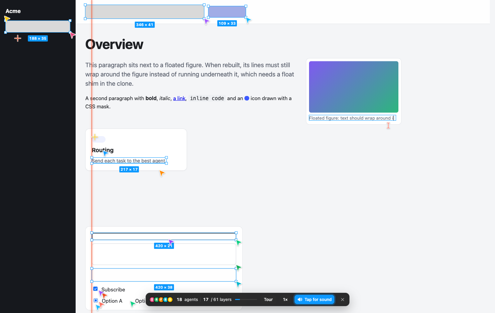

# Swarm Rebuild：网页快照重演与模拟多光标动画

收录日期：2026-11-10

最近核实：2026-11-10，Asia/Shanghai

研究状态：**已核实项目对应关系、核心实现和本地动画路径；商店安装与复杂站点兼容性未实测**。

## 一句话结论

**这是让现有网页“表演自己被一群光标重新搭出来”的 Chrome 扩展，不是多个 AI 智能体真正写代码、设计新网页或操作鼠标。** 它先读取页面结构、样式和几何位置，再在独立覆盖层中播放框选、打字、拖拽、吸附、复制等动画，最后撤去覆盖层回到原网页。[S1][S2][S3][S6]

适合产品录屏、网站展示和解释型动画。若目的是让 AI 真正修改网站、生成工程代码或导出设计文件，这个项目不是对应工具。[S3][S6]

## 原始线索

- 用户原短链：[Nihao 抖音作品](https://v.douyin.com/JR01E2TvsnQ/)。
- 规范作品：[https://www.douyin.com/video/7705646017802518394](https://www.douyin.com/video/7705646017802518394)。
- 作者：**Nihao**；作品 ID：`7705646017802518394`。
- 平台发布时间：**2026-11-08 12:02:02，Asia/Shanghai**，来自作品详情的 `create_time`，与网页显示的分钟一致。
- 完整简介给出产品商店链接，并带有 `#ai #工具 #插件 #拓展` 等标签。开头为“这个真的很帅啊”，不是一个独立技术名称。[S1]
- 实际读取范围：网页正文、平台作品详情、完整约 **25.704 秒**视频下载成功；抽查开源仓库展示、实现说明和商店安装部分的关键帧与可见字幕。**未做全量语音转写，也不把下载成功等同于完整逐帧观看。**
- 视频约前半段展示一群带名称、尺寸标记的彩色光标在现有页面上绘制；中段明确说明这不是实际搭建网页，而是读取原有结构再模拟重建；后段展示 Chrome Web Store 中的 Swarm Rebuild。[S1]

### 项目对应关系为什么可信

1. 抖音完整简介给出商店扩展 ID：`diaeaocnhdhbknkbfbnkjikfcgokainm`。
2. 商店名称是 **Swarm Rebuild**，支持站点和简介均指向 `DhvanilPatel/swarm-cursors`。
3. 对应仓库 README 回链同一个商店扩展 ID。
4. 视频关键帧也能辨认出 `DhvanilPatel / swarm-cursors` 的仓库页面。[S1][S2][S3]

因此不是靠“同名仓库”猜测。检索得到的其他 Swarm-Rebuild 仓库、书签脚本和衍生版本，不作为这条原视频的实际技术栈。

## 技术实现

### 1. 输入：已经存在的网页，而不是需求提示词

主要输入是当前标签页的 DOM、计算后的 CSS、元素位置、文字、图片和滚动信息。`captureModel()` 通过 `getComputedStyle()` 等读取视觉属性，遍历页面并构建内部蓝图。这里源码中的 `model` 是页面布局数据，**不是大语言模型**。[S6，L491–555]

输出蓝图包含盒子、文字、线条、媒体，以及重复组件与对齐关系。原页面是参照答案，项目不需要“推理出应当设计什么”。

### 2. 扩展入口：用户点击后，对当前页注入脚本

- `manifest.json` 为 **Manifest V3**，当前版本 `1.1.0`。
- 显式权限只有 `activeTab` 和 `scripting`；快捷键为 **Alt+Shift+S**。
- `background.js` 收到工具栏点击后，探测脚本是否已运行，再决定启动或退出。
- 首屏存在 canvas、video、iframe 等媒体时，入口会临时隐藏其他元素、捕获可见标签页截图，再注入 `swarm.js`。截图失败时走占位回退，不代表跨域内容被完整解析。[S4][S5]

这不是默认持续扫描所有网站的后台服务。虽然权限数量少，它在被触发的页面上仍能读取页面内容和可见截图，使用敏感页面时要考虑录屏和展示范围。[S5][S7]

### 3. 页面拆解：保留视觉信息，移除原脚本行为

| 页面部分 | 蓝图/重演方式 | 依据 |
| --- | --- | --- |
| 背景块、边框、圆角、渐变、阴影 | 盒子图层，先拖框，再显露真实样式 | [S3][S6] |
| 标题、段落与内联内容 | 按计算样式克隆文字层，逐步显露字符 | [S3][S6，`prepText` / `reveal`] |
| 单边线、分隔线 | 模拟钢笔工具、锚点和连线 | [S3][S6] |
| 图片、SVG 和特殊媒体 | 图层重演；可读媒体使用已有内容，不可读像素使用截图裁片或占位 | [S3][S5][S6] |
| 相似导航项、卡片、列表行 | 先做一个母版，再模拟拖拽复制，必要时改字、换图、改样式 | [S6，L1211–1314] |
| 文本的公共左边缘、基线 | 推导辅助线，模拟拖出标尺与吸附 | [S3][S6] |

其克隆与媒体处理代码会排除脚本等不应重放的节点，并把部分 Web Component 转为普通样式元素。**视觉相似不代表交互逻辑复制成功。** 动画层不运行原网页的业务脚本，也不是新的可交付应用。[S3][S6，L152–344]

### 4. 覆盖层：不是把原网站真正删掉重写

`View` 创建一个置于高层级的 `swarm-rebuild` 元素，在其开放 Shadow Root 中放入背景、文字/页面图层、SVG 辅助标记、光标和工具栏。[S6，L1618–1684]

这里的“canvas”更多是设计画布的说法。当前实现并非把所有内容统一画到单一 `<canvas>`；主界面还使用样式化 DOM、SVG 等，Canvas 参与特殊媒体像素处理。[S6]

原网页仍保留在下方。点击 **Go live** 会渐隐并移除覆盖层；Esc 或再次点击扩展也可退出。原网页业务行为仍在原页面中，而不是由模拟光标重新实现。[S3][S6，L3731–3825]

### 5. “多个 Agent”实际上是动画任务调度

任务依赖来自已知页面结构：子元素等待父容器，复制任务等待母版，视口之外的任务等滚动解锁。`available()` 检查依赖；`pick()` 按位置、距离及任务类型打分；`step()` 根据滚动速度和积压任务调整光标数；每个光标通过 JavaScript generator 执行预设动作。[S6，L1267–1314、L2256–2414]

当前常量包括：

- 普通工作光标目标范围：**8–48**。
- 开场光标：**18**。
- 结束群集光标常量：**36**。
- 页面模型上限：约 **4,000 个图层**、**40,000px 高度**。[S6，L22–40]

这些“Agent”有名称、颜色和状态，但不是各自持有模型上下文的 AI 会话。源码中的任务分配和动作编排是规则、依赖、几何位置与随机化动画，不是模型推理或真实多人协作。[S6]

**页面上显示的 agents、layers、耗时，不应解释成 AI 吞吐量、Token 消耗或工程开发效率。** 当前 HUD 的 layers 进度统计实际使用任务数组长度，不等于原网页的 DOM 节点数量，也不一定等于内部 `items` 数量。[S6，L3689–3727][S9]

### 6. 动画与音效

光标可以切换箭头、十字、文字光标、钢笔、复制等形状；动作包括拖拽框选、打字、尺寸标签、辅助线、复制及开场/结束的群集运动。更新循环使用 `requestAnimationFrame()`。[S3][S6]

音效通过 **Web Audio API** 实时合成，不需要录音或外部音频文件。浏览器会限制未获得用户手势的音频启动，工具栏出现 `Tap for sound` 时需要点击，静音不等于功能异常。[S3][S7]

### 关键判断与证据状态

| 关键判断 | 证据状态 | 来源 |
| --- | --- | --- |
| 原作品对应 Swarm Rebuild / DhvanilPatel/swarm-cursors | 已核实：原简介、商店、README 和视频画面一致 | [S1][S2][S3] |
| 效果依赖读取现有页面，不是生成新网站 | 已核实：原视频说明与布局捕获源码一致 | [S1][S3][S6] |
| “多人光标”由本地动画任务驱动，不是多个 LLM | 已核实当前固定源码路径 | [S6] |
| 原网页保留，退出后恢复原节点 | 已核实源码；本地 demo 已验证节点身份与表单值 | [S6][S9] |
| 不收集、保存或上传用户数据 | 开发者声明；权限、静态检查与受限 demo 观察提供有限佐证，不是全面安全审计 | [S4][S7][S9] |
| 任何网站都能无损重建 | 不成立的泛化：作者已列出受保护页、特殊媒体、长度等限制 | [S3] |
| 能导出源代码、Figma 工程或提升 AI 设计速度 | 当前查阅材料没有该能力证据 | [S3][S6] |

## 相关项目与资料

### Swarm Rebuild：本条实际对应项目

- 所有者/仓库：[`DhvanilPatel/swarm-cursors`](https://github.com/DhvanilPatel/swarm-cursors)。
- 商店版本与源码 manifest：**1.1.0**。
- 商店显示最近更新：**2026-11-05**。
- 核对的源码 commit：`3d49e0ac96172eb6af7ae8229b2152121bed2092`，提交时间 **2026-11-06 16:35:56 UTC**。
- 仓库创建时间：**2026-10-14 23:42:03 UTC**。以上来自 GitHub 元信息，不把视频流行日期当作项目首发日期。
- 关键入口：`manifest.json`、`background.js`、`swarm.js`、`demo/index.html`。
- `swarm.js` 为单文件、无第三方运行依赖的内容脚本；发布脚本只把扩展文件和图标打成 ZIP，不是模型部署流程。[S3][S4][S5][S6]
- 商店与源码版本号相同，**仍不代表商店 ZIP 已与该 commit 逐字节比对**。此次未下载安装商店包。
- 视频中出现约 1.9k Star；查询时 GitHub 为 **2,577 Star**，商店显示 **20,000 users**。这些仅是查阅时平台显示值，不作为功能或安全证明，也不把与视频的差异当作数据造假。[S1][S2][S3]

### Swarm：动画设计和部分引擎的源头

- 原项目：[`califa/swarm-site`](https://github.com/califa/swarm-site)。
- 作者网站演示：[Swarm](https://califa.github.io/swarm-site/)。
- Swarm Rebuild README 明确将光标集合、群集运动、动作编排、辅助线与整体视觉归功于 **Joel Califa**，并说明大量动画引擎改编自原站点。[S3]
- 两者区别：原 Swarm 是“自己随滚动构建自己”的固定网站；Swarm Rebuild 增加读取任意现有页面蓝图和浏览器扩展入口。[S3][S8]

### 许可证边界

**源码公开不等于已有可自由复用的开源许可证。** 当前仓库未提供许可证；README 也明确说明暂未设定许可证，原 Swarm 同样没有许可证，复用改编代码需先核对原作者授权。[S3][S8]

可以把它作为技术研究和现成工具的参考；不要据此承诺可以直接嵌入商业产品、改名发布、出售或按 MIT/Apache 条款分发。此次热点库仅提交独立研究、验证摘要和必要演示证据，**不复制上游实现源码或安装包**。

## 复现路径

### A. 用户体验路径：基于官方资料整理，商店安装未实测

1. 打开[官方 Chrome Web Store 页面](https://chromewebstore.google.com/detail/swarm-rebuild/diaeaocnhdhbknkbfbnkjikfcgokainm)，确认名称和扩展 ID。
2. 安装后固定到工具栏，打开一个普通、非敏感网页，等待页面主要内容加载。
3. 点击图标或按 **Alt+Shift+S**，观察背景覆盖、光标集合、盒子/文字/媒体逐步出现。
4. 手动滚动或使用 **Tour**；按 **1× / 2× / 3×** 切换动画速度。
5. 完成后用 **Go live** 返回原页面；用 **Replay** 重演；Esc 随时退出。[S2][S3]

成功标准是看到重演动画，并能返回原页面，不是得到新网站、编译产物或设计源文件。

### B. 源码加载路径：基于 README，扩展安装未实测

下载或克隆官方仓库后，在 `chrome://extensions` 打开开发者模式，用“加载已解压的扩展程序”选择 `swarm-rebuild/` 子目录，**不是仓库根目录**。测试本地 `file://` 页面时还需开启相应扩展的文件访问许可。[S3][S4]

运行前应自行审查固定版本和权限，不把本文理解为授权在工作浏览器中安装扩展。本文不要求运行发布脚本，也不涉及修改用户现有浏览器配置。

### C. 本次实际运行：受限本地 demo 动画验证

环境：macOS，**Chrome/157.0.8103.50**，一次性隔离浏览器目录；官方 `demo/index.html` 从本机回环地址提供。

方法：通过 CDP 向测试页注入**未修改的固定 commit `swarm.js`**。没有安装扩展、没有带入抖音或其他账户 Cookie、没有对用户现有标签页执行脚本。对 service worker、`activeTab` 授权和 `captureVisibleTab` 截图入口不做端到端成功声明。[S9]

| 检查项 | 实测结果 |
| --- | --- |
| 捕获页面模型 | **63 个 items**；非空 |
| 动画任务 | **61 个 tasks** |
| 抽查时的光标 | **18 个**；独立 Shadow Root 覆盖层存在 |
| 切到 3× 并使用 Tour 后完成 | **61 / 61**；触发完成状态 |
| Go live 后原页面 | 覆盖层移除，app 停止；原 `main` 节点身份一致 |
| 原正文与表单值 | `body.innerHTML` 不变；输入框原值保留 |
| 页面运行时异常 | **0 条** |
| 动画观察窗中的外部 HTTP 请求 | **0 条**；观察到本地 favicon 请求和内联 data 图片，不误称“完全零请求” |

HUD 显示 `Rebuilt by 18 agents in 3.9s`，但这里已切换动画速度，显示数值来自动画内部状态，**不作为真实总耗时、网页通用速度或 AI 性能基准**。

首次验证器把页面正常的本地 favicon 请求也判为网络失败；检查口径调整为“无外部 HTTP 请求”后重新运行，九项断言通过。这是验证器口径修正，不是发现并修改上游缺陷。上游源码未变。[S9]

实际动画截图：

复现证据：[验证摘要 JSON](evidence/runtime-verification.json)、[Go live 后截图](evidence/demo-restored.png)。

**覆盖范围限制：** 这是内容脚本的本地运行，不是商店扩展安装验收；未做复杂生产网页、跨域 iframe、WebGL 首屏截图、长页极限、音效主观效果或批量兼容性测试。

## 适用场景与限制

### 适合

- 产品功能介绍、个人作品集、网页展示与宣传录屏。
- 把已有 UI 的组成结构用拖框、打字、复制等动画方式讲给观看者。
- 研究“页面快照 → 任务依赖 → 并行动画 → 回到原页”的可视化设计模式。[S3][S6]

### 不适合或需要额外验证

- **真正生成网站或自动改代码：** 不输出工程，不改变需求，不替代 Coding Agent。
- **复制交互逻辑：** 视觉覆盖层不等于原站点的事件处理、表单提交和数据请求。
- **动态或跨域媒体完整复现：** 首屏 screenshot 是点按时的像素切片；首屏以下 canvas、video、iframe 等可能是占位，不是完整媒体或子站点复制。[S3][S5][S6]
- **所有 Shadow DOM 都可读：** 作者列出的能力是开放的 Shadow Root，不应扩大到关闭的封装。
- **受保护浏览器页面：** `chrome://`、Chrome Web Store、PDF 查看器等无法按普通网页注入。[S3][S5]
- **长页面、动态布局和懒加载：** 有图层/高度上限；扫描会短暂滚动以触发加载，原页面自身可能继续运行和发起资源请求。[S3][S6，L3548–3565]
- **性能和真实效率：** 更多光标是演出调度，不是新增 CPU worker、增加模型数量或提高开发效率；网页复杂度会影响捕获、图层数量和动画负载。[S6]
- **隐私和录屏：** 开发者声明不上传快照，当前源码检查没有发现常见远端请求/存储调用，本地 demo 也未观察到外部 HTTP 请求；这不替代商店包审计，更不代表录屏中的账户、成本、聊天或业务内容不会被观看者看到。[S7][S9]
- **商业集成或二次分发：** 先解决未设许可证及原动画代码的授权，不把“GitHub 可见”当作许可。[S3][S8]

## 待核实事项

1. 商店包是否与固定 commit 完全一致；实际安装、快捷键及受保护页的 UI 行为。
2. 视频各个示例页面的完整重演质量；本文只核对项目和实现，不证明每个页面都完美兼容。
3. WebGL、播放中的视频、跨域 iframe 的完整扩展截图链路和占位回退。
4. 各类复杂网站、超长页面、页面更新期间的兼容性、资源占用与效果。
5. 上游未来是否补充明确许可证，原 Swarm 的改编授权范围。

**已消除的缺口：** 项目名、商店链接、仓库归属、版本、公开代码入口，以及“是否真正 AI 造网页”的判断均已找到直接证据，不再标记为候选项目。

## 来源与证据

| 编号 | 来源与链接 | 发布/版本日期 | 查阅日期 | 支持的结论 |
| --- | --- | --- | --- | --- |
| S1 | [Nihao 原抖音作品](https://www.douyin.com/video/7705646017802518394)，[用户原短链](https://v.douyin.com/JR01E2TvsnQ/) | 2026-11-08 12:02:02，Asia/Shanghai | 2026-11-10 | 原简介、商店扩展 ID、项目画面、动画说明 |
| S2 | [Swarm Rebuild / Chrome Web Store](https://chromewebstore.google.com/detail/swarm-rebuild/diaeaocnhdhbknkbfbnkjikfcgokainm) | 商店版本 1.1.0；显示更新 2026-11-05 | 2026-11-10 | 产品名、使用方式、开发者仓库、商店显示信息 |
| S3 | [官方 README，固定 commit](https://github.com/DhvanilPatel/swarm-cursors/blob/3d49e0ac96172eb6af7ae8229b2152121bed2092/README.md) | 固定 commit 2026-11-06 | 2026-11-10 | 实现概览、安装方式、限制、原作归属、许可证说明 |
| S4 | [manifest.json](https://github.com/DhvanilPatel/swarm-cursors/blob/3d49e0ac96172eb6af7ae8229b2152121bed2092/swarm-rebuild/manifest.json) | 同固定 commit；版本 1.1.0 | 2026-11-10 | Manifest V3、权限和快捷键 |
| S5 | [background.js](https://github.com/DhvanilPatel/swarm-cursors/blob/3d49e0ac96172eb6af7ae8229b2152121bed2092/swarm-rebuild/background.js) | 同固定 commit | 2026-11-10 | 当前标签页入口、媒体截图与回退、注入/恢复 |
| S6 | [swarm.js](https://github.com/DhvanilPatel/swarm-cursors/blob/3d49e0ac96172eb6af7ae8229b2152121bed2092/swarm-rebuild/swarm.js) | 同固定 commit | 2026-11-10 | 页面蓝图、克隆、任务依赖、光标动画、限制、退出机制 |
| S7 | [隐私声明](https://github.com/DhvanilPatel/swarm-cursors/blob/3d49e0ac96172eb6af7ae8229b2152121bed2092/PRIVACY.md) | 文件标注更新 2026-10-15 | 2026-11-10 | 开发者对数据、截图、声音和权限的声明；非全面审计 |
| S8 | [原 Swarm 仓库](https://github.com/califa/swarm-site) | 仓库创建 2026-10-14 | 2026-11-10 | 原项目存在、固定自构建网站定位、未提供许可证；扩展改编关系由 S3 声明 |
| S9 | [本次本地运行摘要](evidence/runtime-verification.json)，[官方 demo 源码](https://github.com/DhvanilPatel/swarm-cursors/blob/3d49e0ac96172eb6af7ae8229b2152121bed2092/demo/index.html) | 本次执行 2026-11-10 | 2026-11-10 | 63 items / 61 tasks、完成与恢复、受限网络和异常观察 |

## 更新记录

- 2026-11-10：首次收录；解析用户短链并读取原视频关键帧，确认 Swarm Rebuild；核对商店与固定源码；完成本地 demo 内容脚本动画和页面恢复验证。未安装商店包，不提交上游源码或临时媒体。
