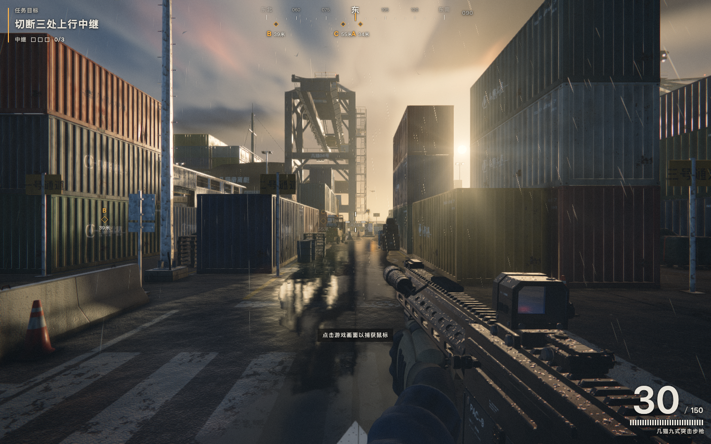
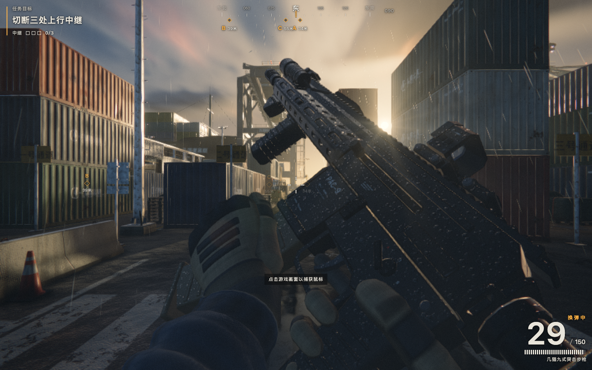
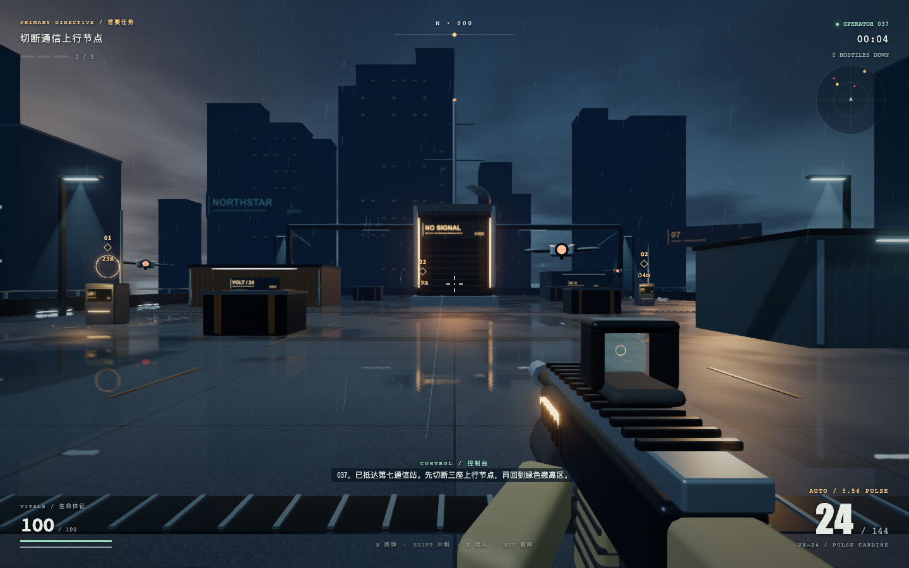
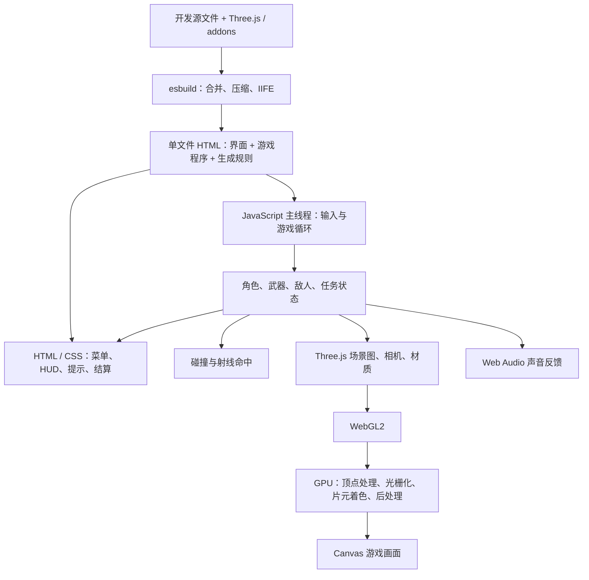
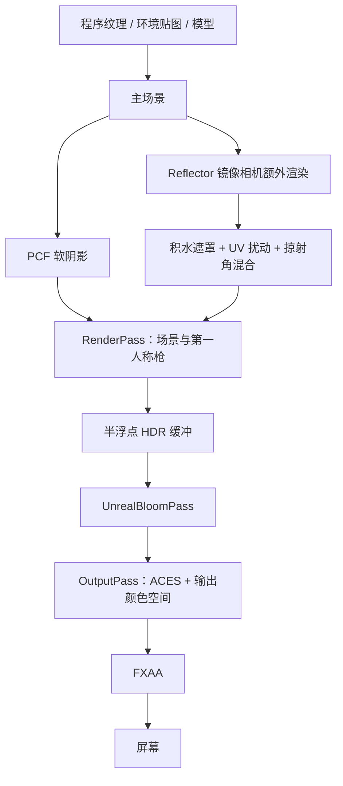

# 单文件 WebGL FPS：Three.js r180 架构与质量差距复盘

收录日期：2026-11-11

最近核实：2026-11-11，Asia/Shanghai

研究状态：**实现与受控问题已核实；参考作品作者、公开来源和许可证待核实**

## 一句话结论

**一个 HTML 可以装入完整的客户端 3D 游戏，但同用 Three.js r180 并不意味着体验接近：参考作品在角色运动、碰撞求解、枪械动画、材质生成、光照和音频反馈上均有更深入的实现；《断电协议》第一版主要完成了玩法闭环，不能视为同等品质复现。**

本次不仅比较代码，也实际运行了两份 HTML，并通过相同碰撞夹具和受控时间步复现出 Demo 的小台阶、悬空梁与射速稳定性问题。[S1][S2]

## 原始线索

| 对象 | 来源与实际读取范围 | 核实边界 |
| --- | --- | --- |
| 参考作品 | 会话提供的 `几猫国产3A大作_V1.html`；阅读内嵌代码，并在隔离 Chrome 中运行、进入游戏及触发换弹 | 页面名称不是质量认证；代码有 `SALTLINE` 标识，不能据此断言公开项目名、作者或生成模型 |
| 本次 Demo | 会话中交付的《断电协议 / BLACKOUT PROTOCOL》HTML、开发源文件、构建配置和浏览器验证记录 | 独立实现，复用 Three.js，不是参考作品换皮；第一版功能通过不等于体验接近 |
| 用户反馈 | 枪感、人物碰撞、美术表现与参考作品差距明显 | 作为待调查问题，而非直接当成技术事实；以下给出核实结果 |
| 图像证据 | 本次直接截取参考作品游戏/换弹画面，以及 Demo 原交付验证中的正常战斗画面 | 不是 AI 概念图；没有使用仍处于黑场淡入的参考作品截图做对比 |

没有收到可核实的公开原始网址。首页按现有目录的截图来源格式保留缺链状态；**官方 Three.js 链接是技术依据，不冒充原游戏来源**。本条目归档研究文档、截图和验证证据，不上传完整参考 HTML，也不公开私聊标识、开发机路径或凭据。

### 实机画面对照

参考作品：真实游戏状态，原实现自动选择的 high 画质。



参考作品：真实换弹状态，可见手指、握持与弹匣配合。



《断电协议》第一版：正常入口进入后自然生成无人机，没有用诊断接口摆放这张图中的敌人。



这些截图用于判断形体、细节、材质与构图，**不是同场景、同效果成本的性能对照实验**。两套作品的关卡、光照时间、默认画质和场景复杂度不同。[S1][S2][S3]

## 技术实现

### 1. 总体架构：HTML 是交付容器，不是渲染方法

下图以已经核实的 Demo 构建链为例；参考 HTML 的原始打包工具未确认。



“前端”表示程序运行在客户端，而不是只能画按钮。JavaScript 通常负责组织状态和发出绘制命令，大量逐顶点、逐像素计算在 GPU 上完成。Three.js 提供渲染与三维数学能力，但**不会自动提供好用的角色控制器、枪感、敌人行为或美术风格**。[S4]

本次 Demo 没有后端、账号、联机、云渲染、运行时大模型调用、WASM 或 WebGPU。单文件包含渲染库和应用程序；模型、纹理、天空与声音的大量内容按规则生成，而不是从远端逐个下载。[S1][S3]

### 2. 模块拆分：参考作品的子系统更完整

| 层次 | 参考作品 | Demo 第一版 |
| --- | --- | --- |
| 运行上下文 | 集中上下文保存模块，包含 `events`、`rng`、`time` 与质量配置 | `main.js` 直接持有共享 `state`、`player` 和各对象数组 |
| 角色与碰撞 | `player`、`physics` 分离；自写胶囊风格移动求解器、视线查询、导航网格 | 位移、分轴碰撞、跳跃、枪械与任务主要集中在 `main.js` |
| 战斗与反馈 | `weapon`、`combat`、`enemies`、`fx`、`audio` 通过事件协作 | `shoot()` 等函数直接更新数值、调用效果与音效 |
| 场景与资产 | `mats`、`props`、`level`、`backdrop`、`ground` 等分层 | `world.js` 建场景/材质/渲染管线，`models.js` 建枪和无人机 |
| 界面与流程 | `hud` 与 `game` 分离，包含过场、游戏、暂停等流程 | `index.html` 加 `main.js` 中的 DOM 更新 |
| 音频 | 空间化、混响、事件阶段、不同地面声音 | `audio.js` 合成基础枪声、风声、命中与提示音 |

Demo 的四个主模块为 `main.js`、`world.js`、`models.js`、`audio.js`；构建入口是 `scripts/build.mjs`，页面模板为 `src/index.html`。这里描述的是原工程结构，本热点仓库没有附带完整工程，不应把这些名称误当成当前目录下可直接运行的文件。[S1]

**模块多不是品质的充分条件**。重要的是职责拆分支撑了更细的状态、时序和反馈，而不是目录数量。

### 3. 每帧流程与数据流

Demo 的实际执行顺序可以概括为：


- `state.mode` 包括 `menu / playing / paused / won / dead`；进入暂停时清空按键与开火状态。
- 玩家子弹为 **hitscan**：从相机方向发射射线，比较场景阻挡与敌人命中距离；枪口曳光线是反馈，不代表实体子弹飞行。
- 敌方使用可见飞行弹；以一帧前后位置构成线段做近身命中检查，并判断场景遮挡。
- 终端以距离和按住 E 的累计时间触发，三处断连后激活撤离；死亡与通关后可以重开。
- HUD 文字、雷达、目标标记约每 0.06 秒刷新一次，并非全部逐帧刷新。

参考作品使用 Three.js `setAnimationLoop`，按输入、游戏流程、角色、武器、敌人、特效/音频/HUD、渲染分派更新。**两者都限制过大的单帧 dt；不是固定时间步、可确定性回放的完整物理架构**。参考作品另在碰撞位移和弹簧积分内部做子步，这比“主循环截断 dt”多解决了一层问题。[S1]

### 4. 渲染管线：共同基础与不同深度

Demo 的真实管线是：



`EffectComposer` 在 r180 中默认创建半浮点渲染目标，并通过读写缓冲交换串接后处理；`OutputPass` 根据 renderer 的色调映射与输出颜色空间构建处理逻辑。这些不是只列出术语，已经核对实际 addons 源码与 Demo 调用链。[S5][S6][S7]

| 项目 | 参考作品 | Demo 第一版 | 对观感的影响 |
| --- | --- | --- | --- |
| 材质输入 | GPU 生成颜色、法线与 ORM 等纹理，配合损伤、湿润、宏观变化 | Canvas 噪声/划痕颜色纹理，混凝土使用 bump；金属度和粗糙度主要为材质标量 | “有噪点”不等于“有材质”：磨损位置、凹凸与反光需要相互对应 |
| 软阴影 | 自定义遮挡物搜索与半影过滤，距离参与软硬变化 | Three.js PCF 软阴影 | 接触关系与阴影层次不同；两者都不是全场景光线追踪 |
| 空气与光束 | 沿视线采样，并查询阴影的体积散射；有近远和室内尘埃处理 | 距离雾 + 半透明锥体几何光束 | Demo 光束是美术近似，没有同样的空间遮挡与散射关系 |
| 反射 | 平面反射结合粗糙度、积水与湿沥青区分，按粗糙度选取模糊层级 | 平面反射 + 噪声遮罩 + 简单三采样模糊与扰动 | Demo 有真实额外渲染，但湿面变化更单一 |
| 曝光与色彩 | 自动曝光、ACES/AgX 混合、冷暖分离等自定义处理 | 固定曝光 1.1、ACES | 参考作品能进一步协调明暗转换与强高光 |
| 镜头层 | 多尺度泛光、光晕、镜头脏污、运动模糊等，按质量配置使用 | Bloom、FXAA；界面叠加暗角和扫描纹理 | 同叫“电影感”不代表实现范围相同 |
| 第一人称视图 | 世界相机与武器相机分离，有独立 FOV、深度安排与环境处理 | 枪放在主相机下，通过 layer 从反射中排除，但没有独立武器渲染相机 | 世界视角变化时，枪械尺度和构图控制能力不同 |

PBR 是基础模型，不是“一键写实”开关；平面反射也不是 SSR，更不是完整光线追踪。射击用的 `Raycaster` 同样不意味着画面使用了光线追踪渲染。[S1][S4][S8][S9]

### 5. 枪感：缺的不是一个后坐力数字

参考作品在武器更新中组合了多组信号：[S1]

1. **射击时钟**：720 RPM，保留射击间隔的时间余量，单次更新最多补发 3 枪。
2. **镜头后坐力**：区分保留的瞄准偏移与会恢复的部分，有短暂保持与恢复过程。
3. **枪体动力学**：9 个弹簧通道覆盖前后/俯仰/偏航/滚转、视角甩动、跳跃/落地及动作冲击；弹簧积分内部步长不超过约 8 ms。
4. **动作连贯性**：行走、冲刺、ADS、空中、落地和待机姿势叠加；准星扩散随移动、连射、空中和蹲姿改变。
5. **机械与手部细节**：枪栓往复、空仓状态、扳机食指两套顶点姿态混合；左手、弹匣按位置与四元数关键帧同步。
6. **换弹状态机**：普通换弹约 2.10 秒、空仓换弹约 2.72 秒，包含拔匣、插匣、拍匣、拉机柄/枪栓等阶段及阶段音效。
7. **反馈链**：枪口光、曳光、抛壳、热量与枪口烟、命中反馈、空间音频共同响应。

Demo 第一版主要是“一个 recoil 标量衰减 + 整枪姿态变化 + 枪口闪光 + 基础声音”。换弹是整枪按正弦曲线倾斜、弹匣短暂隐藏，结束时补弹；手臂和手部主要由圆角盒体构造，没有参考作品的手指和左手换弹动作。

运行时参考作品武器信息报告 **53,136 三角形、13 个 mesh**，截图能看到握持、枪身开孔、导轨和磨损。这是细节投入的证据，**不是“多面数必然更好”的规则**；形体比例、关节动作、合批和材质同样重要。[S1][S2]

#### 已复现：Demo 射击节奏受帧率影响

使用真实武器/帧更新函数，提供充足弹药，在受控时间步下持续开火 6 秒：

| 模拟更新频率 | 参考作品发射数 | Demo 发射数 | Demo 平均相邻射击间隔 |
| --- | ---: | ---: | ---: |
| 60 Hz | 72 | 52 | 0.1167 秒 |
| 30 Hz | 73 | 45 | 0.1333 秒 |
| 20 Hz | 73 | 40 | 0.1500 秒 |

两把枪的设计射速本来就不同，不能只用 72 对 52 判断好坏。**问题是同一把 Demo 枪从 60 Hz 到 20 Hz 少发约 23%**。它每次射击把冷却重置为 `0.11` 秒，丢掉了跨帧多出来的时间；参考作品递减后累加间隔并补发，节奏基本稳定。参考作品 72/73 的一发差异来自离散采样窗口边界，不意味着绝对没有时间误差。[S2]

这个测试不是实际机器固定跑到 60/30/20 FPS 的基准，也不是鼠标到像素延迟测量；它验证的是**更新逻辑对时间步的敏感性**。

### 6. 人物与碰撞：碰到箱子停住，只是最低要求

参考作品的 `moveCapsule` 是**自写的直立圆形/胶囊风格控制器，对盒形碰撞体求解**，不应包装成通用刚体物理引擎。它仍然做了很多 Demo 没做的工作：[S1]

- 根据本帧水平位移和角色半径拆分子步，降低高速漏碰撞风险。
- 每个子步最多进行 3 轮推出重叠；用墙面法线去掉朝墙内的速度，保留切向运动。
- 约 0.42 米的上台阶与地面吸附处理。
- 同时考虑角色高度、头顶碰撞、站起所需净空和蹲姿。
- 角色实际水平速度有地面加速、减速与空中控制。
- 0.12 秒离地容错、0.13 秒跳跃输入缓冲；落地冲量驱动视角下沉和声音。

Demo 主要用半径扩展的 AABB，分别试探 X、Z 位移；速度平滑值更多用于镜头和步态，而不是驱动实际水平位移。它能实现基础阻挡和轴向近似滑动，但不足以涵盖贴角、脱离重叠、台阶、头部和悬空结构。

#### 已复现：两个碰撞缺陷

在隔离浏览器内临时替换碰撞体，使用两套真实更新逻辑；**没有修改任一原始 HTML**：

| 测试夹具 | 参考作品 | Demo 第一版 | 原因 |
| --- | --- | --- | --- |
| 0.20 米高矮台阶 | 走过去，脚部最高到 0.20 米 | 停在台阶前 | Demo 没有自动 step-up |
| 离地 3 米的悬空梁 | 正常从下方通过 | 在梁的水平投影前被挡住 | Demo 水平阻挡逻辑没有检查障碍物底部与人物头部的高度关系 |

第二项是可定位的逻辑缺陷，不是美术差异、硬件不够或“还没调好参数”。源码只跳过了位于脚下的碰撞体，没有对高于人物头顶的碰撞体做相应排除。[S1][S2]

另一项受控移动结果：参考角色按键释放后继续减速移动约 0.247 米；Demo 实际位移立即停止，但用于步态的速度还在衰减。立即停步可以是一种设计选择，**问题是人物位移与身体/枪体反馈没有作为同一套运动系统设计**。两者基础步速不同，首帧位移值不用于评价输入延迟。[S2]

### 7. 美术：构图像，不代表材质与空间成立

从源码与实机画面核对，差距主要在三层：[S1][S2]

- **大尺度**：参考作品利用集装箱通道、起重机、远景与低角度太阳形成前中后景、遮挡和视线焦点；Demo 更多是规则屋顶平面、离散箱体和天际线块体。
- **中尺度**：参考作品有门锁、框架、筋板、管线、铭牌、磨损和边缘变化；Demo 的大量物件仍停在“轮廓可识别”的基础几何层。
- **小尺度**：参考作品让掉漆、锈迹、法线、粗糙度与湿润区域协同；Demo 的随机噪声、统一反光和简单积水遮罩不能替代这种表面结构。

此外，本次 Demo 自行选择了雨夜冷色霓虹，而参考作品依赖低角度暖光和高光反差。**风格目标也发生了偏移**：这不是必须复制昼夜时间，但如果用户目标是参考作品的观感，就应先对齐光照、镜头和材质参照，再决定哪些地方原创。

加大 Bloom、压暗画面、增加雨丝或继续堆菜单设计，不能补回手指动作、碰撞求解和材质逻辑。

### 8. 声音与敌人：容易漏掉的体验组成

参考作品音频代码包含空间化 panner、HRTF/等功率路径、两个卷积器、室内外处理，以及拔匣/插匣/枪栓、不同地面脚步等事件。Demo 主要通过同一输出通道播放合成声音，没有同样的方向、距离和环境层次。[S1]

参考作品有不同敌人类型、状态与导航支持；Demo 主要是同一种无人机的追近、摆动、视线检测和射击。敌人行为、命中反馈、交战距离与掩体布局都会影响“刚枪手感”，不应只调一把枪。

本次没有进行音频 AB 盲听，也没有完整量化敌人公平性，因此这里只把已读到的实现差异当证据，不虚构“听感提升百分比”或战斗评分。

### 9. 构建、离线与性能取舍

Demo 的版本合同为：

| 依赖 | 版本 | 用途 |
| --- | --- | --- |
| Three.js | `0.180.0 / r180` | 运行时三维渲染与数学库 |
| esbuild | `0.25.0` | 开发阶段合并、压缩、生成 IIFE 并嵌入 HTML |
| Playwright | `1.56.1` | 验证阶段启动隔离 Chrome，不是游戏运行依赖 |

交付 HTML 为 **598,178 字节，约 584 KiB**；其 SHA-256 记录在验证证据中。体积小主要来自内嵌代码与程序化生成，不代表运行时贴图、几何和渲染缓冲也只有这点内存。[S3]

Demo 已实现的优化：

- 静态场景按材质合并几何，避免所有小零件各发一条绘制调用。
- 阴影约每累计 0.12 秒模拟时间标记更新，而不是每帧重算。
- 雨丝由着色器随时间移动；粒子使用固定数组。
- 三档画质限制像素比；性能档关闭平面反射并降低雨丝数量。
- 材质、几何和效果对象有一定复用与清理。

**未实现**：参考作品式的帧时间驱动自适应质量控制、相同深度的资产与特效预算管理。手动画质切换不等于动态分辨率。

本次采集的即时计数不能当稳定性能排名：参考作品截图前快照为 13.5 FPS，Demo 快照平滑帧时间约 48 ms，且场景、默认效果和预热阶段不同。多 pass 下的 triangles/calls 也不是唯一场景模型数量。本报告不据此承诺任何设备上稳定 60 FPS。[S2]

### 10. 验收失误与正确的改进顺序

此前 Demo 验证了“移动、命中、换弹、断连、结算、暂停、重开能运行”，但没有证明：

- 与参考作品的手感、动作时序、视觉质量接近；
- 碰撞在台阶、悬空梁、斜向转角与头部场景中正确；
- 在不同时间步下射速、运动与反馈保持一致；
- 材质与镜头的目标风格已经对齐。

**因此不能把功能验收通过包装成质量对标通过。** 本次新增探针确实发现了此前没有覆盖的问题。

建议的后续路线，均为**待实现**：

| 优先级 | 工作 | 验收方式 |
| --- | --- | --- |
| P0 | 修正射击累计时钟、悬空梁高度判断、台阶/地面处理 | 将本次失败夹具改为通过；60/30/20 Hz 射击节奏不出现系统性降速 |
| P1 | 独立角色控制器、独立武器状态机/时间线，统一移动与步态反馈 | 比较启动/停止、空中、落地、ADS、普通/空仓换弹的曲线与录屏 |
| P1 | 重做第一人称手部、握持、枪栓、弹匣和分离的武器视图 | 近景固定相机验收，检查各阶段手与机械部件的接触和遮挡 |
| P2 | 先做一个小范围高质量场景，再扩展资产 | 相同视角核对大中小尺度细节、材质种类、湿面、明暗关系 |
| P2 | 空间声音、表面/阶段音效与敌人反馈 | 分别验证方位、距离、室内外与机械阶段，不只检测“有声音” |
| P3 | 帧时间预算、动态质量和跨设备回归 | 预热后测帧时间分布，并统一场景、画质和测量时长 |

这不是给第一版补几个参数即可完成的小修。是否沿用部分代码、局部重构或重做控制器，应由验收目标决定；**本次任务只完成核实与文档归档，没有宣称这些改进已经写进 Demo**。

### 关键判断核对表

| 关键判断 | 证据状态 | 来源 |
| --- | --- | --- |
| 两者都使用 r180，但渲染/交互深度不同 | 源码、运行时与上游标签核实 | S1、S2、S4 |
| Demo 的低台阶与悬空梁问题 | 真实逻辑受控夹具复现 | S2 |
| Demo 射击节奏随更新频率变化 | 真实逻辑受控时间步复现 | S2 |
| 参考作品有多通道弹簧、手部与分阶段换弹 | 源码与运行画面核实 | S1、S2 |
| 参考作品体积散射与 Demo 几何光束不同 | 源码核实，运行时高级管线开启 | S1、S2 |
| Demo 离线启动、基本玩法闭环可用 | 交付前浏览器验证 | S3 |
| 参考作品一定由某个模型一次生成、耗时多少 | 未核实，不作断言 | 无可靠原始发布材料 |
| 某方案能保证同等 3A 质量或固定帧率 | 未核实，不作承诺 | 当前证据不足 |

## 相关项目与资料

| 项目 | 已核对版本 | 许可证 | 与本条目的关系 |
| --- | --- | --- | --- |
| `mrdoob/three.js` | `r180`，commit `0af9729d0c143a86a1d725d6e2c3ad83301f3f34`；标签记录日期 2025-09-03 | MIT | 两套作品的渲染基础，不是任一游戏的完整作者或来源 |
| Three.js addons | 同一固定 commit | 随 Three.js 发布 | Demo 实际使用的 Reflector、后处理与几何工具 |
| esbuild / Playwright | Demo 锁定为 `0.25.0 / 1.56.1` | 本条未独立审计两者的完整依赖许可 | 仅解释已用构建与验证工具，不把它们当游戏画质来源 |

本轮从官方固定 commit 获取并与已安装 r180 文件逐字节核对了 `WebGLRenderer`、`Reflector`、`EffectComposer`、`UnrealBloomPass`、`OutputPass`、`PMREMGenerator` 六个文件。Three.js 的 MIT 许可不能推导为参考游戏所有应用代码和资产都可再分发。

## 复现路径

### 已实际运行的部分

1. 电脑端 Chrome，WebGL2，隔离浏览器上下文；窗口 1440×900，DPR 1。
2. 直接加载两份 HTML。参考作品等待高级渲染初始化，跳过介绍进入 `playing`；Demo 使用普通“进入行动”按钮。
3. 采集真实场景、武器与换弹状态；检查运行错误。
4. 在隔离运行实例中暂停正常循环，临时替换碰撞体，驱动真实更新函数，验证台阶、悬空梁和受控射击节奏。
5. 不改动两份 HTML 源文件；探针方法和结果保存在 `evidence/quality-gap-probes.json`。

时间步实验对参考作品驱动 `weapon.update(dt)`，对 Demo 驱动捕获到的真实帧回调；均排除缺弹、敌人伤害等干扰。碰撞实验使用相同障碍物尺寸，但两套控制器不是相同代码，步速也不同，因此用于验证“通过/阻挡”和节奏稳定性，不作严格性能或人体工学评分。

### Demo 原工程的构建过程

原工程使用 Node.js：

```bash
npm ci
npm run build
```

esbuild 将模块和依赖合成 IIFE，嵌入页面模板，输出单文件 HTML。打开后应能进入菜单、移动、射击、换弹、断开三处终端并撤离。

**本热点条目未附完整工程或完整游戏 HTML**，以上不是“克隆热点仓库后直接运行”的命令。需要原会话交付的 HTML或对应完整源工程；本文可用于理解与重新设计，而不是承诺可一键复刻参考作品。

### 先前验证的范围

归档的 Demo 最终验证覆盖基础碰撞、跳跃、箱顶落地、掩体阻挡 hitscan、敌方弹道伤害、画质/音效/帮助面板、三节点撤离回归和普通离线入口；记录中未发现 JavaScript/着色器错误与外部 HTTP 请求。

任务流测试使用显式诊断模式缩短路途，不代表人工完整跑图；截图中的正常战斗场景另外走普通入口。**这些通过项与本次查出的缺陷可以同时成立**：测过“箱顶落地”并不等于测过“走上低台阶”或“穿过悬空梁”。[S3]

## 适用场景与限制

- 适合浏览器图形实验、交互原型、短流程单机 FPS、程序化内容与渲染教学。
- 单文件便于交付，但主线程游戏逻辑、GPU 成本、资源生成时间和状态维护仍然存在。
- 程序化内容擅长规则结构，不会自动生成可信的形体、磨损位置、动画接触或场景叙事。
- 参考作品的自写碰撞器仍围绕 AABB 与直立角色近似；不能据此假定支持任意三角网格、复杂刚体或连续物理。
- Demo 没有联机、存档、完整角色动画与手机触屏支持，第一版存在本文已复现的未修复问题。
- 截图只能证明某一画面；枪感仍应结合曲线、录屏、声音与实际操作，不能靠截图验收。

## 待核实事项

1. 参考 HTML 的作者、最初发布地址、完整许可证、生成过程与制作工时。
2. 参考作品完整通关、边界碰撞、长时运行和多设备兼容性；本次未宣称全面验收。
3. 音频 AB 评价、输入到画面延迟、敌人行为公平性等体验指标。
4. 统一场景/画质/预热条件下的稳定性能与内存基准。
5. Demo 质量改进尚未实施；后续应对同一组失败用例和动作/美术标准重新验收。

## 来源与证据

| 编号 | 来源与链接 | 发布/生成日期 | 查阅日期 | 支持的结论 |
| --- | --- | --- | --- | --- |
| S1 | [源码与来源核对记录](evidence/source-audit.md) | 原参考发布日期未知；本轮记录 2026-11-11 | 2026-11-11 | 两个样本的身份、模块、实现位置、限制 |
| S2 | [本次双样本受控探针](evidence/quality-gap-probes.json) | 2026-11-11 | 2026-11-11 | 台阶、悬空梁、运动、射击节奏和运行时配置 |
| S3 | [Demo 最终交付验证](evidence/demo-final-verification.json) | 2026-11-11 | 2026-11-11 | 交付物哈希、字节数、基础功能与离线检查 |
| S4 | [Three.js r180 固定版本](https://github.com/mrdoob/three.js/tree/0af9729d0c143a86a1d725d6e2c3ad83301f3f34)；[WebGLRenderer](https://github.com/mrdoob/three.js/blob/0af9729d0c143a86a1d725d6e2c3ad83301f3f34/src/renderers/WebGLRenderer.js)；[MIT 许可](https://github.com/mrdoob/three.js/blob/0af9729d0c143a86a1d725d6e2c3ad83301f3f34/LICENSE) | r180 标签 2025-09-03 | 2026-11-11 | 版本、WebGL2 与许可边界 |
| S5 | [EffectComposer](https://github.com/mrdoob/three.js/blob/0af9729d0c143a86a1d725d6e2c3ad83301f3f34/examples/jsm/postprocessing/EffectComposer.js) | r180 | 2026-11-11 | 半浮点渲染目标、pass 链与缓冲交换 |
| S6 | [UnrealBloomPass](https://github.com/mrdoob/three.js/blob/0af9729d0c143a86a1d725d6e2c3ad83301f3f34/examples/jsm/postprocessing/UnrealBloomPass.js) | r180 | 2026-11-11 | Demo 的泛光实现 |
| S7 | [OutputPass](https://github.com/mrdoob/three.js/blob/0af9729d0c143a86a1d725d6e2c3ad83301f3f34/examples/jsm/postprocessing/OutputPass.js) | r180 | 2026-11-11 | 色调映射和输出颜色空间 |
| S8 | [Reflector](https://github.com/mrdoob/three.js/blob/0af9729d0c143a86a1d725d6e2c3ad83301f3f34/examples/jsm/objects/Reflector.js) | r180 | 2026-11-11 | 镜像相机与平面反射 |
| S9 | [PMREMGenerator](https://github.com/mrdoob/three.js/blob/0af9729d0c143a86a1d725d6e2c3ad83301f3f34/src/extras/PMREMGenerator.js) | r180 | 2026-11-11 | 环境贴图的预过滤，不等于实时全局光照 |

## 更新记录

- 2026-11-11：首次整理整体架构；根据用户质量反馈补做参考作品实际运行、手部/换弹检查与受控探针，记录 Demo 已复现的缺陷，并明确功能通过与质量对标之间的差别。
