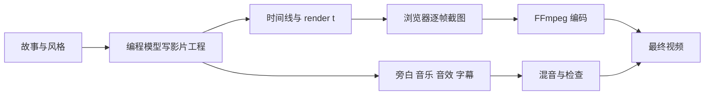

# Lemo-Opuscar：99 种代码影片风格与 DeepSeek 接入核查

收录日期：2026-11-26

最近核实：2026-11-26，Asia/Shanghai

研究状态：部分核实。原图、项目对应关系、风格目录和关键渲染源码已核实；原作者的 DeepSeek 成片效果、耗时和费用未独立验证。

## 一句话结论

Lemo-Opuscar 是一套交给编程 agent 使用的影片风格、导演指南和渲染工具：模型把故事写成动画及音频代码，浏览器按时间绘制画面，FFmpeg 编码合成成片。现有 99 种风格确实能在仓库目录中对应到，但「DeepSeek 一句话稳定出大片」「一定比视频生成模型便宜」没有足够证据。适合先研究风格化短片、科普、数据讲解和品牌动画；商用要区分代码、风格文档、演示素材各自的许可。[S1–S8]

## 原始线索

- 用户提供：[抖音分享短链](https://v.douyin.com/-zi658x8qOw/)。
- 规范原作：[图文作品 7712127508354696895](https://www.douyin.com/note/7712127508354696895)。
- 作者：今天也费算力了。作品简介为「#大模型 #视频生成 #人工智能 #deepseek」；平台发布时间是 **2026-11-25 23:13:33 +08:00**。原图内截图显示 23:10，不能与作品上传时间混用。
- 实际读取范围：取得作品 ID 匹配的公开详情，下载并视觉阅读 **1 张完整原图**（1224×2189），读取简介和部分公开评论，包括 4 条经作者身份匹配的回复。没有取得原作者声称置顶的 DeepSeek 运行截图、工程、提示词、模型版本或完整成片。
- 原图明确点名 **Lemo-Opuscar**，称有 99 种视觉风格，以「点云测绘风、40 秒、废弃采石场」举例，宣称可自动写代码、渲染、配音配乐和混音；另称移入 DeepSeek 智能体框架即可使用。作者也承认 DeepSeek 的初版较粗糙，后续仍需人工微调。
- 已读取的作者评论说「没放视频」「手机不行」「普通电脑都可以」「试过可以做一些简单的」。这些是作者体验陈述，不是本轮验收结果。[S1]

## 技术实现

### 从故事到画面、声音和成片

1. **选风格并读规则。** Skill 入口调用 `scripts/setup.sh` 获取公共库，随后读取导演指南、技术指南及 `styles/<slug>/STYLE.md`。每个风格定义画法、色彩、镜头、动作、声音和适合的题材，模型另写本次故事。[S2、S6]
2. **编程模型创建影片工程。** 内容通常包含 `index.html`、时间线、配音文本、音乐/音效代码和 `build.sh`。画面用 Canvas 2D、Three.js/WebGL 等实现；时间线同时驱动画面、音乐、字幕和音效。[S3]
3. **时间决定画面。** 页面暴露 `window.DUR`、`window.READY` 和 `window.render(t)`；工具等待资源就绪，再用 `f/FPS` 调用绘制函数，并截取 JPEG 帧。`video.mjs` 的 worker 将截图喂给 FFmpeg，以 H.264 编码，最后拼接分段。[S4]
4. **生成并校验声音。** 官方指南的默认英语旁白使用本地 Kokoro；中文入口 `tts_zh.py` 调用 Microsoft 的在线 edge-tts。音乐可由采样库、物理建模或合成器生成；旁白、音乐和音效需要按同一时间线混合。[S3、S5]
5. **编码后仍需检查。** `mux.sh` 实施响度归一化、真峰值测量和必要的音频重编码；指南还要求静帧检查、动作片段检查、文本可读性检查以及完整带声音观看。工具成功退出不等于影片艺术质量合格。[S3、S5]



**逐帧渲染不等于逐帧调用大模型。** 例如 40 秒、24 fps 对应约 960 帧，已读取的循环执行 `window.render(t)` 和浏览器截图，没有在这个循环里请求 LLM。Token 成本主要取决于生成代码、查阅资料、观察结果及修改代码的模型调用，渲染成本另看机器资源与耗时。不能由帧数直接推出 Token 数，更不能据此断言与某视频模型的费用高低。[S4]

### 原图中的说法核对

| 关键判断 | 证据状态 | 核实结果与来源 |
| --- | --- | --- |
| 项目是 Lemo-Opuscar | 已核实 | 原图明确点名；原仓库名称及画廊互相对应。[S1、S2] |
| 有 99 种风格 | 已核实 | 固定 commit 下排除 `_template` 后共有 99 个 `styles/*/style.json`；`styleboard/catalog.json` 同为 99 条。[S2、S7] |
| 代码可渲染成视频 | 已核实到源码 | 浏览器按时刻绘制、JPEG 截图、FFmpeg 编码与合成入口存在；本轮未运行该工程。[S4、S5] |
| 不需要视频生成模型 | 主要渲染路径已核实 | 画面代码渲染链路成立；不表示整个流程无模型调用。官方还列出 3 种需要额外生图工具的风格。[S2、S3] |
| 不需要任何素材 | 不可泛化 | 官方项目含使用真实档案影像、卫星图、点云和 CAD 的风格；音乐可能取用采样库。[S2、S3、S6] |
| 点云测绘只需一句话即可制作 | 功能规则已核实，完成效果未验证 | 风格要求真实扫描点、地面模型、坐标转换及数据许可，不能用编造的点云代替测量证据。[S8] |
| 普通电脑都能胜任 | 作者宣称，有适用条件 | 官方依赖 Node 20+、FFmpeg 7+、Python 3.11+ 或 uv；3D 和复杂 shader 风格需要 GPU。[S1–S3] |
| 半小时左右完成 | 作者估计，未实测 | 原项目 README 估计一支片子 30–60 分钟，Token 用量不小；未给出对照基准。[S1、S2] |
| DeepSeek 已稳定完成复杂成片 | 作者宣称，未独立验证 | 原作者承认初版较粗糙；上游 README 明示 Claude 专用、其他模型适配度不高。[S1、S2] |
| 可固定自己的品牌色与角色风格 | 文档机制已核实 | `MY-STYLES.md` 规定经确认的个人风格存在 `~/lemo-my-styles/<slug>/`，包含说明与 demo；角色一致性质量未实测。[S9] |

### DeepSeek 接入：Skill 可被发现与影片能做成功是两步

原图没有提供框架名称和接入代码。**DeepSeek Harness (`deepseek-ai/deepseek-harness`) 是与描述匹配的官方候选，尚未确认它就是作者的实际运行环境。** 官方 README 确认它基于 Cordis 的插件架构，仍为 developer preview。[S10]

Lemo 当前交付的是 Claude 插件目录和一个带脚本的 Markdown Skill；插件 manifest 的许可为 `MIT AND CC-BY-NC-4.0`，没有从中发现 DSH bundle 声明。DSH 的本地 Skill provider 则扫描项目 `.dsh/skills`、`.agents/skills`、用户 Skill 根目录和配置的附加目录，支持 `<name>/SKILL.md`，不做任意多层递归发现。[S6、S10]

据此，**候选适配路径**是把 Lemo 的完整 `plugin/skills/lemo-opuscar/` 包放到 DSH 可识别的项目 Skill 根目录，随后验证 Skill 正文加载、脚本资源路径、shell 执行、系统依赖和渲染结果。只把它丢进一个叫「plugins」的文件夹，不能证明框架会自动加载或自动配置成功。即使框架识别成功，模型是否能持续写对动画代码、审查画面和修复长任务，仍需真实成片测试。[S6、S10]

本轮只研究接口和源码，没有安装 Lemo/DSH，没有修改本机 agent 的插件配置，也没有调用 Claude、DeepSeek 或 TTS 生成影片。

## 相关项目与资料

### 固定版本和同类方案比较

以下 Star 为 2026-11-26 的 GitHub API 快照，只表明关注度。它们提供不同层级的能力，不能据此给成片质量排名。

| 项目 | 核实时 Star | 能力与适用选择 | 许可及与原图关系 |
| --- | ---: | --- | --- |
| [lemomo-ai/lemo-opuscar](https://github.com/lemomo-ai/lemo-opuscar) | 21,225 | 99 种风格、导演指南、声音与渲染工具；适合从风格开始制作短片。 | 原图点名的原项目；`package.json` 为 2.0.0。代码 MIT，文档和素材另有条件。[S2、S11] |
| [remotion-dev/remotion](https://github.com/remotion-dev/remotion) | 75,769 | React 程序化视频，官方同时介绍 agent 制作、交互编辑、模板和批量渲染；适合把稳定模板接入产品或批量任务。 | 相似技术参考，非原作依赖；公司许可有规模条件。[S12] |
| [3b1b/manim](https://github.com/3b1b/manim) | 96,974 | Python 精确动画，侧重数学与知识讲解。该仓库是 ManimGL，安装名 `manimgl`。 | MIT；不是 Manim Community，也不是 99 风格影片工作室。[S13] |
| [motion-canvas/motion-canvas](https://github.com/motion-canvas/motion-canvas) | 20,244 | TypeScript generator 编排动画，带实时预览编辑器，适合矢量讲解与旁白同步。 | MIT；仓库已有[专题](../2026-10-25-motion-canvas/README.md)，本次不重复收录。[S14] |

原项目、DSH 和上述参考项目都以固定 commit 留存定位信息，见 [research_snapshot.json](research_snapshot.json)。Lemo 固定为 `8ca0dd805e214bcc1d30714cd5b9d21cc02a454b`；其 README 记录 2026-11-12 扩展至 99 风格，核实时最新 commit 日期为 2026-11-23。原图库的作者不是 Lemo 原仓库作者 Lemomo，不混淆二者。

### 新版许可需要按文件看

当前 `LICENSE` 与 `REUSE.toml` 采用分层规则，GitHub 元信息返回 `NOASSERTION`；实际许可证文本比元信息标签更有判断价值。[S11]

- **自己的代码部分：MIT。** 不包括被单独列为文档或第三方的部分。
- **Markdown 指南、STYLE.md、DEMO.md、Skill 正文及特定生图提示：CC BY-NC 4.0。** 同时授予额外权限：可读、跟随、复制和改编这些文档，用来制作自己的影片，包括商业影片及客户影片，并可交付该影片的工程文档。
- **把风格文档卖给别人、作为商业产品/服务的一部分向项目协作者之外分发：** 超出上述额外许可的商业使用，需要另获商业许可。不能将「允许制作商业影片」扩成「整套风格 Skill 可无条件商业再分发」。
- **演示影片和静帧：** 项目有权许可的部分为 CC BY 4.0，第三方素材继续受原许可约束；特定配音、Clawd 角色和第三方界面/商标有明确排除项。
- **用库制作的自有影片：** 官方允许包括商业影片在内归制作者所有、不要求 Lemo 署名；其中使用的第三方采样、素材和服务条件仍需分别遵守。

这是对已读取条款的用途归纳，本轮没有重新分发上游风格正文、demo 或素材。

## 复现路径

**基于官方文档和源码整理，未实际运行。**

1. 先用官方[画廊](https://lemomo-ai.github.io/lemo-opuscar/)和 `STYLE.md` 选一个普通 2D 风格，准备 15–30 秒、内容确定的测试故事；记录模型名称、版本、effort 和提示词。确认所选风格需要哪些真实数据、生图工具或素材。
2. 在独立影片项目中准备 Node 20+、FFmpeg 7+、Python 3.11+ 或 uv。先检查 Skill 中的 `setup.sh`；它会下载/更新公共库，`deps` 会安装 Node/Python 包及浏览器，`voice`、`music` 是可选层。本轮只读取了它，没有执行。[S2、S3、S6]
3. 原项目优先路径是 Claude 的 marketplace/plugin 安装。若改用 DSH，先按前述候选 Skill 根目录方式验证发现与加载，再处理脚本、素材、浏览器和执行权限；不能把 Claude plugin manifest 直接当成 DSH 插件配置。[S6、S10]
4. 让 agent 创建故事、时间线与确定性的 `render(t)` 页面，生成配音、字幕及音乐。先看关键静帧，确认字体、布局和人物动作，再渲染完整画面并混音合成。[S3–S5]
5. 验收至少包含：视频时长/尺寸/帧率符合 brief；无空白帧和资源加载错误；字幕、旁白与画面一致；音乐不盖住旁白；整片带声音看完。另记录实际墙钟耗时、失败/重试次数和费用，不能只看「生成了 MP4」。

候选的最小画面命令，来自已读取官方接口，需先有工程与依赖：

```sh
node core/render/still.mjs /absolute/film-project 0 3 8
node core/render/video.mjs /absolute/film-project --fps 24 --workers 1 --out /absolute/film-project/out/video.mp4
```

费用比较应使用同一 brief、时长、分辨率和验收要求：分开统计 LLM 写代码/修代码的 Token、渲染耗时、旁白服务及额外生图；视频模型一侧计入失败采样和剪辑。当前不能给出谁更省的数字。

## 适用场景与限制

- **值得尝试：** 科普解释、品牌片头、数据动画、风格化讲述，以及已有 CAD/扫描/档案数据的可视化。动画参数可修改，字幕、布局和时间关系可在代码里控制。[S2–S4]
- **复杂漫剧需单独验收：** 已取得的作者回复只说做过简单内容。长时叙事、自然表演、角色连续一致及精细镜头不能由 99 风格数量推导出来。
- **不保证完全离线：** 编程模型可能在云端，中文默认 TTS 在线，部分风格用额外生图，数据和采样还可能需要下载。[S2、S3、S5]
- **风格与事实分开：** 点云测绘强调真实测量数据，卫星/档案题材可能需要真实来源；画面看起来专业不等于测量或历史陈述真实。[S8]
- **模型及机器条件影响成功率：** 官方说明面向 Claude，复杂 3D/shader 对 GPU 有要求。原作者对 DeepSeek 的说法可保留为实验线索，不能代替适配和性能验收。[S1–S3]
- **选择建议：** 想从现成美术风格起步先研究 Lemo；想做长期可复用、可批量渲染的模板产品重点比较 Remotion；数学讲解用 ManimGL 作参考，矢量动画和旁白同步比较 Motion Canvas。这些是根据项目定位的选型建议，未进行同题成片对照测试。[S12–S14]

## 待核实事项

1. 原作者使用的 DeepSeek 框架、模型、版本、插件配置、完整提示词、成片和运行日志；公开评论中尚未取得其声称置顶的运行截图。
2. 相同任务下 Claude/DeepSeek 的成功率、修改轮数、墙钟耗时和真实费用；是否优于视频生成模型仍无对照证据。
3. 当前主机是否完整满足 Lemo 的渲染和音频依赖；本轮没有做 Lemo 环境安装或端到端 smoke test。
4. 真实漫剧、固定角色长期一致性及目标业务质量；原图只有文字体验介绍。
5. 如将整套风格 Skill 嵌入对外商业服务，应按实际分发用途核对新版文档许可和第三方素材条件。

## 来源与证据

下列均在 2026-11-26 实际读取；版本化源码以固定 commit 引用。发布日未知的文件不从页面抓取时间反推发布日期。

| 编号 | 来源与链接 | 发布/版本日期 | 支持的结论 |
| --- | --- | --- | --- |
| S1 | [原抖音图文](https://www.douyin.com/note/7712127508354696895)，[用户短链](https://v.douyin.com/-zi658x8qOw/) | 2026-11-25 23:13:33 +08:00 | 原图项目名、作者宣称、读取范围与部分公开作者回复。 |
| S2 | [Lemo 中文 README](https://github.com/lemomo-ai/lemo-opuscar/blob/8ca0dd805e214bcc1d30714cd5b9d21cc02a454b/README.zh-CN.md) | commit 2026-11-23；更新栏 2026-11-12 | 99 风格、Claude 适配、依赖、耗时估计和生图例外。 |
| S3 | [TECHNIQUE.md](https://github.com/lemomo-ai/lemo-opuscar/blob/8ca0dd805e214bcc1d30714cd5b9d21cc02a454b/TECHNIQUE.md) | 固定 commit 2026-11-23 | 时间线、画面函数、声音、检查流程、GPU 与联网条件。 |
| S4 | [video.mjs](https://github.com/lemomo-ai/lemo-opuscar/blob/8ca0dd805e214bcc1d30714cd5b9d21cc02a454b/core/render/video.mjs#L50)、[page.mjs](https://github.com/lemomo-ai/lemo-opuscar/blob/8ca0dd805e214bcc1d30714cd5b9d21cc02a454b/core/render/page.mjs) | 固定 commit 2026-11-23 | 按时刻绘制、逐帧截图、FFmpeg 编码和资源加载检查。 |
| S5 | [mux.sh](https://github.com/lemomo-ai/lemo-opuscar/blob/8ca0dd805e214bcc1d30714cd5b9d21cc02a454b/core/render/mux.sh)、[tts_zh.py](https://github.com/lemomo-ai/lemo-opuscar/blob/8ca0dd805e214bcc1d30714cd5b9d21cc02a454b/core/tts/tts_zh.py) | 固定 commit 2026-11-23 | 声音合成、响度/峰值检查、中文在线 TTS。 |
| S6 | [Skill 入口](https://github.com/lemomo-ai/lemo-opuscar/blob/8ca0dd805e214bcc1d30714cd5b9d21cc02a454b/plugin/skills/lemo-opuscar/SKILL.md)、[setup.sh](https://github.com/lemomo-ai/lemo-opuscar/blob/8ca0dd805e214bcc1d30714cd5b9d21cc02a454b/plugin/skills/lemo-opuscar/scripts/setup.sh)、[插件 manifest](https://github.com/lemomo-ai/lemo-opuscar/blob/8ca0dd805e214bcc1d30714cd5b9d21cc02a454b/plugin/.claude-plugin/plugin.json) | 固定 commit 2026-11-23 | 库下载、依赖层、Claude 插件与资源路径。 |
| S7 | [styleboard/catalog.json](https://github.com/lemomo-ai/lemo-opuscar/blob/8ca0dd805e214bcc1d30714cd5b9d21cc02a454b/styleboard/catalog.json)、[styles 目录](https://github.com/lemomo-ai/lemo-opuscar/tree/8ca0dd805e214bcc1d30714cd5b9d21cc02a454b/styles) | 固定 commit 2026-11-23 | 99 条目录数据与 99 个正式 style.json。 |
| S8 | [LiDAR Survey STYLE.md](https://github.com/lemomo-ai/lemo-opuscar/blob/8ca0dd805e214bcc1d30714cd5b9d21cc02a454b/styles/lidar-survey/STYLE.md) | 固定 commit 2026-11-23 | 点云是实测数据，坐标/分类/数据许可及依赖条件。 |
| S9 | [MY-STYLES.md](https://github.com/lemomo-ai/lemo-opuscar/blob/8ca0dd805e214bcc1d30714cd5b9d21cc02a454b/MY-STYLES.md) | 固定 commit 2026-11-23 | 用户自有风格的结构、确认及保存机制。 |
| S10 | [DSH README](https://github.com/deepseek-ai/deepseek-harness/blob/4b399c39a6d1479cd84ca591b4d7c88e24d38a96/README.md)、[Skills 文档](https://github.com/deepseek-ai/deepseek-harness/blob/4b399c39a6d1479cd84ca591b4d7c88e24d38a96/docs/subsystems/skills.md)、[本地 provider](https://github.com/deepseek-ai/deepseek-harness/blob/4b399c39a6d1479cd84ca591b4d7c88e24d38a96/packages/skill/skill-filesystem/src/index.ts#L255) | 固定 commit，日期见快照 | 官方框架定位、Skill 发现、加载与资源边界；不证明原作者用了它。 |
| S11 | [Lemo LICENSE](https://github.com/lemomo-ai/lemo-opuscar/blob/8ca0dd805e214bcc1d30714cd5b9d21cc02a454b/LICENSE)、[REUSE.toml](https://github.com/lemomo-ai/lemo-opuscar/blob/8ca0dd805e214bcc1d30714cd5b9d21cc02a454b/REUSE.toml) | 固定 commit 2026-11-23 | 代码/文档/演示许可、商用影片额外许可及第三方排除。 |
| S12 | [Remotion README](https://github.com/remotion-dev/remotion/blob/c1de64d7e260e83cdaf5ff379583d7067c128d20/README.md)、[LICENSE.md](https://github.com/remotion-dev/remotion/blob/c1de64d7e260e83cdaf5ff379583d7067c128d20/LICENSE.md) | commit 2026-11-25 | 程序化/agent 视频与批量场景；个人、非营利及至多 3 员工的营利组织免费许可等条件。 |
| S13 | [ManimGL README](https://github.com/3b1b/manim/blob/fafa083a4fb274bba9cabde0b6e2f50ba6da0622/README.md)、[LICENSE.md](https://github.com/3b1b/manim/blob/fafa083a4fb274bba9cabde0b6e2f50ba6da0622/LICENSE.md) | commit 2026-09-09 | 数学动画定位、ManimGL 与社区版区别、MIT。 |
| S14 | [Motion Canvas README](https://github.com/motion-canvas/motion-canvas/blob/7b91435c301d530351dcf5ebb91dd139c002e405/README.md)、[LICENSE](https://github.com/motion-canvas/motion-canvas/blob/7b91435c301d530351dcf5ebb91dd139c002e405/LICENSE) | commit 2026-07-02 | TypeScript generator、实时预览、矢量讲解和 MIT。 |

## 更新记录

- 2026-11-26：首次收录；读取单张原图、部分作者回复和固定版本一手资料，核对 99 风格及核心渲染循环，补充 DeepSeek 候选接入、同类方案与新版许可。未进行影片生成实测。
